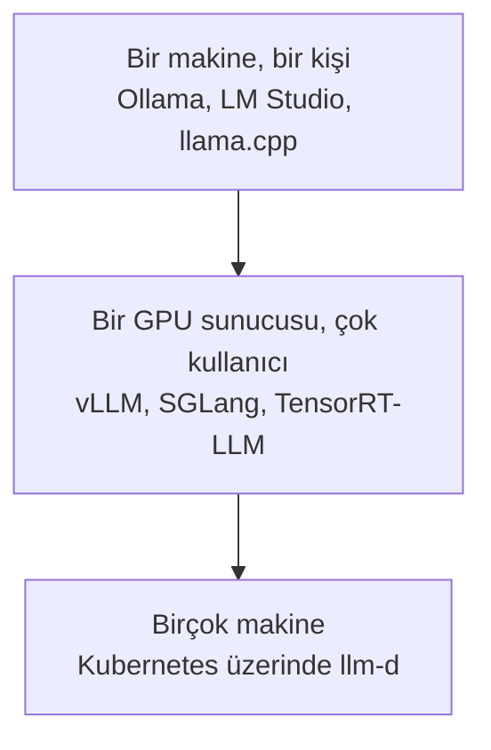

# Inference Engine'ler

[Inference Provider'lar](inference_providers_tr.md) modülü, bir şirketten model kiralamayı anlatıyordu. Bu modül ise o şirketlerin çalıştırdığı yazılımı ve senin şirketinin onu ne zaman kendisinin çalıştırabileceğini anlatıyor.

**Inference engine**, bir modeli gerçekten bir bilgisayarda çalıştıran programdır: modeli yükler ve senin metnini cevaba çevirir. Inference provider ise bu engine'lerden birini senin için çalıştıran ve token başına ücret alan bir şirkettir.

## Bu Senin İçin Neden Önemli

Er ya da geç şirketindeki biri şunu soracak: "Yapay zekâyı kendi sunucularımızda, kendimiz çalıştırsak mı?" Bu modül sana üç iyi sebebi ve başlıca vazgeçme sebebini veriyor.

## Neden Kendin Çalıştırasın

Üç sebep var ve yalnızca bu üçü zahmete değer.

**1. Veri şirketin dışına çıkmamalı.** Sağlık kayıtları, hukuki dokümanlar ve metnin içeride kalması gerektiğini söyleyen bir kurala tabi her şey. Bu, açık farkla en yaygın sebep.

**2. Hacim, bunu daha ucuz yapıyor.** Token başına ödemek başta çok iyi bir anlaşma. Ama çok büyük hacimde, kendi makinelerini kiralayıp modeli kendin çalıştırmak daha ucuz hâle geliyor.

**3. Hiçbir provider'ın sunmadığı bir şeye ihtiyacın var**; örneğin [LLM Eğitimi](../1_fundamentals/training_tr.md) modülündeki kendi fine-tune ettiğin model, kimsenin barındırmadığı bir model ya da hangi sürümün çalıştığı üzerinde tam kontrol; böylece bir güncelleme seni asla şaşırtmaz.

Bunların hiçbiri doğru değilse bir provider kullan. Modelleri kendin çalıştırmak, bir ekip için gerçek ve süregelen bir iş ve ilk ay çoğunlukla bütçelemeyi unuttuğun şeyleri öğreniyorsun.

## Engine'ler, İşin Büyüklüğüne Göre

- **Tek bir bilgisayarda**, [LLM Temelleri](../1_fundamentals/llms_tr.md) modülündeki basit uygulamaları kullan: LM Studio ya da Ollama.
- **Birçok kullanıcısı olan bir şirket sunucusunda**, düzgün bir serving engine: **vLLM** olağan varsayılan. SGLang ve NVIDIA'nın TensorRT-LLM'i duyacağın diğer isimler.
- **Birçok makine üzerinde**, **llm-d** gibi bir sistem onları koordine ediyor.

## Rakamların Arkasındaki Tek Fikir: Batching

Aynı anda tek bir isteğe cevap veren bir bilgisayar çoğu zaman bekliyor. Bu yüzden engine'ler birçok isteği birlikte karşılıyor ve buna **batching** deniyor. Her kişi için ayrı bir taksi yerine bir otobüs düşün: yolculuğun maliyeti aşağı yukarı aynı, ama çok daha fazla insan taşıyor.

En iyi engine'ler otobüsün dolmasını bile beklemiyor: yeni istekler, eskileri biter bitmez katılıyor; böylece bilgisayar hiç boş kalmıyor. Büyük provider'ların token'ları bu kadar ucuza satabilmesinin sebebi bu: her yolculuğu dolduruyorlar.

## Önünde Bir Ekran

Bir engine, programların onunla konuşması için bir yol veriyor, ama bir insanın bakabileceği hiçbir şey vermiyor. **Open WebUI**, şirketlerin kendi modellerinin önüne sıkça koyduğu sohbet ekranı; böylece çalışanlar, şirketin kendi bilgisayarlarında çalışan ve ChatGPT gibi görünen ve çalışan bir şey elde ediyor.

## Artık Bildiğin Terimler

- **Inference engine**: bir modeli gerçekten çalıştıran program.
- **Self-hosting**: bir modeli şirketin kendi bilgisayarlarında çalıştırmak.
- **vLLM**: bir şirket sunucusu için olağan engine.
- **Batching**: birçok isteği birlikte karşılamak; taksiler yerine otobüs gibi.
- **Open WebUI**: bir şirketin kendi modeli için ChatGPT benzeri bir ekran.

## Özet

Inference engine modeli çalıştırır; provider ise onlardan birini senin için çalıştıran bir şirkettir. Kendin çalıştırmayı yalnızca üç sebepten biri için yap: verinin içeride kalması gerekiyor, hacim çok büyük ya da hiçbir provider'ın sunmadığı bir şeye ihtiyacın var. Aksi halde kirala. Büyük provider'ların ucuz olmasının sebebi batching.

**Hızlı Kontrol**: Bir şirketin modeli kendisinin çalıştırmasının en yaygın sebebi nedir? Batching her token'ı neden daha ucuz yapıyor?

## Kaynaklar

### 🛠️ Araçlar

- [Ollama](https://ollama.com/) ve [LM Studio](https://lmstudio.ai/): bir modeli tek bir bilgisayarda çalıştırmak için basit uygulamalar

### 🗃️ Repolar

- [Open WebUI](https://github.com/open-webui/open-webui): bir şirketin kendi modelinin önüne konacak sohbet ekranı
- [llm-d](https://github.com/llm-d/llm-d): birçok makine üzerinde serving
