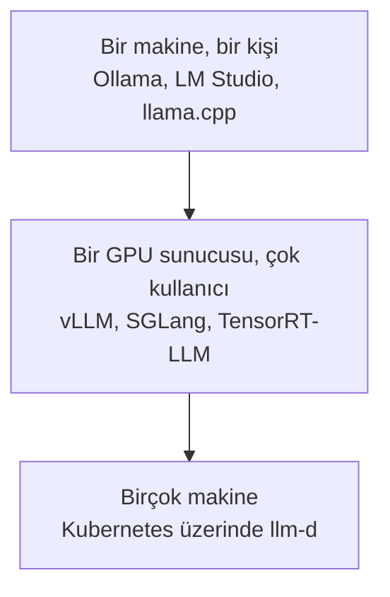

---
objectives:
  - "Inference engine'in ne olduğunu ve bir provider ile arasındaki ilişkiyi açıkla"
  - "Modeli kendin çalıştırmanın üç nedenini ve ne zaman çalıştırmaman gerektiğini say"
  - "Batching'i otobüs benzetmesiyle açıkla ve büyük provider'ların token'ı neden ucuza satabildiğini söyle"
  - "Bir modeli kendi bilgisayarında çalıştırabileceğini ve en kolay uygulamanın hangisi olduğunu bil"
---

# Inference Engine'ler

[Inference Provider'lar](inference_providers_tr.md) modülü, bir şirketten model kiralamayı anlatıyordu. Bu modül ise o şirketlerin çalıştırdığı yazılımı ve senin şirketinin onu ne zaman kendisinin çalıştırabileceğini anlatıyor.

**Inference engine**, bir modeli gerçekten bir bilgisayarda çalıştıran programdır: modeli yükler ve senin metnini cevaba çevirir. Inference provider ise bu engine'lerden birini senin için çalıştıran ve token başına ücret alan bir şirkettir.

  
*Engine ortadaki katman: üstünde modelin kendisi (weight'leri), altında aritmetiği yapan yazılım katmanı ve çip var. Bir provider bunların hepsini senin yerine çalıştırıyor.*

## Bu Senin İçin Neden Önemli

Er ya da geç şirketindeki biri şunu soracak: "Yapay zekâyı kendi sunucularımızda, kendimiz çalıştırsak mı?" Bu modül sana üç iyi sebebi ve başlıca vazgeçme sebebini veriyor.

## Neden Kendin Çalıştırırsın

Üç sebep var ve yalnızca bu üçü zahmete değer.

**1. Veri şirketin dışına çıkmamalı.** Sağlık kayıtları, hukuki dokümanlar ve metnin içeride kalması gerektiğini söyleyen bir kurala tabi her şey. Bu, açık farkla en yaygın sebep.

**2. Hacim, bunu daha ucuz yapıyor.** Token başına ödemek başta çok iyi bir anlaşma. Ama çok büyük hacimde, kendi makinelerini kiralayıp modeli kendin çalıştırmak daha ucuz hâle geliyor.

**3. Hiçbir provider'ın sunmadığı bir şeye ihtiyacın var**; örneğin [LLM Eğitimi](../1_fundamentals/training_tr.md) modülündeki kendi fine-tune ettiğin model, kimsenin barındırmadığı bir model ya da hangi sürümün çalıştığı üzerinde tam kontrol; böylece bir güncelleme seni asla şaşırtmaz.

Bunların hiçbiri doğru değilse bir provider kullan. Modelleri kendin çalıştırmak, bir ekip için gerçek ve süregelen bir iş ve ilk ay çoğunlukla bütçelemeyi unuttuğun şeyleri öğreniyorsun.

## Problemin Büyüklüğüne Göre Engine'ler



- **Tek bir bilgisayarda**, [LLM Temelleri](../1_fundamentals/llms_tr.md) modülündeki basit uygulamaları kullan: LM Studio ya da Ollama.
- **Birçok kullanıcısı olan bir şirket sunucusunda**, düzgün bir serving engine: **vLLM** olağan varsayılan. SGLang ve NVIDIA'nın TensorRT-LLM'i duyacağın diğer isimler.
- **Birçok makine üzerinde**, **llm-d** gibi bir sistem onları koordine ediyor.

Aşağıdaki harita, bütün bunların nerede durduğunu ve provider'ların onların yanında nerede olduğunu gösteriyor.

  
*Wing'in yapay zekâ modellerini sunan sistemlerin haritası, aşağıdan yukarı okunuyor: kiralık çipler, onları yöneten araçlar, engine'ler, sonra birçok makine arasında iş paylaştıran yöntemler. Sağdaki inference-as-a-service sütunu provider yolu: o şirketler bütün yığını senin yerine çalıştırıyor.*

## Dizüstü Bilgisayarında Bir Model Çalıştır

Bir yapay zekâ modelini kendi bilgisayarında çalıştırabilirsin. En kolay yolu **[LM Studio](https://lmstudio.ai/)**. Bu bir masaüstü uygulaması ve diğer programlar gibi kurulur. Modelleri uygulamanın içinden indirir ve kendi penceresinde onlarla sohbet edersin. Daha yeni ve ayrı bir uygulaması olan LM Studio Bionic ise senin yerine görevleri yapan bir yapay zekâ agent'ı için geliştirildi; aşağıdaki görsel onu gösteriyor.

  
*Sıradan bir uygulama penceresi: solda projelerin, ortada sohbet, sağda sonucun önizlemesi var. Terminal yok.*

Terminalle aran iyiyse, **[Ollama](https://ollama.com/)** aynı işi yazdığın komutlarla yapar. Kurulumu [Ollama indirme sayfasından](https://ollama.com/download) yaparsın. Aşağıdaki komutlar bir modeli indirir, modellerini listeler, biriyle sohbet ettirir ve onu durdurur. Bunları takip etmesen de olur: LM Studio aynı sonucu hiç komut yazmadan verir.

```bash
ollama pull llama3.2:3b   # download the model to your disk
ollama list               # show the models you have downloaded
ollama run llama3.2:3b    # chat with the model; it pulls the model first if needed
ollama ps                 # show the models that are loaded in memory
ollama stop llama3.2:3b   # unload the model from memory
```

  
*İndirdiğin her model bilgisayarında bir dosyadır ve bu liste her birinin ne kadar büyük olduğunu gösterir. Daha büyük bir dosya genellikle daha güçlü bir bilgisayar ister.*

İsimleri birbirine karıştırma. Open WebUI'ı bu modülün sonunda anlatıyoruz ve o sohbet etmek için bir web sayfasıdır: modeli kendisi çalıştırmaz, Ollama'ya ya da modeli çalıştıran benzer bir programa bağlanır. Ollama ile birlikte paketlenmiş bir sürümü de var, ama modeli yine Ollama çalıştırır. LM Studio farklıdır, çünkü modeli çalıştıran program ile sohbet ekranı tek bir uygulamanın içindedir.

## Sayıları Açıklayan Tek Fikir

Aynı anda tek bir isteğe cevap veren bir bilgisayar çoğu zaman bekliyor. Bu yüzden engine'ler birçok isteği birlikte karşılıyor ve buna **batching** deniyor. Her kişi için ayrı bir taksi yerine bir otobüs düşün: yolculuğun maliyeti aşağı yukarı aynı, ama çok daha fazla insan taşıyor.

  
*İstekler bir uygulamadan geliyor ve bir kuyrukta bekliyor (otobüs durağı). Batching adımı otobüsü dolduruyor ve model herkesi birlikte cevaplıyor. Engine yalnızca içteki kutu; çevresindeki server bekleme sırasını yönetiyor ve işlerin nasıl gittiğinin kaydını tutuyor.*

En iyi engine'ler otobüsün dolmasını bile beklemiyor: yeni istekler, eskileri biter bitmez katılıyor; böylece bilgisayar hiç boş kalmıyor. Büyük provider'ların token'ları ucuza satabilmesinin sebeplerinden biri bu: her yolculuğu dolduruyorlar.

## Engine'in Önüne Konan Arayüz

Bir engine, programların onunla konuşması için bir yol veriyor, ama bir insanın bakabileceği hiçbir şey vermiyor. **Open WebUI**, şirketlerin kendi modellerinin önüne sıkça koyduğu sohbet ekranı; böylece çalışanlar, şirketin kendi bilgisayarlarında çalışan ve ChatGPT gibi görünen ve çalışan bir şey elde ediyor.

## Artık Bildiğin Terimler

- **Inference engine**: bir modeli gerçekten çalıştıran program.
- **Self-hosting**: bir modeli şirketin kendi bilgisayarlarında çalıştırmak.
- **vLLM**: bir şirket sunucusu için olağan engine.
- **Batching**: birçok isteği birlikte karşılamak; taksiler yerine otobüs gibi.
- **Open WebUI**: bir şirketin kendi modeli için ChatGPT benzeri bir ekran.
- **LM Studio**: bir modeli kendi bilgisayarında çalıştıran ve sohbet penceresini içinde taşıyan masaüstü uygulaması.
- **Ollama**: modelleri kendi bilgisayarında indirmek ve çalıştırmak için terminalden kullandığın araç.

## Özet

Inference engine modeli çalıştırır; provider ise onlardan birini senin için çalıştıran bir şirkettir. Kendin çalıştırmayı yalnızca üç sebepten biri için yap: verinin içeride kalması gerekiyor, hacim çok büyük ya da hiçbir provider'ın sunmadığı bir şeye ihtiyacın var. Aksi halde kirala. Büyük provider'ların ucuz olmasının sebeplerinden biri batching. Küçük bir modeli kendi bilgisayarında da çalıştırabilirsin ve en kolay yolu LM Studio.

**Hızlı Kontrol**: Bir şirketin modeli kendisinin çalıştırmasının en yaygın sebebi nedir? Batching her token'ı neden daha ucuz yapıyor?

## Kaynaklar

### 🛠️ Araçlar

- [Ollama](https://ollama.com/) ve [LM Studio](https://lmstudio.ai/): bir modeli tek bir bilgisayarda çalıştırmak için basit uygulamalar

### 🗃️ Repolar

- [Open WebUI](https://github.com/open-webui/open-webui): bir şirketin kendi modelinin önüne konacak sohbet ekranı
- [llm-d](https://github.com/llm-d/llm-d): birçok makine üzerinde serving
