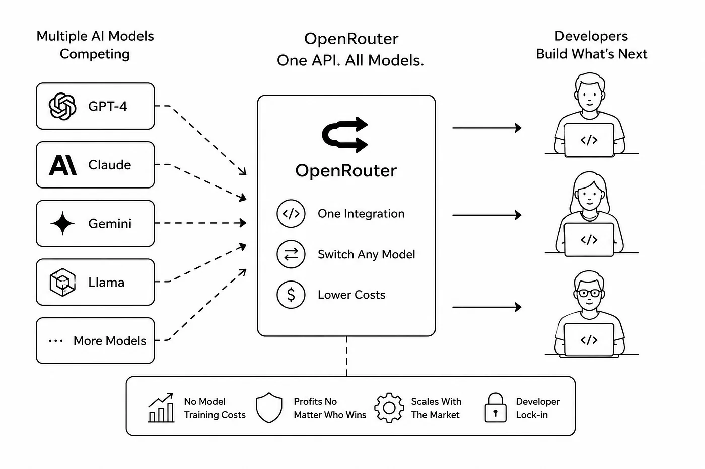
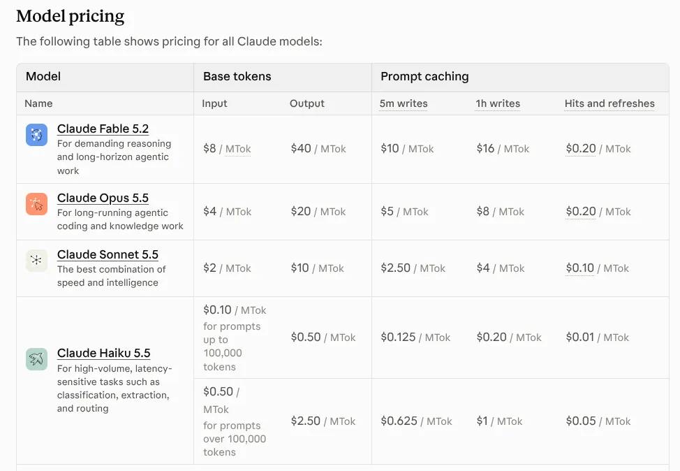
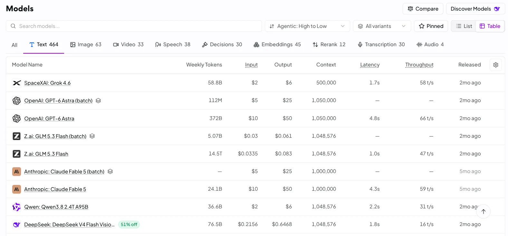

# Inference Provider‌ها

[مبانی LLM](../1_fundamentals/llms_fa.md) نشون داد که به اجرای یه مدل می‌گن inference، و می‌شه توی cloud انجامش داد. این درس درباره‌ی شرکت‌هاییه که این سرویس رو می‌فروشن، و این‌که موقع انتخاب یکی چی رو با هم مقایسه کنی.

یه **inference provider** مدل‌های AI رو روی کامپیوترهای خودش اجرا می‌کنه و دسترسی بهشون رو بهت اجاره می‌ده. متن می‌فرستی، متن برمی‌گرده، و بر اساس مقدار متنی که ردوبدل شده پول می‌دی، که با token شمرده می‌شه. هیچ‌کدوم از ماشین‌ها مال تو نیست. مثل اینه که برق رو به اندازه‌ی مصرف پول بدی، به جای این‌که نیروگاه داشته باشی.

## چرا این برای تو مهمه

اگه شرکتت دسترسی به AI می‌خره، یکی باید یه provider انتخاب کنه، و قیمت هر token عددیه که همه می‌گن. این درس سوال‌هایی رو بهت می‌ده که از قیمت مهم‌ترن، مخصوصاً اون یکی که درباره‌ی این‌که داده‌ت کجا می‌ره.

## Gateway (Router)

[OpenRouter](https://openrouter.ai/) یه **gateway**‌ه (بهش router هم می‌گن). جلوی کلی provider می‌شینه، پس یه حساب، یه صورت‌حساب و یه راه اتصال داری، و می‌تونی به تقریباً هر مدلی برسی.

- **با عوض کردن یه خط می‌تونی مدل رو عوض کنی.** اگه دوشنبه یه مدل بهتر بیاد، چند ساعت بعد می‌تونی ازش استفاده کنی.
- **یه حساب به جای کلی حساب.**
- **Failover:** اگه یه provider از کار بیفته، درخواست می‌تونه به جای شکست خوردن بره پیش یکی دیگه.
- **یه مدل از چند فروشنده**، با قیمت و سرعت متفاوت، که بتونی انتخاب کنی.

  
*وسط یه دروازه‌ی واحده، یه طرفش کلی مدل و طرف دیگه‌ش آدم‌هایی که باهاشون چیز می‌سازن. نوار پایین نشون می‌ده خود gateway چه‌جوری پول درمیاره: مدل خودش رو نمی‌سازه، پس هر مدلی که برنده بشه اون سود می‌کنه، و کسی که ازش چیز بسازه معمولاً همون‌جا می‌مونه.*

هزینه‌ش یه شرکت بیشتر بین تو و مدله، و یه تأخیر خیلی کوچیک.

**Portkey** همین کار مسیردهی رو با حساب‌های خودت انجام می‌ده، و چیزهایی اضافه می‌کنه که یه تیم شرکتی می‌خواد: نگهبان، trace، سقف بودجه و caching.

یه هشدار درباره‌ی یه جور router دیگه: **AgentRouter** یه کیف پول برای کلی سرویس پولی می‌ده که یه agent ممکنه استفاده کنه، مثل ایمیل، تلفن و رزرو سفر. پولت رو نگه می‌داره و هر درخواستی رو که ازش رد می‌کنی می‌بینه، و وب‌سایتش نمی‌گه کدوم شرکت اداره‌ش می‌کنه. باهاش مثل هر شخص ثالثی که با داده‌ی تو سر و کار داره رفتار کن.

## Inference مستقیم از سازنده‌های LLM

راه دیگه اینه که مستقیم از شرکتی که مدل رو ساخته بخری: OpenAI، Anthropic یا
Google. تازه‌ترین مدل‌هاشون رو اول از همه می‌گیری، و قابلیت‌هایی که فقط خودشون دارن، مثل ارزون‌تر شدن دستورهای تکراری (caching)، تخفیف برای دسته‌های بزرگ، و سقف‌های بالاتر.

  
*فهرست قیمت خود Anthropic. اولین باری که دستورهای تکراری رو ذخیره می‌کنی یه کم گرون‌تر از حالت عادیه، و هر بار بعدی که استفاده‌شون می‌کنی فقط کسر کوچیکی از قیمت عادیه. caching توی ساده‌ترین شکلش همینه.*

خیلی از شرکت‌ها هر دو رو انجام می‌دن: برای مدلی که هر روز استفاده می‌کنن مستقیم می‌خرن، و از gateway برای امتحان کردن بقیه استفاده می‌کنن.

## غیر از قیمت، چی رو مقایسه کنی

قیمت هر میلیون token همون عددیه که همه بهش نگاه می‌کنن، و بدترین عدده که تنها بر اساسش تصمیم بگیری.

  
*فهرست مدل‌های خود OpenRouter. قیمت فقط دو تا از ستون‌هاست: توی همون ردیف می‌بینی چقدر متن توی یه درخواست جا می‌شه، اولین کلمه چقدر زود میاد، و جواب با چه سرعتی جلو میاد. بعضی مدل‌ها دو بار اومدن، و نسخه‌ی batch که ارزون‌تره برای کارهاییه که می‌تونن صبر کنن.*

این هم یه چک‌لیست خریدار:

- **Caching.** اگه دستیارت با هر درخواست همون دستورهای بلند رو می‌فرسته، provider‌ای که اون‌ها رو cache می‌کنه برای هر تکرار خیلی کمتر می‌گیره. این می‌تونه از قیمت پایه مهم‌تر باشه.
- **Rate limit‌ها.** چند تا درخواست در دقیقه اجازه داری. قیمت خوب فایده‌ای نداره اگه درخواست‌هات توی صف منتظر بمونن.
- **سرعت، و کدوم جورش.** مدت زمان تا ظاهر شدن اولین کلمه چیزیه که یه آدم توی چت حس می‌کنه. مدت کل چیزیه که یه کار دسته‌ای بزرگ حس می‌کنه. این‌ها دو تا عدد متفاوتن.
- **محدودیت اندازه.** چقدر متن توی یه درخواست جا می‌شه، و یه جواب چقدر می‌تونه بلند باشه. محدودیت جواب همونیه که آدم‌ها یادشون می‌ره، تا وقتی که یه جواب بلند وسطش بریده بشه.
- **داده‌ت چی می‌شه.** provider متنت رو نگه می‌داره؟ تا کِی؟ می‌تونه از متنت برای آموزش مدل‌هاش استفاده کنه؟ اگه درخواست‌هات داده‌ی مشتری یا کارمند دارن، قبل از فرستادن هر چیزی این بخش رو بخون. برای کار منابع انسانی، مالی و حقوقی، این سوال اول میاد.
- **کیفیت از فروشنده‌های مختلف.** از طریق یه gateway، دو فروشنده می‌تونن یه مدل با یه اسم یکسان عرضه کنن، ولی یکیشون ممکنه برای ارزون‌تر شدن یه کپی کوچیک‌شده و کم‌کیفیت‌تر (همون quantization از [مبانی LLM](../1_fundamentals/llms_fa.md)) اجرا کنه.

## شروع رایگان

**[Google AI Studio](https://aistudio.google.com/)** و OpenRouter هر دو پلن رایگان با سقف روزانه دارن، که برای یاد گرفتن و امتحان یه ایده کافیه.

یه هشدار. پلن رایگان بهت می‌گه یه مدل *می‌تونه* کار تو رو انجام بده یا نه. نمی‌گه محصولت چقدر سریع حس می‌شه، چون ظرفیت رایگان کندتره، محدودتره، و وقتی provider شلوغه اول از همه اون قطع می‌شه. سرعت رو روی پلنی تست کن که واقعاً پولش رو می‌دی.

## کلمه‌هایی که الان بلدی

- **Inference provider**: شرکتی که مدل‌های AI رو اجرا می‌کنه و دسترسی رو به ازای هر token اجاره می‌ده.
- **Gateway** (router): یه در به کلی مدل و provider.
- **Failover**: جابه‌جا کردن یه درخواست به provider دیگه وقتی یکی از کار افتاده.
- **Caching**: کمتر پول دادن برای دستورهایی که بارها و بارها می‌فرستی.
- **Rate limit**: چند تا درخواست در دقیقه اجازه داری بفرستی.
- **Data retention**: این‌که provider متنت رو نگه می‌داره یا نه و تا کِی.

## خلاصه

inference provider‌ها مدل‌های AI رو به ازای هر token بهت اجاره می‌دن. یه gateway مثل OpenRouter یه در به کلی‌شون می‌ده؛ یه‌راست رفتن سراغ سازنده تازه‌ترین مدل‌هاشون و قابلیت‌های خاص رو بهت می‌ده. فقط بر اساس قیمت انتخاب نکن: caching، سقف‌ها، سرعت، طول جواب، کیفیت، و بالاتر از همه این‌که داده‌ت چی می‌شه رو چک کن.

**بررسی سریع**: یه gateway چی بهت می‌ده که یه provider تنها نمی‌ده؟ و وقتی درخواست‌هات داده‌ی کارمند دارن، کدوم سوال چک‌لیست از همه مهم‌تره؟

## منابع

### 🛠️ ابزارها

- [OpenRouter](https://openrouter.ai/): یه حساب برای کلی مدل، و سریع‌ترین راه برای مقایسه‌شون
- [Portkey](https://portkey.ai/): مسیردهی با حساب‌های خودت، به‌اضافه‌ی نگهبان و trace
- [Google AI Studio](https://aistudio.google.com/): یه پلن رایگان با سهمیه‌ی روزانه، که برای یاد گرفتن کافیه
