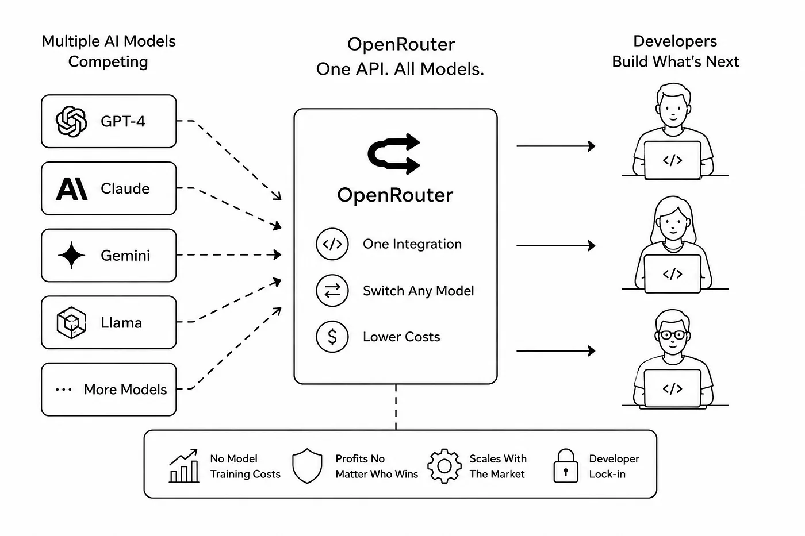
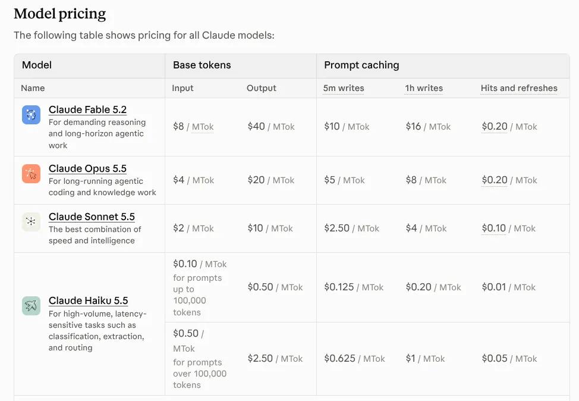
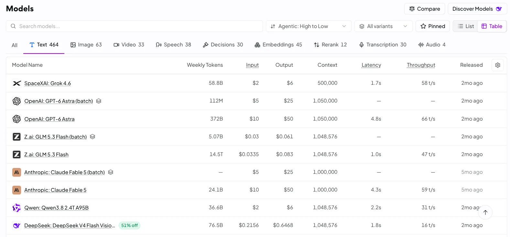

# Inference Provider'lar

[LLM Temelleri](../1_fundamentals/llms_tr.md) modülü, bir modeli çalıştırmaya inference dendiğini ve bunu bulutta yapabileceğini göstermişti. Bu modül bu hizmeti satan şirketleri ve birini seçerken nelere bakman gerektiğini anlatıyor.

Bir **inference provider**, yapay zekâ modellerini kendi bilgisayarlarında çalıştırıyor ve sana onlara erişimi kiralıyor. Metin gönderiyorsun, metin geri alıyorsun ve içinden ne kadar metin geçtiği kadar ödüyorsun; bu miktar token olarak sayılıyor. Makinelerin hiçbirine sahip değilsin. Bir elektrik santraline sahip olmak yerine elektriği kullandığın kadar ödemeye benziyor.

## Bu Senin İçin Neden Önemli

Şirketin yapay zekâ erişimi satın alıyorsa, birinin bir provider seçmesi gerekir ve token başına fiyat, herkesin ilk baktığı rakamdır. Bu modül sana bundan daha önemli soruları veriyor; özellikle verilerinin nereye gittiğine dair olanı.

## Gateway (Router)

[OpenRouter](https://openrouter.ai/) bir **gateway** (router da deniyor). Birçok provider'ın önünde duruyor; böylece tek bir hesap, tek bir fatura ve tek bir bağlanma yöntemi kullanıyorsun ve neredeyse her modele ulaşabiliyorsun.

- **Modeli tek bir satırı değiştirerek değiştirebilirsin.** Pazartesi daha iyi bir model çıkarsa onu birkaç saat sonra kullanabilirsin.
- **Birçok hesap yerine tek bir hesap.**
- **Failover:** bir provider çökmüşse istek hata vermek yerine bir başkasına gidebilir.
- **Aynı model, birkaç satıcıdan**, farklı fiyat ve hızlarda; böylece seçebilirsin.

  
*Ortada tek bir kapı, bir yanda birçok model, öbür yanda onları kullanarak bir şey kuran insanlar. Alttaki şerit gateway'in kendi kazancını da gösteriyor: kendi modelini yapmıyor, bu yüzden hangi model kazanırsa kazansın para kazanıyor ve üzerinden bir şey kuranlar orada kalma eğiliminde.*

Bedeli, seninle model arasında bir şirket daha ve küçük bir gecikme.

**Portkey**, aynı yönlendirme işini senin kendi hesaplarınla yapıyor ve bir şirket ekibinin istediği şeyleri ekliyor: koruyucular, izler, bütçe sınırları ve caching.

Farklı türde bir router için bir uyarı: **AgentRouter**, bir agent'ın kullanabileceği e-posta, telefon ve seyahat rezervasyonu gibi birçok ücretli servis için tek bir cüzdan veriyor. Paranı tutuyor, üzerinden gönderdiğin her çağrıyı görüyor ve web sitesi onu hangi şirketin işlettiğini söylemiyor. Verilerini işleyen herhangi bir üçüncü taraf gibi davran.

## LLM Üreticilerinden Doğrudan Inference

Diğer yol, modeli yapan şirketten doğrudan satın almak: OpenAI, Anthropic ya da Google. En yeni modellerine ilk sen ulaşıyorsun ve yalnızca onların sunduğu özelliklere de: tekrarlanan talimatlar için daha ucuz fiyat (caching), büyük toplu işler için indirimler ve daha yüksek limitler.

  
*Anthropic'in kendi fiyat listesi. Tekrar eden talimatları ilk kez saklamak normalden biraz pahalı, sonraki her yeniden kullanım ise normal fiyatın yalnızca küçük bir kısmı. Caching'in sade hâli bu.*

Birçok şirket ikisini de yapıyor: her gün kullandıkları model için doğrudan satın alıyor, geri kalan her şeyi denemek için bir gateway kullanıyor.

## Fiyatın Ötesinde Neyi Karşılaştırmalısın

Bir milyon token'ın fiyatı herkesin söylediği rakam ve tek başına karar vermek için en kötü rakam.

  
*OpenRouter'ın kendi model listesi. Fiyat sütunların yalnızca ikisi: aynı satırda bir istekte ne kadar metnin sığdığı, ilk kelimenin ne kadar çabuk geldiği ve cevabın ne hızla aktığı da yazıyor. Bazı modeller iki kez listeleniyor ve daha ucuz olan batch kopyası, beklemeyi göze alabileceğin işler için.*

İşte bir alıcı kontrol listesi:

- **Caching.** Asistanın her istekle aynı uzun talimatları gönderiyorsa, bunları önbelleğe alan bir provider her tekrar için çok daha az ücret alır. Bu, taban fiyattan daha önemli olabilir.
- **Rate limit'ler.** Dakikada kaç istek göndermene izin verildiği. İsteklerin bir kuyrukta bekliyorsa iyi bir fiyatın işine yaramaz.
- **Hız ve hangi tür hız.** İlk kelimenin görünmesine kadar geçen süre, bir insanın sohbette hissettiği şeydir. Toplam süre ise büyük bir toplu işin hissettiği şeydir. Bunlar farklı rakamlar.
- **Boyut sınırları.** Bir istekte ne kadar metnin sığdığı ve tek bir cevabın ne kadar uzun olabileceği. Cevap sınırı, uzun bir cevap kesilene kadar insanların unuttuğu sınırdır.
- **Verilerine ne oluyor.** Provider metnini saklıyor mu? Ne kadar süre? Metnini modellerini eğitmek için kullanabilir mi? İsteklerin müşteri ya da çalışan verisi içeriyorsa, bir şey göndermeden önce bu kısmı oku. İK, finans ve hukuk işlerinde bu soru ilk sırada gelir.
- **Farklı satıcılardan gelen kalite.** Bir gateway üzerinden iki satıcı aynı adda bir model sunabilir, ama biri daha ucuz olmak için küçültülmüş, daha düşük kaliteli bir kopya ([LLM Temelleri](../1_fundamentals/llms_tr.md) modülündeki quantization) çalıştırıyor olabilir.

## Ücretsiz Başlamak

**[Google AI Studio](https://aistudio.google.com/)** ve OpenRouter'ın ikisinin de günlük limitli ücretsiz planları var; öğrenmeye ve bir fikri denemeye yetecek kadar.

Bir uyarı. Ücretsiz plan, bir modelin görevini yapıp *yapamayacağını* söyler. Ürününün ne kadar hızlı hissettireceğini söylemez, çünkü ücretsiz kapasite daha yavaş, daha sınırlı ve provider yoğun olduğunda ilk kesilen kapasitedir. Hızı, gerçekte ödeyeceğin planda test et.

## Artık Bildiğin Terimler

- **Inference provider**: yapay zekâ modellerini çalıştıran ve token başına erişim kiralayan şirket.
- **Gateway** (router): birçok modele ve provider'a tek kapı.
- **Failover**: bir provider çöktüğünde isteği bir başkasına yönlendirmek.
- **Caching**: tekrar tekrar gönderdiğin talimatlar için daha az ödemek.
- **Rate limit**: dakikada kaç istek gönderebileceğin.
- **Data retention**: bir provider'ın metnini saklayıp saklamadığı ve ne kadar süre sakladığı.

## Özet

Inference provider'lar sana yapay zekâ modellerini token başına kiralıyor. OpenRouter gibi bir gateway sana birçoğuna tek kapı veriyor; doğrudan üreticiden almak en yeni modellerini ve özel özelliklerini veriyor. Yalnızca fiyata göre seçme: caching'e, limitlere, hıza, cevap uzunluğuna, kaliteye ve hepsinden önce verilerine ne olduğuna bak.

**Hızlı Kontrol**: Bir gateway, tek bir provider'ın vermediği neyi veriyor? İsteklerin çalışan verisi içerdiğinde kontrol listesindeki hangi soru en önemli?

## Kaynaklar

### 🛠️ Araçlar

- [OpenRouter](https://openrouter.ai/): birçok model için tek hesap ve onları karşılaştırmanın en hızlı yolu
- [Portkey](https://portkey.ai/): kendi hesaplarınla yönlendirme, ayrıca koruyucular ve izler
- [Google AI Studio](https://aistudio.google.com/): günlük kotası olan ücretsiz bir plan, öğrenmeye yetecek kadar
