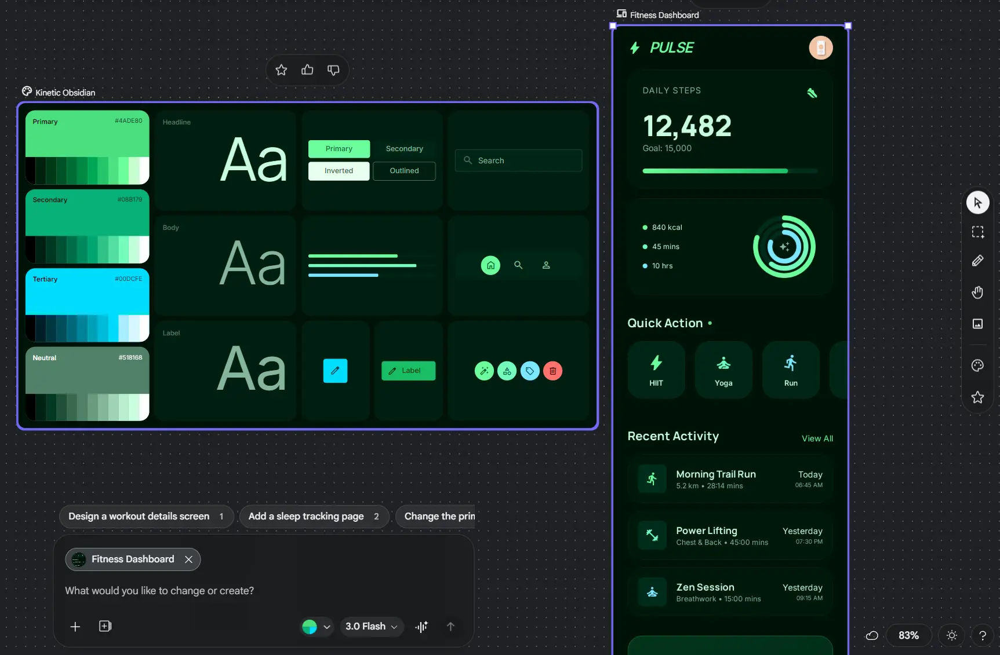
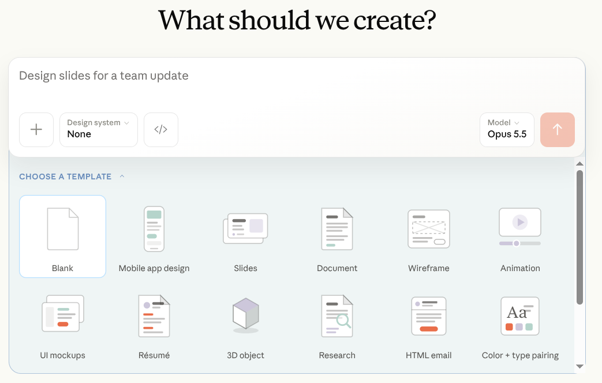
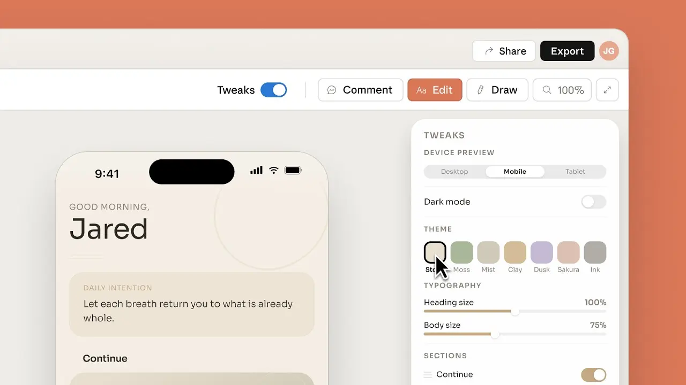
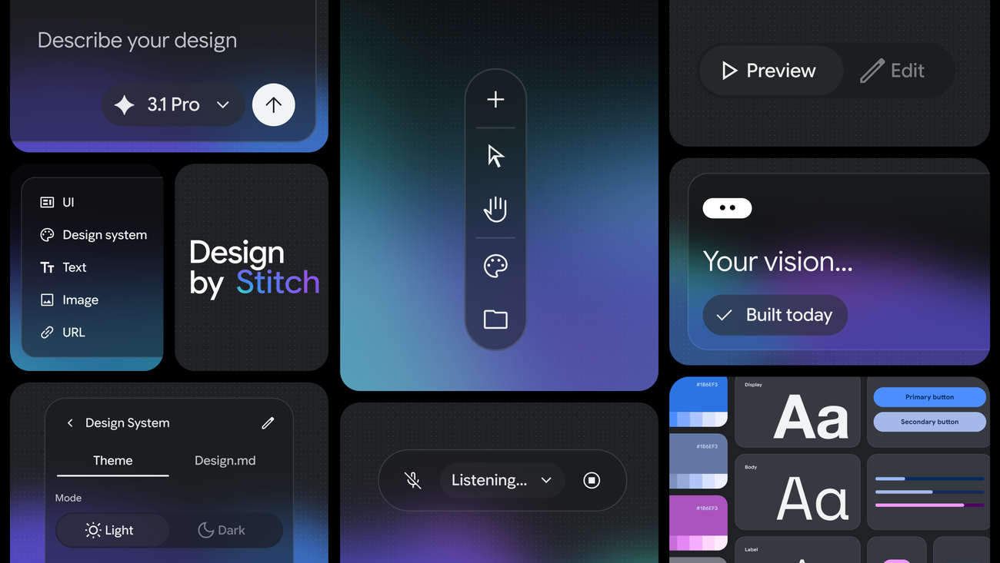

# UI Design

An AI that writes code will happily build you a screen. The problem is that it builds a different
one every time. Ask for a settings page today and a dashboard tomorrow, and you get two screens that
look like they came from two different companies: different colours, different button shapes,
different headings. Each looks fine alone. Together, it looks like nobody was in charge.

This module is about the tools that design screens, and the simple fix for that problem.

## Why This Matters to You

If you build a website or an internal tool by describing it, as this course promises you can, you
will meet this problem on your second screen. The fix is one file, and it is the same idea as the
onboarding note from [Code Agents](../2_intermediate/coding_agents.md).

## Two Tools That Turn a Description into a Screen

**[Google Stitch](https://stitch.withgoogle.com/)** takes a description, an image, a rough sketch or a
spoken description, and produces a finished design with real code behind it. It can also send the
design to Figma, the tool many designers use.

  
*Stitch's own overview. You describe a design in words, by voice ("Listening...") or with an image or a link, then preview and edit it. Notice the "Design.md" tab in its design system panel: it is the file the DESIGN.md section below is about.*

**[Claude Design](https://claude.ai/design)** from Anthropic, launched in April 2026, makes prototypes,
slides and one-page documents as real, working code. It can also read an existing project, find the
design rules already in it, and follow them for whatever you ask next.

  
*Claude Design starts from one request and a template: a mobile app, slides, a document, a wireframe and more. The "Design system" menu picks a set of design decisions before anything is drawn.*

  
*A prototype being adjusted in Claude Design. The Tweaks panel changes the device, dark mode, the colour theme and the text sizes without a new prompt.*

Between the two, the pattern is clear: describing a screen is now faster than drawing one, and the
result is working code, not a picture.

## A Design System, and Why the Agent Needs it in a File

A **design system** is the set of design decisions a brand makes once, so nobody has to make them
again: the colours and what each is for, the fonts and sizes, the spacing, the corner shapes, and how
a button looks when you hover over it or press it. If you have seen a company's brand guidelines from
marketing, that is the same idea.

An AI building a screen has to make every one of those decisions. It cannot know yours, so it invents
ones that look reasonable, and different ones each time. The fix is the same as for instructions:
write the decisions down in a file, and let the AI read it.

  
*A design system in Google Stitch (left): its colours with their exact codes, three text styles, buttons and icons. On the right is a fitness dashboard generated from it. Every next screen you ask for, such as the suggested "workout details screen" below it, reuses the same decisions.*

## DESIGN.md

`DESIGN.md` is that file. It sits in the project folder, and most AI tools read it automatically. It
needs two kinds of content:

- **The exact values**: the colour codes, font sizes, spacing steps and corner shapes.
- **The intent, in words**: what the design should feel like, what it avoids on purpose, and why. A
  list of values cannot say this part.

The demonstration is very direct. Give an AI one request with a `DESIGN.md` modelled on Stripe's
style, and you get Stripe's colours and spacing. Swap in another brand's file and change nothing
else, and the result matches the new brand.

Notice the three files this course has now met. `AGENTS.md` holds the rules for working in a project.
`SOUL.md`, from [Personal Agents](../2_intermediate/personal_agents.md), holds who an agent is. And
`DESIGN.md` holds how its work should look.

## What They Still Do Not Do

These tools give you a good-looking screen fast. They do not give you what a designer gives you,
which is knowing what the screen is *for*: what the user is trying to finish, and what should be easy.

**Accessibility** is the clearest gap. It means everyone can use the screen, including a person who
uses only a keyboard or a screen reader (software that reads the screen aloud). Generated screens
often get it wrong:

- text whose contrast fails the measured ratio, which you can only measure, not see
- no visible marker of where the keyboard is on the page
- a control that only works with a mouse
- an icon button with no name, so a screen reader cannot announce it

None of these show up in a screenshot. Someone has to check them.

## Words You Now Know

- **Design system**: the design decisions a brand makes once (colours, fonts, spacing, buttons).
- **DESIGN.md**: a file that gives those decisions to the AI.
- **Google Stitch / Claude Design**: tools that turn a description into a working design.
- **Accessibility**: making sure everyone can use a screen, including with a keyboard or screen reader.

## Summary

AI can design a screen from a description, but without your brand rules every screen comes out
different. Put the rules in `DESIGN.md`, with both the exact values and the intent, and every screen
matches. And check what a screenshot cannot show: whether everyone can actually use it.

**Quick check**: Why do two AI-made screens look like they came from different companies? And name
one accessibility problem a screenshot will not show you.

## References

### 📄 Articles

- [From idea to app: Introducing Stitch](https://developers.googleblog.com/stitch-a-new-way-to-design-uis/): Google's announcement, and where DESIGN.md comes from

### 🛠️ Tools

- [Google Stitch](https://stitch.withgoogle.com/): turns a description or a sketch into a real design
- [Claude Design](https://claude.ai/design): makes prototypes as real code

### 🗃️ Repositories

- [awesome-design-md](https://github.com/VoltAgent/awesome-design-md): ready-made DESIGN.md files for well-known brands
