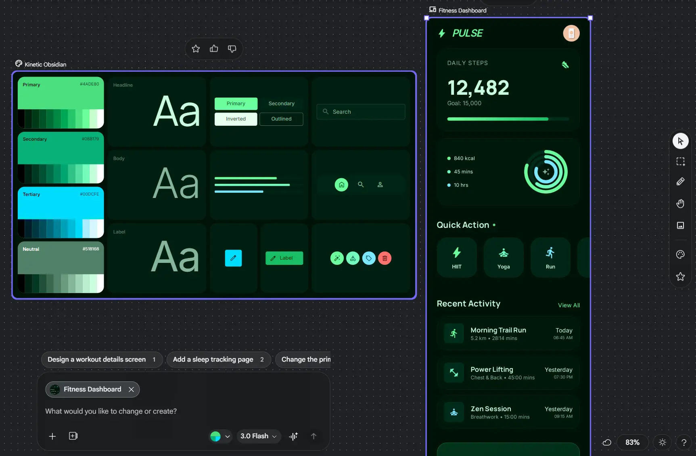
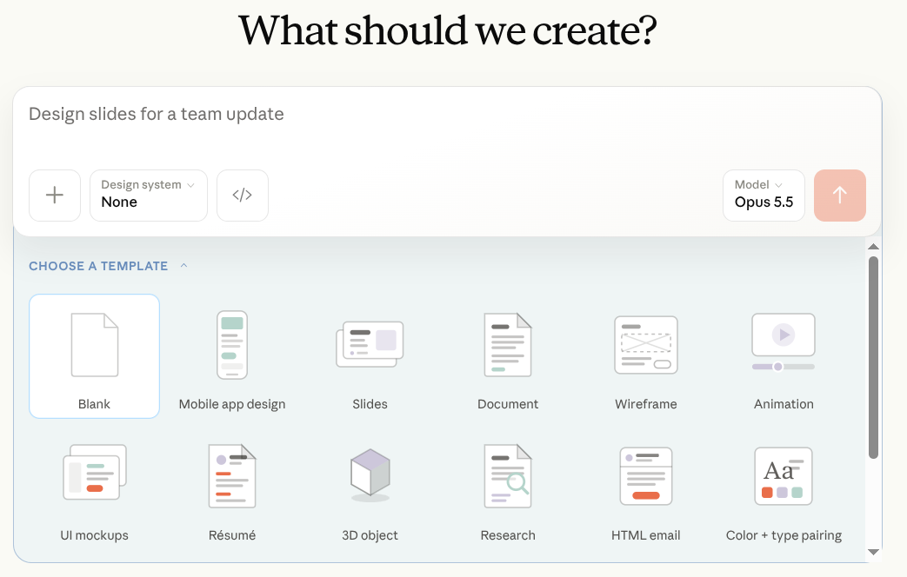
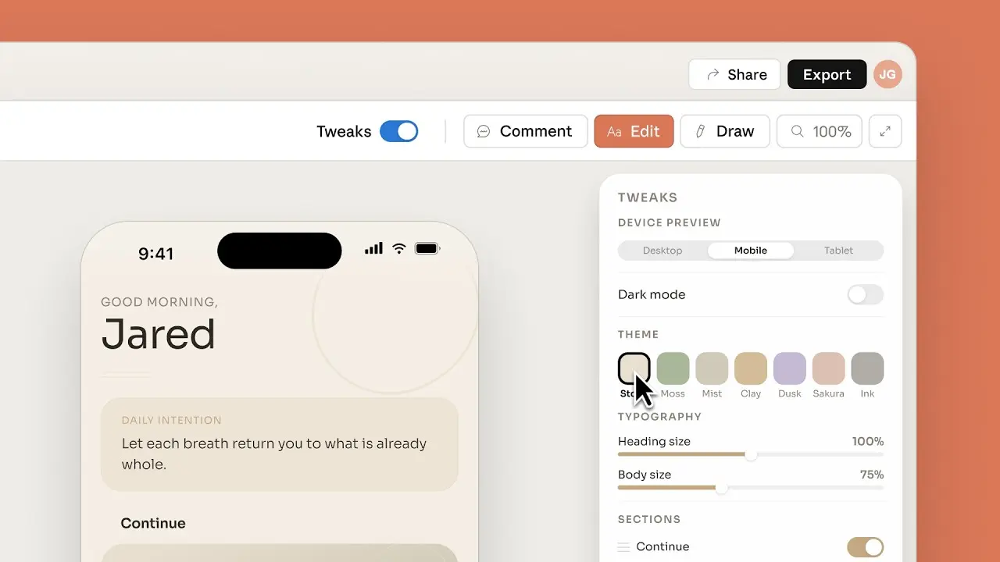
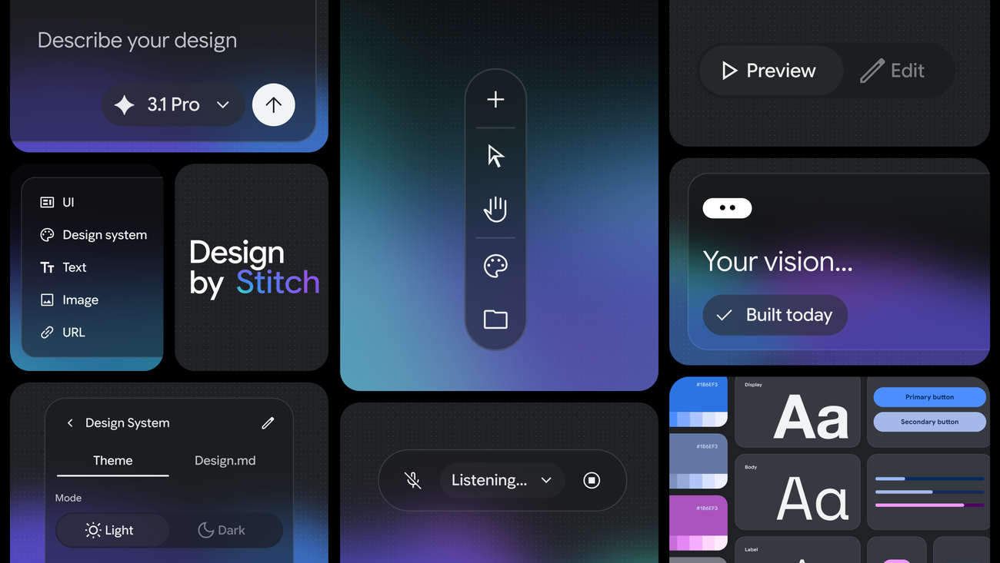

# UI Design

یه AI که کد می‌نویسه با کمال میل برات یه صفحه می‌سازه. مشکل اینه که هر بار یه صفحه‌ی متفاوت می‌سازه. امروز یه صفحه‌ی تنظیمات بخوای و فردا یه داشبورد، دو تا صفحه می‌گیری که انگار مال دو تا شرکت مختلفن: رنگ‌ها فرق دارن، شکل دکمه‌ها فرق داره، تیترها فرق دارن. هر کدوم تنهایی خوبه. کنار هم، انگار هیچ‌کس مسئول نبوده.

این درس درباره‌ی ابزارهاییه که صفحه طراحی می‌کنن، و راه‌حل ساده‌ی همین مشکل.

## چرا این برای تو مهمه

اگه یه وب‌سایت یا یه ابزار داخلی رو با توضیح دادنش می‌سازی، همون‌طور که این دوره قولش رو می‌ده، با این مشکل توی صفحه‌ی دومت روبه‌رو می‌شی. راه‌حلش یه فایله، و همون ایده‌ی یادداشت معرفی از [Code Agent‌ها](../2_intermediate/coding_agents_fa.md)‌ه.

## دو ابزار که از یه توضیح، صفحه می‌سازن

**[Google Stitch](https://stitch.withgoogle.com/)** یه توضیح، یه عکس، یه طرح دست‌کشیده یا یه توضیح صوتی می‌گیره، و یه طراحی تموم‌شده با کد واقعی پشتش تحویل می‌ده. می‌تونه طراحی رو به Figma هم بفرسته، ابزاری که خیلی از طراح‌ها استفاده می‌کنن.

  
*تصویر معرفی خود Stitch. یه طراحی رو با نوشتن، با صدا ("Listening...")، یا با یه عکس یا لینک توضیح می‌دی، بعد پیش‌نمایشش رو می‌بینی و ویرایشش می‌کنی. به تب "Design.md" توی پنل design system دقت کن: همون فایلیه که بخش DESIGN.md پایین‌تر درباره‌شه.*

**[Claude Design](https://claude.ai/design)** از Anthropic، که آوریل 2026 راه افتاد، نمونه‌ی اولیه، اسلاید و سند یه‌صفحه‌ای رو به شکل کد واقعی و کارا می‌سازه. می‌تونه یه پروژه‌ی موجود رو هم بخونه، قانون‌های طراحی‌ای رو که از قبل توشه پیدا کنه، و برای هر چیزی که بعداً می‌خوای ازشون پیروی کنه.

  
*Claude Design با یه درخواست و یه template شروع می‌شه: اپ موبایل، اسلاید، سند، wireframe و چیزهای دیگه. منوی "Design system" قبل از این‌که چیزی کشیده بشه، یه سری تصمیم طراحی رو انتخاب می‌کنه.*

  
*یه prototype که داره توی Claude Design تنظیم می‌شه. پنل Tweaks بدون prompt جدید، دستگاه، dark mode، تم رنگی و اندازه‌ی متن‌ها رو عوض می‌کنه.*

از بین این دو تا الگو روشنه: توضیح دادن یه صفحه الان از کشیدنش سریع‌تره، و نتیجه کد کاراست، نه یه عکس.

## Design System، و چرا باید توی یه فایل باشه

یه **design system** مجموعه‌ی تصمیم‌های طراحیه که یه برند یه بار می‌گیره، که هیچ‌کس مجبور نباشه دوباره بگیرتشون: رنگ‌ها و کاربرد هر کدوم، فونت‌ها و اندازه‌ها، فاصله‌ها، شکل گوشه‌ها، و این‌که یه دکمه وقتی موس رو روش می‌بری یا فشارش می‌دی چه شکلی می‌شه. اگه راهنمای برند یه شرکت رو از بخش بازاریابی دیده باشی، همین ایده‌ست.

یه AI که یه صفحه می‌سازه باید همه‌ی این تصمیم‌ها رو بگیره. نمی‌تونه مال تو رو بدونه، پس چیزهایی درمیاره که منطقی به نظر میان، و هر بار یه جور دیگه. راه‌حل همونیه که برای دستورها بود: تصمیم‌ها رو توی یه فایل بنویس و بذار AI بخونه.

  
*یه design system توی Google Stitch (سمت چپ): رنگ‌هاش با کد دقیقشون، سه تا سبک متن، دکمه‌ها و آیکون‌ها. سمت راست یه fitness dashboard‌ه که ازش ساخته شده. هر صفحه‌ی بعدی که بخوای، مثلاً "workout details screen" که پایینش پیشنهاد شده، همون تصمیم‌ها رو دوباره استفاده می‌کنه.*

## DESIGN.md

`DESIGN.md` همون فایله. توی پوشه‌ی پروژه می‌شینه و بیشتر ابزارهای AI خودکار می‌خوننش. دو جور محتوا لازم داره:

- **مقدارهای دقیق**: کد رنگ‌ها، اندازه‌ی فونت‌ها، پله‌های فاصله و شکل گوشه‌ها.
- **منظور، با کلمه**: طراحی باید چه حسی بده، عمداً از چی دوری می‌کنه، و چرا. یه فهرست از مقدارها نمی‌تونه این بخش رو بگه.

نمایشش خیلی مستقیمه. به یه AI یه درخواست بده با یه `DESIGN.md` که بر اساس سبک Stripe نوشته شده، و رنگ‌ها و فاصله‌های Stripe رو می‌گیری. فایل یه برند دیگه رو بذار جاش و هیچ چیز دیگه‌ای رو عوض نکن، و نتیجه با برند جدید جور می‌شه.

به سه فایلی که این دوره تا الان دیده دقت کن. `AGENTS.md` قانون‌های کار کردن توی یه پروژه رو داره. `SOUL.md`، از [Personal Agent‌ها](../2_intermediate/personal_agents_fa.md)، می‌گه یه agent کیه. و `DESIGN.md` می‌گه کارش باید چه شکلی باشه.

## چیزهایی که هنوز از دستشون برنمیاد

این ابزارها سریع یه صفحه‌ی قشنگ بهت می‌دن. چیزی رو که یه طراح می‌ده بهت نمی‌دن، یعنی دونستن این‌که صفحه *برای چیه*: کاربر می‌خواد چی رو تموم کنه، و چی باید راحت باشه.

**Accessibility** (دسترس‌پذیری) واضح‌ترین کمبوده. یعنی همه بتونن از صفحه استفاده کنن، از جمله کسی که فقط از کیبورد یا screen reader (نرم‌افزاری که صفحه رو بلند می‌خونه) استفاده می‌کنه. صفحه‌های تولیدشده اغلب این رو غلط درمیارن:

- متنی که contrast‌ش به نسبت لازم نمی‌رسه، چیزی که فقط می‌شه اندازه‌ش گرفت و با چشم دیده نمی‌شه
- هیچ نشونه‌ی دیدنی از این‌که کیبورد توی صفحه کجاست
- یه کنترل که فقط با موس کار می‌کنه
- یه دکمه‌ی آیکونی بدون اسم، که screen reader نمی‌تونه اعلامش کنه

هیچ‌کدوم از این‌ها توی یه اسکرین‌شات دیده نمی‌شن. یکی باید چکشون کنه.

## کلمه‌هایی که الان بلدی

- **Design system**: تصمیم‌های طراحی‌ای که یه برند یه بار می‌گیره (رنگ‌ها، فونت‌ها، فاصله‌ها، دکمه‌ها).
- **DESIGN.md**: فایلی که این تصمیم‌ها رو به AI می‌ده.
- **Google Stitch / Claude Design**: ابزارهایی که یه توضیح رو به یه طراحی کارا تبدیل می‌کنن.
- **Accessibility**: مطمئن شدن از این‌که همه بتونن از یه صفحه استفاده کنن، از جمله با کیبورد یا screen reader.

## خلاصه

AI می‌تونه از یه توضیح یه صفحه طراحی کنه، ولی بدون قانون‌های برند تو هر صفحه یه جور درمیاد. قانون‌ها رو توی `DESIGN.md` بذار، هم مقدارهای دقیق هم منظور رو، و هر صفحه جور می‌شه. و چیزی رو که اسکرین‌شات نشون نمی‌ده چک کن: این‌که همه واقعاً می‌تونن ازش استفاده کنن یا نه.

**بررسی سریع**: چرا دو تا صفحه‌ی ساخته‌شده با AI انگار مال دو شرکت مختلفن؟ و یه مشکل دسترس‌پذیری رو اسم ببر که اسکرین‌شات نشونت نمی‌ده.

## منابع

### 📄 مقاله‌ها

- [From idea to app: Introducing Stitch](https://developers.googleblog.com/stitch-a-new-way-to-design-uis/): اعلام Google، و جایی که DESIGN.md از اون‌جا اومده

### 🛠️ ابزارها

- [Google Stitch](https://stitch.withgoogle.com/): یه توضیح یا یه طرح رو به یه طراحی واقعی تبدیل می‌کنه
- [Claude Design](https://claude.ai/design): نمونه‌ی اولیه رو به شکل کد واقعی می‌سازه

### 🗃️ Repository‌ها

- [awesome-design-md](https://github.com/VoltAgent/awesome-design-md): فایل‌های DESIGN.md آماده برای برندهای معروف
