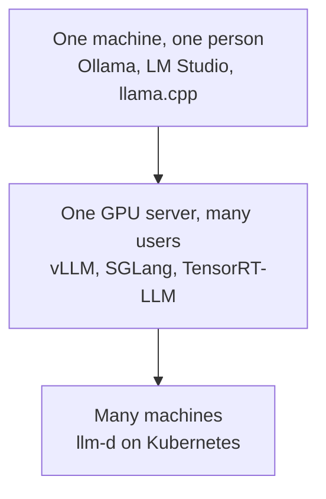
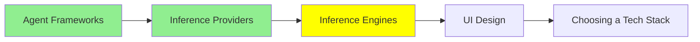

# Inference Engines

[LLM Fundamentals](../1_fundamentals/llms.md) named the engines. Then it said that you rarely touch them directly. That is true, and it is why that module moved straight on to Ollama. This module is about the times when you do touch them.

An **inference engine** is the program that loads the weights and turns your tokens into the next token. It has these jobs:

- It manages GPU memory.
- It batches requests together.
- It caches attention state between turns.
- It decides what runs in what order.

An inference provider, the subject of [Inference Providers](inference_providers.md), is somebody else who runs one of these engines for you and charges you per token.

## Why You Would Run it Yourself

There are three reasons, and only these three are worth the trouble.

**The data cannot leave.** Examples are health records, legal documents, and anything under a rule that says the text must stay on your infrastructure. This is the most common reason, much more common than the other two. If it applies to you, it decides the question on its own.

**The volume makes it cheaper.** Per-token pricing is excellent, until it is not. There is a crossover point. Past that point, a rented GPU that runs all day costs less than the same work bought by the token. If you are past it, the arithmetic is not close: the difference is large.

**You need something a provider will not give you.** For example:

- a fine-tuned model of your own, from [Training LLMs](../1_fundamentals/training.md)
- a model that nobody hosts
- an unusual quantization
- control over the exact version, so that an upgrade never surprises you

If none of those is true, use a provider. Self-hosting is a real operational job. In the first month, you mostly learn what you did not budget for.

## The Engines, by the Size of the Problem

**On your own machine**, use the wrappers. [LLM Fundamentals](../1_fundamentals/llms.md) covered [Ollama](https://ollama.com/) and [LM Studio](https://lmstudio.ai/), and they are the right answer here. They hide the engine, and they get you running in minutes. Underneath, both of them are built on **[llama.cpp](https://github.com/ggml-org/llama.cpp)**. It is LLM inference written in C and C++. It is also the reason that a quantized model can run on a laptop at all. Use llama.cpp directly in two cases: when you want a build flag that the wrapper does not expose, or when you are putting a model on hardware that nobody else supports.

**On a GPU server with real users**, the wrappers are no longer enough. Here you want a serving engine.

- **vLLM** is the usual default. It supports a broad range of hardware. Its continuous batching is what gives it good throughput.
- **[SGLang](https://github.com/sgl-project/sglang)** is a high-performance serving framework for language and multimodal models. It is strong when requests share a long common prefix. If every request starts with the same big system prompt, that is exactly your case.
- **[TensorRT-LLM](https://github.com/NVIDIA/TensorRT-LLM)** comes from NVIDIA. It gets the most out of NVIDIA hardware specifically. You compile the model into an optimised engine ahead of time. That costs you a build step, and it gives you lower latency.

**Across many machines**, serving stops being a process problem and becomes a cluster problem. That is what **[llm-d](https://github.com/llm-d/llm-d)** is for. It runs inference on Kubernetes with modern accelerators. The platform then handles scheduling, routing and cache-aware placement, so you do not have to.

## The One Idea That Explains the Numbers

If you remember only one mechanism from this module, remember **batching**.

A GPU that runs one request at a time is mostly idle. The reason is that generating a token takes a small amount of arithmetic and a huge amount of memory traffic. If you run many requests together, the same weight-loading pays for all of them at once. That is why people measure throughput on these engines with many concurrent users. It is also why the same hardware can look brilliant or hopeless. It depends only on how full the batch is.

Continuous batching is the improvement that matters in practice. The engine does not wait for a batch to finish. Instead, it puts new requests into the batch as older ones complete, so the GPU is never left without work. This is also why your own benchmark, with one request at a time, will badly mislead you about what the server can do.

And batching connects to [Context Engineering](../2_intermediate/context_engineering.md) from the other side. The attention state for a long context has to stay in GPU memory. So a full context window is slower to reason over. It also takes up memory that another user's request needed.

## Something to Put in Front of it

An engine gives you an API and nothing to look at. **[Open WebUI](https://github.com/open-webui/open-webui)** is the interface that people put in front of an engine. It is a chat UI that talks to Ollama, or to anything that uses the same API shape as OpenAI. It has accounts, conversation history and model switching. Some teams want a private ChatGPT on their own hardware. For them, that is the whole stack, in two pieces: the engine and Open WebUI.

## Where this fits in the series

## Summary

An inference engine is the program that actually runs the weights. It takes care of:

- GPU memory
- batching
- the attention cache
- scheduling

A provider is somebody else who operates an engine for you.

Run your own engine for one of three reasons:

- The data cannot leave your infrastructure.
- The volume has passed the point where renting a GPU is cheaper than buying tokens.
- You need a model or a version that nobody hosts.

Otherwise, use a provider, because self-hosting is an operational job.

Match the engine to the size of the problem. On your own machine, use Ollama or LM Studio, with llama.cpp underneath. On a GPU server with real users, use vLLM, SGLang or TensorRT-LLM. SGLang suits a shared long prefix, and TensorRT-LLM gets the most out of NVIDIA hardware. When the problem becomes a cluster, use llm-d.

Batching is the idea that explains every number in this module. A GPU that serves one request is mostly idle. Continuous batching keeps it full. That is why a benchmark with one request at a time tells you almost nothing.

**Quick Check**: you measure your self-hosted model with one request at a time, and it looks fast. Why might it collapse with fifty users? And what should you have measured instead?

## References

- [llama.cpp](https://github.com/ggml-org/llama.cpp): LLM inference in C and C++, and the base that the local wrappers are built on
- [SGLang](https://github.com/sgl-project/sglang): high-performance serving, strong when requests share a prefix
- [TensorRT-LLM](https://github.com/NVIDIA/TensorRT-LLM): from NVIDIA, compiled ahead of time for lower latency
- [llm-d](https://github.com/llm-d/llm-d): serving across many machines on Kubernetes
- [Open WebUI](https://github.com/open-webui/open-webui): the chat interface to put in front of any of them
- [Ollama](https://ollama.com/) and [LM Studio](https://lmstudio.ai/): the local wrappers, covered in [LLM Fundamentals](../1_fundamentals/llms.md)
