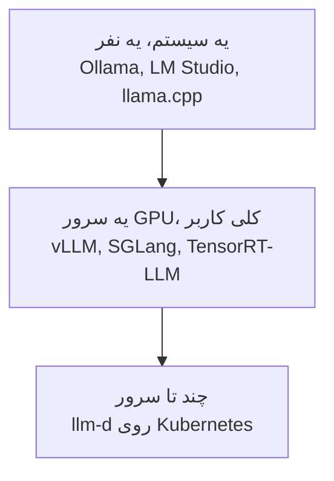
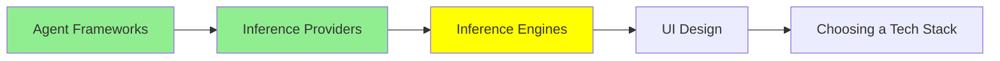

# Inference Engine‌ها

[مبانی LLM](../1_fundamentals/llms_fa.md) اسم این engine‌ها رو آورد و گفت کمتر پیش میاد مستقیم باهاشون سروکار داشته باشی. حرف درستیه، و برای همین هم اون درس یه‌راست رفت سراغ Ollama. این درس درباره‌ی وقت‌هاییه که سروکارت مستقیم با خود engine می‌افته.

**inference engine** برنامه‌ایه که weight‌ها رو load می‌کنه و از روی token‌هایی که بهش می‌دی، token بعدی رو درمیاره. این کارها هم به عهده‌ی خودشه:

- حافظه‌ی GPU رو مدیریت می‌کنه.
- درخواست‌ها رو با هم توی یه batch می‌ذاره.
- attention state رو بین نوبت‌های گفت‌وگو cache می‌کنه.
- تصمیم می‌گیره چی با چه ترتیبی اجرا بشه.

inference provider، که موضوع [Inference Provider‌ها](inference_providers_fa.md) بود، یعنی یه نفر دیگه یکی از همین engine‌ها رو برات اجرا می‌کنه و به ازای هر token ازت پول می‌گیره.

## چرا خودت اجراش کنی؟

سه تا دلیل هست، و فقط همین سه تا می‌ارزه که دردسرش رو به جون بخری.

**داده نباید بیرون بره.** مثل پرونده‌های پزشکی، اسناد حقوقی، و هر چیزی که طبق قانون باید روی زیرساخت خودت بمونه. این رایج‌ترین دلیله، خیلی رایج‌تر از دو تای دیگه، و اگه شامل حال تو می‌شه، به‌تنهایی تکلیف رو روشن می‌کنه.

**حجم کار، خودت اجرا کردن رو ارزون‌تر می‌کنه.** قیمت‌گذاری به ازای هر token عالیه، ولی تا یه جایی. یه نقطه‌ی سربه‌سر (crossover) هست که از اون به بعد، یه GPU اجاره‌ای که کل روز کار می‌کنه، از همون حجم کار که token به token بخری ارزون‌تر درمیاد. اگه از اون نقطه رد شده باشی، فرقش ناچیز نیست، خیلی زیاده.

**چیزی لازم داری که provider بهت نمی‌ده.** مثلاً:

- مدل fine-tune‌شده‌ی خودت، از همون چیزهایی که توی [Training LLMs](../1_fundamentals/training_fa.md) دیدیم
- مدلی که هیچ‌کس host‌ش نمی‌کنه
- یه quantization غیرمعمول
- کنترل دقیق روی نسخه، که هیچ آپدیتی غافلگیرت نکنه

اگه هیچ‌کدوم از این‌ها صدق نمی‌کنه، از provider استفاده کن. self-hosting یه کار عملیاتی واقعیه، و ماه اولش بیشتر می‌فهمی چه چیزهایی رو توی بودجه‌ت حساب نکرده بودی.

## Engine مناسب، بسته به بزرگی کار

**روی سیستم خودت**، سراغ wrapper‌ها برو. [مبانی LLM](../1_fundamentals/llms_fa.md) درباره‌ی [Ollama](https://ollama.com/) و [LM Studio](https://lmstudio.ai/) گفت، و اینجا هم جواب درست همین‌هان: engine رو پشت خودشون قایم می‌کنن و ظرف چند دقیقه کارت رو راه می‌ندازن.

زیر هر دوشون **[llama.cpp](https://github.com/ggml-org/llama.cpp)** خوابیده، یعنی inference مدل‌های زبانی که با C و C++ نوشته شده، و اصلاً به لطف همینه که یه مدل quantize‌شده می‌تونه روی لپ‌تاپ اجرا بشه. llama.cpp رو فقط توی دو حالت مستقیم استفاده کن: وقتی یه build flag می‌خوای که wrapper دستت نمی‌ده، یا وقتی داری مدل رو روی سخت‌افزاری می‌بری که هیچ‌کس دیگه پشتیبانیش نمی‌کنه.

**روی یه سرور GPU با کاربرهای واقعی**، wrapper‌ها دیگه جواب نمی‌دن و یه serving engine لازم داری.

- **vLLM** انتخاب پیش‌فرض بیشتر آدم‌هاست. سخت‌افزارهای خیلی متنوعی رو پشتیبانی می‌کنه، و throughput خوبش رو مدیون continuous batching‌ه.
- **[SGLang](https://github.com/sgl-project/sglang)** یه framework پرسرعت برای serve کردن مدل‌های زبانی و multimodal‌ه، و وقتی درخواست‌ها یه prefix طولانی مشترک دارن، خیلی خوب جواب می‌ده. اگه همه‌ی درخواست‌هات با یه system prompt بزرگ و یکسان شروع می‌شن، دقیقاً حالت تو همینه.
- **[TensorRT-LLM](https://github.com/NVIDIA/TensorRT-LLM)** مال NVIDIA‌ه و حداکثر استفاده رو از سخت‌افزار خود NVIDIA می‌کنه. مدل رو از قبل به یه engine بهینه‌شده کامپایل می‌کنی؛ این یه مرحله‌ی build اضافه برات خرج داره، ولی در عوض latency پایین‌تری می‌گیری.

**وقتی کار به چند تا سرور می‌کشه**، دیگه مسئله این نیست که یه برنامه رو روی یه سرور خوب اجرا کنی؛ مسئله اینه که کل یه cluster از سرورها رو با هم هماهنگ کنی. **[llm-d](https://github.com/llm-d/llm-d)** برای همین ساخته شده: inference رو روی Kubernetes و با accelerator‌های جدید اجرا می‌کنه، و scheduling و routing رو هم خود پلتفرم انجام می‌ده تا تو درگیرش نشی؛ یعنی خودش تصمیم می‌گیره هر درخواست روی کدوم سرور اجرا بشه. یه کار دیگه‌ش هم جاگذاری با در نظر گرفتن cache‌ه (cache-aware placement): سروری رو ترجیح می‌ده که داده‌ی لازم از قبل توی cache‌ش باشه.

## ایده‌ای که همه‌ی عددها رو توضیح می‌ده

اگه قراره از این درس فقط یه مکانیزم یادت بمونه، اون **batching** باشه.

GPU‌ای که هر بار فقط یه درخواست رو اجرا می‌کنه، بیشتر وقتش بیکاره، چون تولید هر token محاسبه‌ی کمی لازم داره ولی کلی جابه‌جایی داده توی حافظه (memory traffic). اگه چند تا درخواست رو با هم اجرا کنی، همون یه بار load کردن weight‌ها به کار همه‌شون میاد. برای همینه که throughput این engine‌ها رو با کلی کاربر هم‌زمان اندازه می‌گیرن. و برای همینه که یه سخت‌افزار ثابت ممکنه یه بار معرکه به نظر بیاد و یه بار افتضاح، فقط بسته به اینکه batch چقدر پره.

اون بهبودی که در عمل واقعاً مهمه، continuous batching‌ه: engine منتظر نمی‌مونه کل batch تموم بشه، بلکه هر وقت یه درخواست قدیمی تموم شد، یه درخواست جدید رو جاش توی batch می‌ذاره، و این‌طوری GPU هیچ‌وقت بیکار نمی‌مونه. به همین دلیل هم benchmark خودت، که هر بار فقط یه درخواست می‌فرسته، درباره‌ی توان واقعی سرور حسابی گمراهت می‌کنه.

batching از اون طرف هم به [Context Engineering](../2_intermediate/context_engineering_fa.md) گره می‌خوره. attention state یه context بلند باید توی حافظه‌ی GPU بمونه؛ پس یه context window پر، هم پردازشش کندتره، هم حافظه‌ای رو اشغال می‌کنه که درخواست یه کاربر دیگه لازمش داشت.

## یه رابط جلوی Engine

engine فقط یه API بهت می‌ده و هیچ صفحه‌ای برای دیدن نداره. **[Open WebUI](https://github.com/open-webui/open-webui)** همون رابطیه که معمولاً جلوی engine می‌ذارن: یه UI چت که با Ollama، یا با هر چیزی که API‌ش هم‌شکل API شرکت OpenAI باشه، حرف می‌زنه، و حساب کاربری، تاریخچه‌ی گفت‌وگو و عوض کردن مدل هم داره. بعضی تیم‌ها یه ChatGPT خصوصی روی سخت‌افزار خودشون می‌خوان، و برای اون‌ها کل stack همین دو تیکه‌ست: engine و Open WebUI.

## کجای این مجموعه هستیم

## خلاصه

inference engine برنامه‌ایه که واقعاً weight‌ها رو اجرا می‌کنه، و این‌ها به عهده‌ی خودشه:

- حافظه‌ی GPU
- batching
- attention cache
- scheduling

provider هم یعنی یکی دیگه یه engine رو برات اجرا می‌کنه.

فقط به یکی از این سه دلیل engine خودت رو راه بنداز:

- داده نباید از زیرساخت خودت بیرون بره.
- حجم کار از نقطه‌ای رد شده که اجاره‌ی GPU از خریدن token ارزون‌تر درمیاد.
- مدل یا نسخه‌ای لازم داری که هیچ‌کس host‌ش نمی‌کنه.

در غیر این صورت سراغ provider برو، چون self-hosting یه کار عملیاتی جدیه.

engine رو به اندازه‌ی مسئله انتخاب کن. روی سیستم خودت Ollama یا LM Studio، که llama.cpp زیرشونه. روی یه سرور GPU با کاربرهای واقعی vLLM، SGLang یا TensorRT-LLM: SGLang برای وقتی که درخواست‌ها یه prefix طولانی مشترک دارن، و TensorRT-LLM برای گرفتن حداکثر کارایی از سخت‌افزار NVIDIA. وقتی هم کار به cluster کشید، llm-d.

batching ایده‌ایه که همه‌ی عددهای این درس رو توضیح می‌ده. GPU‌ای که فقط یه درخواست رو جواب می‌ده بیشتر وقتش بیکاره، و continuous batching پر نگهش می‌داره. برای همینه که یه benchmark با یه درخواست در هر لحظه، تقریباً هیچی بهت نمی‌گه.

**بررسی سریع**: مدل self-host‌شده‌ت رو با یه درخواست در هر لحظه تست می‌کنی و سریع به نظر میاد. چرا ممکنه با پنجاه تا کاربر از پا دربیاد؟ و به‌جاش باید چی رو اندازه می‌گرفتی؟

## منابع

- [llama.cpp](https://github.com/ggml-org/llama.cpp): inference مدل‌های زبانی با C و C++، و پایه‌ای که wrapper‌های محلی روش ساخته شدن
- [SGLang](https://github.com/sgl-project/sglang): serve کردن پرسرعت، که وقتی درخواست‌ها prefix مشترک دارن خیلی خوب جواب می‌ده
- [TensorRT-LLM](https://github.com/NVIDIA/TensorRT-LLM): مال NVIDIA، که از قبل کامپایل می‌شه تا latency پایین‌تری بده
- [llm-d](https://github.com/llm-d/llm-d): serve کردن روی چند تا سرور با Kubernetes
- [Open WebUI](https://github.com/open-webui/open-webui): رابط چتی که می‌شه جلوی هر کدوم از این‌ها گذاشت
- [Ollama](https://ollama.com/) و [LM Studio](https://lmstudio.ai/): wrapper‌های محلی، که توی [مبانی LLM](../1_fundamentals/llms_fa.md) دیدیمشون
