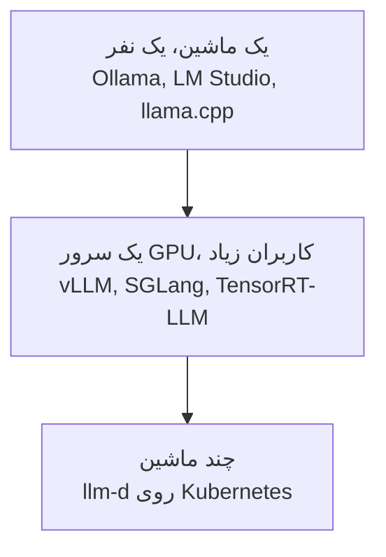
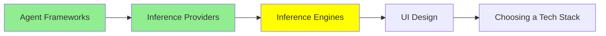

# Inference Engine‌ها

[مبانی LLM](../1_fundamentals/llms_fa.md) engine‌ها را نام برد. بعد گفت که شما به‌ندرت مستقیم با آن‌ها کار می‌کنید. این درست است، و به همین دلیل آن ماژول مستقیم به سراغ Ollama رفت. این ماژول درباره‌ی زمان‌هایی است که واقعاً با آن‌ها کار می‌کنید.

یک **inference engine** برنامه‌ای است که weight‌ها را بارگذاری می‌کند و token‌های شما را به token بعدی تبدیل می‌کند. کار‌های آن این‌ها هستند:

- GPU memory را مدیریت می‌کند.
- درخواست‌ها را با هم batch می‌کند.
- attention state را بین نوبت‌ها cache می‌کند.
- تصمیم می‌گیرد که چه چیزی، به چه ترتیبی اجرا شود.

یک inference provider، که موضوع [Inference Provider‌ها](inference_providers_fa.md) است، شخص دیگری است که یکی از این engine‌ها را برای شما اجرا می‌کند و به‌ازای هر token از شما هزینه می‌گیرد.

## چرا باید خودتان آن را اجرا کنید

سه دلیل وجود دارد و فقط همین سه دلیل ارزش دردسرش را دارند.

**داده نمی‌تواند بیرون برود.** مثال‌ها عبارت‌اند از سوابق سلامت، اسناد حقوقی، و هر چیزی که زیر قاعده‌ای باشد که می‌گوید متن باید روی زیرساخت (infrastructure) شما بماند. این رایج‌ترین دلیل است، خیلی بیشتر از دو دلیل دیگر. اگر این دلیل برای شما صدق کند، به‌تنهایی تصمیم را مشخص می‌کند.

**حجم کار آن را ارزان‌تر می‌کند.** قیمت‌گذاری به‌ازای هر token عالی است، تا وقتی که دیگر عالی نباشد. یک نقطه‌ی تلاقی (crossover point) وجود دارد. بعد از آن نقطه، یک GPU اجاره‌ای که تمام روز کار می‌کند، از همان کاری که به‌ازای هر token خریده شود، هزینه‌ی کمتری دارد. اگر از آن نقطه گذشته‌اید، حساب‌کتاب نزدیک هم نیست: تفاوت بزرگ است.

**به چیزی نیاز دارید که provider به شما نمی‌دهد.** برای مثال:

- یک مدل fine-tune شده‌ی خودتان، از [Training LLMs](../1_fundamentals/training_fa.md)
- مدلی که هیچ‌کس host نمی‌کند
- یک quantization غیرمعمول
- کنترل روی نسخه‌ی دقیق، تا هیچ ارتقایی شما را غافلگیر نکند

اگر هیچ‌کدام از این‌ها درست نیست، از یک provider استفاده کنید. Self-hosting یک کار عملیاتی واقعی است. در ماه اول، بیشتر یاد می‌گیرید که چه چیز‌هایی را در بودجه‌تان پیش‌بینی نکرده بودید.

## Engine‌ها، بر اساس اندازه‌ی مسئله

**روی ماشین خودتان**، از wrapper‌ها استفاده کنید. [مبانی LLM](../1_fundamentals/llms_fa.md) به [Ollama](https://ollama.com/) و [LM Studio](https://lmstudio.ai/) پرداخته بود، و در اینجا پاسخ درست همین‌هاست. آن‌ها engine را پنهان می‌کنند و شما را در چند دقیقه به اجرا می‌رسانند. زیر همه‌چیز، هر دو روی **[llama.cpp](https://github.com/ggml-org/llama.cpp)** ساخته شده‌اند. این یک LLM inference است که با C و C++ نوشته شده است. همین هم دلیلی است که یک مدل quantize شده اصلاً می‌تواند روی laptop اجرا شود. llama.cpp را مستقیم در دو حالت به کار ببرید: وقتی یک build flag می‌خواهید که wrapper آن را در اختیار شما نمی‌گذارد، یا وقتی مدل را روی سخت‌افزاری (hardware) می‌گذارید که هیچ‌کس دیگری پشتیبانی نمی‌کند.

**روی یک سرور GPU با کاربران واقعی**، wrapper‌ها دیگر کافی نیستند. اینجا به یک serving engine نیاز دارید.

- **vLLM** گزینه‌ی پیش‌فرض رایج است. طیف گسترده‌ای از سخت‌افزار را پشتیبانی می‌کند. آنچه به آن throughput خوبی می‌دهد، continuous batching آن است.
- **[SGLang](https://github.com/sgl-project/sglang)** یک serving framework با کارایی بالا برای مدل‌های زبانی و multimodal است. وقتی درخواست‌ها یک prefix طولانی و مشترک دارند، قوی است. اگر هر درخواست با همان system prompt بزرگ شروع شود، دقیقاً وضعیت شماست.
- **[TensorRT-LLM](https://github.com/NVIDIA/TensorRT-LLM)** از NVIDIA است. مخصوصاً از سخت‌افزار NVIDIA بیشترین بهره را می‌برد. مدل را از قبل به یک engine بهینه‌شده کامپایل می‌کنید. این کار یک مرحله‌ی build از شما می‌گیرد، اما latency کمتری می‌دهد.

**روی چند ماشین**، serving دیگر یک مسئله‌ی process نیست و به یک مسئله‌ی cluster تبدیل می‌شود. **[llm-d](https://github.com/llm-d/llm-d)** برای همین کار است. این ابزار inference را روی Kubernetes و با accelerator‌های مدرن اجرا می‌کند. بعد، پلتفرم scheduling، routing و جای‌دهی آگاه از cache را انجام می‌دهد، پس شما لازم نیست این کار‌ها را انجام دهید.

## ایده‌ای که عدد‌ها را توضیح می‌دهد

اگر فقط یک مکانیزم از این ماژول را به خاطر بسپارید، **batching** را به خاطر بسپارید.

یک GPU که هر بار یک درخواست را اجرا می‌کند، بیشترش بیکار است. دلیلش این است که تولید یک token به مقدار کمی محاسبه و ترافیک بسیار زیادی از memory نیاز دارد. اگر چند درخواست را با هم اجرا کنید، همان بارگذاری weight‌ها هزینه‌ی همه‌ی آن‌ها را پوشش می‌دهد. به همین دلیل است که throughput این engine‌ها را با کاربران هم‌زمان زیاد می‌سنجند. همچنین به همین دلیل است که یک سخت‌افزار می‌تواند هم عالی و هم ناامیدکننده به نظر برسد. این فقط به میزان پرشدن batch بستگی دارد.

Continuous batching بهبودی است که در عمل اهمیت دارد. Engine منتظر تمام شدن یک batch نمی‌ماند. در عوض، درخواست‌های جدید را به batch اضافه می‌کند، همان‌طور که درخواست‌های قدیمی‌تر کامل می‌شوند. پس GPU هرگز بی‌کار نمی‌ماند. به همین دلیل هم benchmark خودتان، با یک درخواست در هر لحظه، شما را به‌شدت درباره‌ی آنچه سرور می‌تواند انجام دهد، گمراه می‌کند.

و batching از طرف دیگر به [Context Engineering](../2_intermediate/context_engineering_fa.md) وصل می‌شود. وضعیت attention برای یک context طولانی باید در GPU memory بماند. بنابراین، یک context window پر، برای استدلال روی آن کندتر است. همچنین memory‌ای را اشغال می‌کند که درخواست کاربر دیگری به آن نیاز داشت.

## چیزی که جلوی آن می‌گذارید

یک engine به شما یک API می‌دهد و چیزی برای دیدن نمی‌دهد. **[Open WebUI](https://github.com/open-webui/open-webui)** رابطی است که مردم جلوی یک engine می‌گذارند. این یک chat UI است که با Ollama یا هر چیزی که همان ساختار API مربوط به OpenAI را دارد، صحبت می‌کند. این ابزار حساب کاربری، تاریخچه‌ی گفت‌وگو و امکان تغییر مدل دارد. بعضی تیم‌ها یک ChatGPT خصوصی روی سخت‌افزار خودشان می‌خواهند. برای آن‌ها، کل stack از دو بخش تشکیل شده است: engine و Open WebUI.

## کجای این مجموعه هستیم

## خلاصه

یک inference engine برنامه‌ای است که واقعاً weight‌ها را اجرا می‌کند. این برنامه این موارد را مدیریت می‌کند:

- GPU memory
- batching
- attention cache
- scheduling

یک provider شخص دیگری است که یک engine را برای شما اداره می‌کند.

engine خودتان را به یکی از این سه دلیل اجرا کنید:

- داده نمی‌تواند از زیرساخت شما خارج شود.
- حجم کار از نقطه‌ای گذشته که اجاره‌ی یک GPU از خرید token ارزان‌تر است.
- به یک مدل یا نسخه‌ای نیاز دارید که هیچ‌کس host نمی‌کند.

در غیر این صورت، از یک provider استفاده کنید، چون self-hosting یک کار عملیاتی است.

engine را با اندازه‌ی مسئله هماهنگ کنید. روی ماشین خودتان، از Ollama یا LM Studio استفاده کنید که زیر آن‌ها llama.cpp قرار دارد. روی یک سرور GPU با کاربران واقعی، از vLLM، SGLang یا TensorRT-LLM استفاده کنید. SGLang برای یک prefix مشترک و طولانی مناسب است، و TensorRT-LLM بیشترین بهره را از سخت‌افزار NVIDIA می‌برد. وقتی مسئله به یک cluster تبدیل شد، از llm-d استفاده کنید.

Batching ایده‌ای است که هر عددی در این ماژول را توضیح می‌دهد. یک GPU که فقط یک درخواست را سرویس می‌دهد، بیشترش بیکار است. continuous batching آن را پر نگه می‌دارد. به همین دلیل است که یک benchmark با یک درخواست در هر لحظه، تقریباً هیچ چیزی به شما نمی‌گوید.

**بررسی سریع**: شما مدل self-hosted خودتان را با یک درخواست در هر لحظه می‌سنجید و سریع به نظر می‌رسد. چرا ممکن است با پنجاه کاربر فرو بریزد؟ و در عوض باید چه چیزی را می‌سنجیدید؟

## منابع

- [llama.cpp](https://github.com/ggml-org/llama.cpp): LLM inference با C و C++، و پایه‌ای که wrapper‌های محلی روی آن ساخته شده‌اند
- [SGLang](https://github.com/sgl-project/sglang): serving با کارایی بالا، قوی وقتی درخواست‌ها یک prefix مشترک دارند
- [TensorRT-LLM](https://github.com/NVIDIA/TensorRT-LLM): از NVIDIA، از قبل کامپایل‌شده برای latency کمتر
- [llm-d](https://github.com/llm-d/llm-d): serving در چند ماشین روی Kubernetes
- [Open WebUI](https://github.com/open-webui/open-webui): رابط chat که می‌توانید جلوی هر کدام از آن‌ها بگذارید
- [Ollama](https://ollama.com/) و [LM Studio](https://lmstudio.ai/): wrapper‌های محلی که در [مبانی LLM](../1_fundamentals/llms_fa.md) به آن‌ها پرداخته شد
