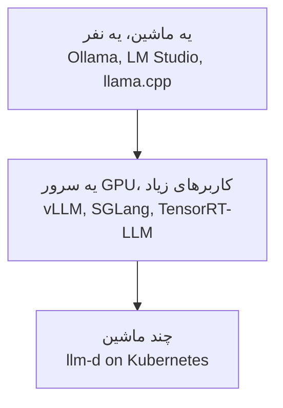
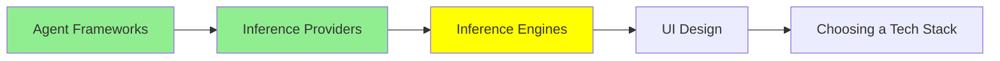

# Inference Engine‌ها

تو ماژول [مبانی LLM](../1_fundamentals/llms_fa.md) اسم inference engine‌ها رو دیدی و یاد گرفتی که معمولاً لازم نیست مستقیم باهاشون کار کنی. حرفش درسته، و برای همین بود که اون ماژول سریع رفت سراغ Ollama. این ماژول درباره‌ی وقت‌هاییه که واقعاً لازمه بهشون دست بزنی.

**inference engine** برنامه‌ایه که weight‌های مدل رو توی حافظه بار می‌کنه و توکن‌هایی که تو می‌فرستی رو به توکن بعدی تبدیل می‌کنه. کارهای اصلیش این‌هاست:

- مدیریت حافظه‌ی GPU
- کنار هم گذاشتن درخواست‌ها توی یه batch
- نگه داشتن attention state بین نوبت‌های گفت‌وگو توی cache
- تصمیم گرفتن درباره‌ی ترتیب اجرای کارها

یه inference provider، که موضوع ماژول [Inference Provider‌ها](inference_providers_fa.md) هست، یه طرف دیگه‌ست که یکی از همین engine‌ها رو به جای تو اجرا می‌کنه و به‌ازای هر توکن ازت پول می‌گیره.

## چرا خودت مدل رو اجرا کنی؟

سه تا دلیل برای این کار هست، و فقط همین سه تا ارزش دردسرش رو دارن.

**داده نمی‌تونه از زیرساخت تو بیرون بره.** مثلاً سوابق پزشکی، اسناد حقوقی، و هر چیزی که یه قانون بگه باید روی زیرساخت خودت بمونه. این شایع‌ترین دلیله، خیلی بیشتر از دوتای دیگه. اگه این شرط برای تو برقرار باشه، همین تنهایی تصمیم رو می‌گیره.

**حجم بالا کار رو ارزون‌تر می‌کنه.** قیمت‌گذاری به‌ازای هر توکن عالیه، تا وقتی که دیگه عالی نباشه. یه نقطه‌ی crossover وجود داره که بعدش، یه GPU اجاره‌ای که تمام روز کار می‌کنه، از همون کاری که با خرید توکن انجام می‌شه ارزون‌تر درمیاد. اگه از اون نقطه رد شده باشی، حساب و کتاب خیلی نزدیک نیست و اختلاف زیاده.

**یه چیزی لازم داری که provider بهت نمی‌ده.** مثلاً:

- یه مدل fine-tune شده‌ی خودت، از همون نوعی که توی [Training LLMs](../1_fundamentals/training_fa.md) درباره‌اش حرف زدیم
- یه مدلی که هیچ‌کس میزبانیش نمی‌کنه
- یه quantization غیرمعمول
- کنترل روی نسخه‌ی دقیق مدل، تا یه آپدیت هیچ‌وقت غافلگیرت نکنه

اگه هیچ‌کدوم از این‌ها درست نیست، از provider استفاده کن. self-hosting یه کار عملیاتی واقعیه، و توی ماه اول بیشتر چیزهایی رو یاد می‌گیری که توی بودجه‌ات پیش‌بینی نکرده بودی.

## موتور مناسب، بسته به اندازه‌ی مسئله

روی **ماشین شخصی خودت**، از wrapper‌ها استفاده کن. [مبانی LLM](../1_fundamentals/llms_fa.md) درباره‌ی [Ollama](https://ollama.com/) و [LM Studio](https://lmstudio.ai/) حرف زد، و برای این سطح، بهترین جواب همین دوتاست. این ابزارها engine رو پشت صحنه قایم می‌کنن و در عرض چند دقیقه کار رو راه می‌ندازن.

زیر این دوتا، هر دو روی **[llama.cpp](https://github.com/ggml-org/llama.cpp)** ساخته شدن. llama.cpp یه پروژه‌ست که inference مدل زبانی رو با C و C++ انجام می‌ده. به خاطر همین هم یه مدل quantize شده اصلاً می‌تونه روی لپ‌تاپ اجرا بشه. llama.cpp رو مستقیم فقط توی دو حالت به کار ببر: یا وقتی یه build flag می‌خوای که wrapper نشونش نمی‌ده، یا وقتی مدل رو روی سخت‌افزاری می‌ذاری که هیچ‌کس دیگه‌ای پشتیبانیش نمی‌کنه.

**روی یه سرور GPU با کاربر واقعی**، wrapper‌ها دیگه کافی نیستن و اینجا باید سراغ یه serving engine بری.

- **vLLM** معمول‌ترین انتخاب پیش‌فرضه. طیف وسیعی از سخت‌افزارها رو پشتیبانی می‌کنه، و throughput خوبش مدیون continuous batching‌شه.
- **[SGLang](https://github.com/sgl-project/sglang)** یه framework سرویس‌دهی با کارایی بالا برای مدل‌های زبانی و multimodal هست. وقتی درخواست‌ها یه prefix طولانی و مشترک دارن، خیلی قویه. اگه هر درخواست با یه system prompt بزرگ و یکسان شروع بشه، دقیقاً همین حالت تو هست.
- **[TensorRT-LLM](https://github.com/NVIDIA/TensorRT-LLM)** از NVIDIA میاد و بیشترین بهره رو از سخت‌افزار خود NVIDIA می‌بره. مدل رو قبل از اجرا توی یه engine بهینه کامپایل می‌کنی. این یه مرحله‌ی build اضافه می‌خواد، ولی در عوض latency پایین‌تری گیرت میاد.

**وقتی کار به چند ماشین می‌رسه**، سرویس‌دهی دیگه فقط به مدیریت یه پروسه‌ی واحد خلاصه نمی‌شه و تبدیل می‌شه به مسئله‌ی cluster. [llm-d](https://github.com/llm-d/llm-d) برای همین ساخته شده. این ابزار inference رو روی Kubernetes و با accelerator‌های مدرن اجرا می‌کنه، و scheduling، routing و cache-aware placement رو خودش انجام می‌ده، پس تو لازم نیست اون‌ها رو دستی انجام بدی.

## یه ایده که همه‌ی عددها رو توضیح می‌ده

اگه فقط یه مکانیزم از این ماژول رو قرار باشه به خاطر بسپاری، اون **batching** هست.

یه GPU که هر بار فقط یه درخواست رو اجرا کنه، بیشترش بیکاره. دلیلش اینه که تولید یه توکن محاسبه‌ی کمی می‌خواد، ولی ترافیک memory خیلی زیادی لازم داره. اگه چند درخواست رو با هم اجرا کنی، همون بارگذاری weight‌ها هزینه‌ی همه‌شون رو یه‌جا پس می‌ده. برای همین آدم‌ها throughput این engine‌ها رو با چند کاربر هم‌زمان می‌سنجن. این هم دلیلیه که یه سخت‌افزار واحد می‌تونه، بسته به پر بودن batch، هم عالی به نظر بیاد و هم ناامیدکننده. همه‌چیز فقط به همین بستگی داره که batch چقدر پره.

**continuous batching** بهبودیه که توی عمل واقعاً مهمه. engine منتظر نمی‌مونه تا یه batch کامل تموم بشه، بلکه درخواست‌های جدید رو همون‌جا که قدیمی‌ها تموم می‌شن وارد batch می‌کنه، و این‌جوری GPU هیچ‌وقت بی‌کار نمی‌مونه. به همین دلیل هم benchmark خودت، که یه درخواست در هر لحظه رو می‌فرسته، درباره‌ی اون‌چه سرور واقعاً می‌تونه بکنه، بدجوری گمراهت می‌کنه.

batching از سمت دیگه هم به [Context Engineering](../2_intermediate/context_engineering_fa.md) وصل می‌شه. حالت attention برای یه context بلند باید توی حافظه‌ی GPU بمونه، و برای همین یه context window پر، پردازش‌اش کندتره. علاوه بر این، حافظه‌ای رو هم اشغال می‌کنه که درخواست یه کاربر دیگه بهش نیاز داشت.

## یه رابط جلوی engine

یه engine فقط یه API بهت می‌ده و هیچی برای دیدن نداره. **[Open WebUI](https://github.com/open-webui/open-webui)** همون چیزیه که آدم‌ها جلوی engine می‌ذارن. این یه رابط chat‌ه که با Ollama یا هر چیزی که همون شکل API مربوط به OpenAI رو داشته باشه، حرف می‌زنه. حساب کاربری، تاریخچه‌ی گفت‌وگو و تغییر مدل هم داره. بعضی تیم‌ها یه ChatGPT خصوصی روی سخت‌افزار خودشون می‌خوان، و برای اون‌ها کل stack همین دو تیکه‌ست: engine و Open WebUI.

## کجای این مجموعه هستیم

## خلاصه

یه inference engine برنامه‌ایه که weight‌های مدل رو واقعاً اجرا می‌کنه، و این کارها رو انجام می‌ده:

- مدیریت حافظه‌ی GPU
- batching
- attention cache
- scheduling

provider هم یه طرف دیگه‌ست که یه engine رو برای تو اجرا می‌کنه.

اجرای engine خودت فقط به یکی از این سه دلیل ارزش داره:

- داده نباید از زیرساخت تو بیرون بره.
- حجم کار به جایی رسیده که اجاره‌ی GPU از خرید توکن ارزون‌تر باشه.
- یه مدل یا نسخه‌ای لازم داری که هیچ‌کس میزبانیش نمی‌کنه.

وگرنه از provider استفاده کن، چون self-hosting یه کار عملیاتیه.

engine رو با اندازه‌ی مسئله هماهنگ کن. روی ماشین شخصی خودت، Ollama یا LM Studio رو استفاده کن که زیرش llama.cpp هست. روی یه سرور GPU با کاربر واقعی، vLLM، SGLang یا TensorRT-LLM رو بذار. SGLang برای وقتی خوبه که یه prefix طولانی و مشترک داری، و TensorRT-LLM بیشترین بهره رو از سخت‌افزار NVIDIA می‌بره. وقتی مسئله تبدیل به cluster بشه، llm-d رو استفاده کن.

batching همون ایده‌ایه که همه‌ی عددهای این ماژول رو توضیح می‌ده. یه GPU که فقط یه درخواست رو سرویس می‌ده، بیشترش بیکاره، و continuous batching پرش نگه می‌داره. به همین خاطر یه benchmark که با یه درخواست در هر لحظه اجرا بشه، تقریباً هیچی درباره‌ی سرور بهت نمی‌گه.

**بررسی سریع**: فرض کن مدل self-hosted خودت رو با یه درخواست در هر لحظه تست می‌کنی و سریع به نظر می‌رسه. چرا ممکنه وقتی پنجاه کاربر بیان، از کار بیفته؟ و به جاش باید چی رو اندازه می‌گرفتی؟

## منابع

- [llama.cpp](https://github.com/ggml-org/llama.cpp): inference مدل زبانی با C و C++، و پایه‌ای که wrapper‌های محلی روش ساخته شدن
- [SGLang](https://github.com/sgl-project/sglang): serving با کارایی بالا، که وقتی درخواست‌ها prefix مشترک دارن قویه
- [TensorRT-LLM](https://github.com/NVIDIA/TensorRT-LLM): از NVIDIA، که قبل از اجرا کامپایل می‌شه و latency پایین‌تری می‌ده
- [llm-d](https://github.com/llm-d/llm-d): سرویس‌دهی روی چند ماشین با Kubernetes
- [Open WebUI](https://github.com/open-webui/open-webui): رابط chat که می‌شه جلوی هر کدوم از این‌ها گذاشت
- [Ollama](https://ollama.com/) و [LM Studio](https://lmstudio.ai/): wrapper‌های محلی که توی [مبانی LLM](../1_fundamentals/llms_fa.md) بررسی شدن
