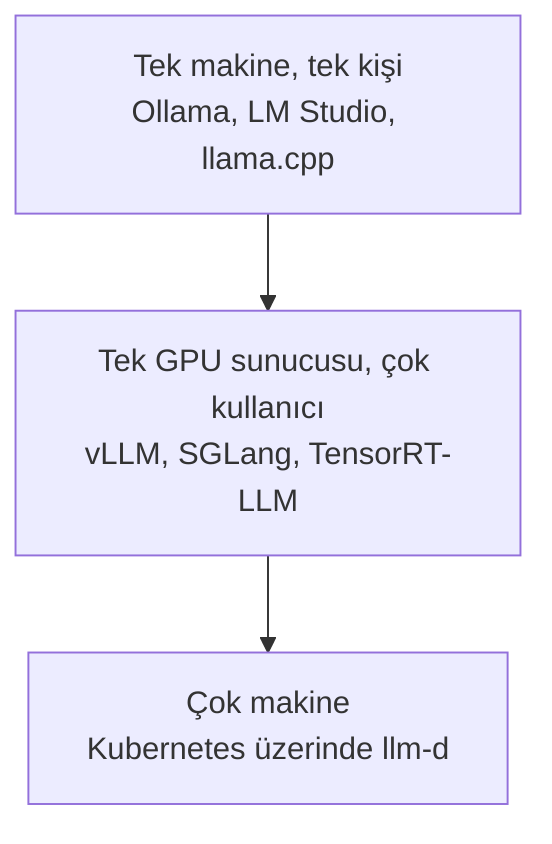

# Inference Engine'ler

[LLM Temelleri](../1_fundamentals/llms_tr.md) modülünde inference engine'lerin adları geçmişti. Oradaki açıklama, bu engine'lere nadiren doğrudan dokunacağını söylüyordu. Bu doğru ve bu yüzden o modül hemen Ollama'ya geçmişti. Bu modül ise engine'lere gerçekten dokunmanın gerektiği durumları anlatıyor.

Bir **inference engine**, model weight'lerini belleğe yükleyen ve senin token'larını bir sonraki token'a çeviren programdır. Bu programın şu işleri vardır:

- GPU belleğini yönetir.
- İstekleri bir batch'te birleştirir.
- Turlar arasında attention state'ini önbellekte tutar.
- İşlerin sırasını, yani scheduling'i belirler.

Bir inference provider ise bu engine'lerden birini senin yerine çalıştıran ve senden token başına ücret alan bir başkasıdır. Konunun kendisi, [Inference Provider'lar](inference_providers_tr.md) modülünün ana konusudur.

## Neden Kendin Çalıştırırsın

Bunu kendin çalıştırmanın üç nedeni var ve yalnızca bu üçü uğraşmaya değer.

**Veri dışarı çıkamaz.** Sağlık kayıtları, hukuki belgeler ve metnin senin altyapında kalmasını söyleyen bir kuralın kapsamındaki her şey buna örnektir. Bu, diğer ikisinden çok daha sık karşılaşılan en yaygın nedendir. Eğer senin için geçerliyse, karar tek başına bu nedenle verilmiş olur.

**Hacim işi ucuzlatır.** Token başına fiyatlandırma çok iyidir, ama her hacimde değil. Bir kesişim noktası vardır ve o noktanın ötesinde, bütün gün çalışan kiralık bir GPU, aynı işi token satın alarak yapmaktan çok daha ucuza gelir. Bu noktayı geçtiysen hesap artık yakın değildir, fark büyüktür.

**Bir provider'ın vermeyeceği bir şeye ihtiyacın var.** Örneğin:

- [Training LLMs](../1_fundamentals/training_tr.md) modülünde anlatılan şekilde, kendi fine-tune ettiğin bir model
- Kimsenin barındırmadığı bir model
- Alışılmadık bir quantization
- Tam olarak hangi sürümün çalışacağını sen belirlersin, böylece bir güncelleme seni hiç şaşırtmaz

Bunların hiçbiri geçerli değilse, bir provider kullanman en iyisidir. Kendi altyapında barındırmak (self-hosting) gerçek bir operasyon işidir ve ilk ay boyunca çoğunlukla bütçesine koymadığın şeylerle karşılaşırsın.

## Problemin Büyüklüğüne Göre Engine'ler

**Kendi makinende** sarmalayıcıları (wrapper) kullanmak en doğrusudur. [LLM Temelleri](../1_fundamentals/llms_tr.md) modülünde anlatılan [Ollama](https://ollama.com/) ve [LM Studio](https://lmstudio.ai/) bu durumda doğru seçimdir. İkisi de engine'i gizler ve birkaç dakika içinde çalıştırmanı sağlar; altlarında ise **[llama.cpp](https://github.com/ggml-org/llama.cpp)** bulunur. llama.cpp, C ve C++ ile yazılmış bir LLM inference projesidir ve quantize edilmiş bir modelin dizüstü bilgisayarda bile çalışabilmesinin nedeni de budur. llama.cpp'yi doğrudan kullanmak iki durumda mantıklıdır: sarmalayıcının açmadığı bir build flag'ine ihtiyacın olduğunda ya da kimsenin desteklemediği bir donanıma model koyacağın zaman.

**Gerçek kullanıcılara hizmet veren bir GPU sunucusunda** sarmalayıcılar artık yetmez ve burada bir serving engine'e ihtiyacın olur.

- **vLLM** genellikle varsayılan seçimdir. Geniş bir donanım yelpazesini destekler ve iyi bir verimi büyük ölçüde sürekli batching'e borçludur.
- **[SGLang](https://github.com/sgl-project/sglang)**, dil ve multimodal modeller için yüksek performanslı bir serving framework'üdür. Özellikle isteklerin uzun ve ortak bir önek (prefix) paylaştığı durumlarda güçlüdür. Her isteğin aynı büyük system prompt'la başladığı bir durumdaysan, tam olarak senin durumun budur.
- **[TensorRT-LLM](https://github.com/NVIDIA/TensorRT-LLM)**, NVIDIA'dan gelir ve özellikle o donanımdan en fazla verimi çıkarmak için tasarlanmıştır. Modeli önceden optimize edilmiş bir engine'e derlersin. Bunun bir build adımı maliyeti vardır, ama karşılığında daha düşük gecikme (latency) elde edersin.

**Birden fazla makineye yayıldığında** serving bir süreç sorunu olmaktan çıkar ve bir cluster sorununa dönüşür. [llm-d](https://github.com/llm-d/llm-d) tam bu iş için tasarlanmıştır ve modern hızlandırıcılarla Kubernetes üzerinde inference çalıştırır. Zamanlamayı, yönlendirmeyi ve önbellek farkındalıklı yerleştirmeyi (cache-aware placement) platform üstlenir, böylece sen bunlarla uğraşmak zorunda kalmazsın.

## Sayıları Açıklayan Tek Fikir

Bu modülden yalnızca tek bir mekanizmayı hatırlayacaksan, o **batching**'dir.

Tek seferde tek istek çalıştıran bir GPU çoğunlukla boştadır, çünkü bir token üretmek çok az hesaplama ama çok büyük bir bellek trafiği gerektirir. Aynı anda birçok isteği birlikte çalıştırırsan, aynı weight yüklemesi hepsinin maliyetini bir kerede öder.

İnsanlar bu engine'lerin verimini (throughput) çok sayıda eş zamanlı kullanıcıyla ölçer. Aynı donanımın bazen harika, bazen umutsuz görünmesinin nedeni de budur. Belirleyici olan tek şey, batch'in ne kadar dolu olduğudur.

Pratikte en çok önem taşıyan iyileştirme **continuous batching**'dir. Engine, bir batch'in bitmesini beklemek yerine eski istekler tamamlandıkça yenilerini batch'e ekler. Böylece GPU hiçbir zaman iş olmadan kalmaz. Aynı nedenle, tek istekle çalıştırdığın kendi benchmark'ın sunucunun neler yapabileceği konusunda seni ciddi biçimde yanıltır.

Batching'in bir de [Context Engineering](../2_intermediate/context_engineering_tr.md) ile bağlantısı var, ama bu sefer öbür yönden. Uzun bir context için attention state'in GPU belleğinde kalması gerekir. Bu yüzden dolu bir context window üzerinde akıl yürütmek daha yavaştır. Üstelik bu bellek, başka bir kullanıcının isteğinin ihtiyaç duyduğu belleği de tutar.

## Engine'in Önüne Konan Arayüz

Bir engine sana bir API verir, ama bakabileceğin bir şey vermez. **[Open WebUI](https://github.com/open-webui/open-webui)**, insanların bir engine'in önüne koyduğu arayüzdür. Ollama'ya ya da OpenAI'ın API biçimini kullanan herhangi bir şeye bağlanan bir chat UI'dır. Hesapları, konuşma geçmişi ve model değiştirme özellikleri vardır. Bazı ekipler kendi donanımlarında çalışan özel bir ChatGPT ister. Onlar için tüm yığın iki parçadan ibarettir: engine ve Open WebUI.

## Bu serinin neresindeyiz

## Özet

Bir inference engine, weight'leri gerçekten çalıştıran programdır. Şunların sorumluluğunu üstlenir:

- GPU belleği
- batching
- attention cache'i
- scheduling

Provider ise bu engine'i senin yerine işleten bir başkasıdır.

Kendi engine'ini üç nedenden biri için çalıştır:

- Verin senin altyapından çıkamaz.
- Hacim, GPU kiralamanın token satın almaktan ucuz olduğu noktayı geçti.
- Kimsenin barındırmadığı bir model ya da sürüme ihtiyacın var.

Bunlardan biri geçerli değilse, bir provider kullan, çünkü self-hosting bir operasyon işidir.

Engine'i problemin büyüklüğüne göre seçmelisin. Kendi makinende, altlarında llama.cpp çalışan Ollama ya da LM Studio'yu kullan. Gerçek kullanıcılara hizmet veren bir GPU sunucusunda ise vLLM, SGLang ya da TensorRT-LLM'den birini seç. SGLang, ortak bir uzun prefix paylaşan istekler için uygundur; TensorRT-LLM ise NVIDIA donanımından en fazla verimi alır. Problem bir cluster'a dönüştüğünde llm-d'ye geçersin.

Batching, bu modüldeki her sayıyı açıklayan fikirdir. Tek bir isteğe hizmet veren bir GPU çoğunlukla boştadır ve continuous batching onu dolu tutar. Bu yüzden tek istekle yapılan bir benchmark, sana neredeyse hiçbir şey söylemez.

**Hızlı Kontrol**: Kendi altyapında çalıştırdığın modeli her seferinde tek istekle ölçüyorsun ve hızlı görünüyor. Peki elli kullanıcıyla neden çökebilir? Bunun yerine neyi ölçmen gerekirdi?

## Kaynaklar

- [llama.cpp](https://github.com/ggml-org/llama.cpp): C ve C++ ile yazılmış bir LLM inference projesi. Yerel sarmalayıcıların dayandığı temel budur.
- [SGLang](https://github.com/sgl-project/sglang): yüksek performanslı serving. Ortak bir prefix paylaşan isteklerde güçlüdür.
- [TensorRT-LLM](https://github.com/NVIDIA/TensorRT-LLM): NVIDIA'dan gelir ve daha düşük gecikme için önceden derlenir.
- [llm-d](https://github.com/llm-d/llm-d): Kubernetes üzerinde birden fazla makineye yayılmış serving.
- [Open WebUI](https://github.com/open-webui/open-webui): bunların herhangi birinin önüne koyabileceğin chat arayüzü.
- [Ollama](https://ollama.com/) ve [LM Studio](https://lmstudio.ai/): [LLM Temelleri](../1_fundamentals/llms_tr.md) modülünde anlatılan yerel sarmalayıcılar.
