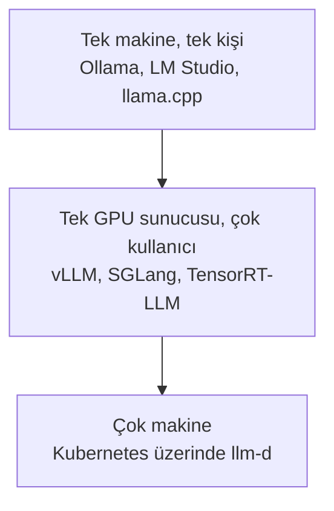
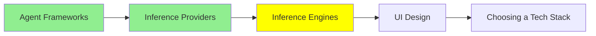

# Inference Engine'ler

[LLM Fundamentals](../1_fundamentals/llms_tr.md) engine'leri adlandırdı. Sonra onlara doğrudan nadiren dokunduğunu söyledi. Bu doğru, ve o modülün hemen Ollama'ya geçmesinin sebebi de bu. Bu modül ise onlara dokunduğun zamanlarla ilgili.

Bir **inference engine**, weight'leri yükleyen ve token'larını sıradaki token'a çeviren program. Görevleri şunlar:

- GPU memory'yi yönetiyor.
- İstekleri birlikte batch'liyor.
- Turlar arasında attention state'ini cache'liyor.
- Neyin hangi sırada çalışacağına karar veriyor.

[Inference Provider'lar](inference_providers_tr.md) ise şu demek: başka biri bu engine'lerden birini senin için çalıştırıyor ve token başına ücret alıyor.

## Kendin Çalıştırmanın Sebepleri

Üç sebep var, ve zahmete değen sadece bu üçü.

**Veri çıkamıyor.** Örnekler: sağlık kayıtları, hukuki dokümanlar ve metnin senin altyapında kalmasını şart koşan bir kurala bağlı her şey. Bu, açık ara en yaygın sebep. Senin için geçerliyse, soruyu tek başına çözüyor.

**Hacim onu daha ucuz yapıyor.** Token başına fiyatlama, bir noktaya kadar mükemmel. Bir kesişme noktası var. O noktadan sonra, gün boyu çalışan kiralık bir GPU, aynı işi token token satın almaktan daha ucuza geliyor. O noktayı geçtiysen hesap yakın bile değil: fark çok büyük.

**Bir provider'ın vermeyeceği bir şeye ihtiyacın var.** Örneğin:

- [Training LLMs](../1_fundamentals/training_tr.md)'den kendi fine-tune ettiğin bir model
- kimsenin barındırmadığı (host etmediği) bir model
- alışılmadık bir quantization
- tam sürüm üzerinde kontrol, böylece bir yükseltme seni hiç şaşırtmaz

Bunların hiçbiri geçerli değilse bir provider kullan. Self-hosting gerçek bir operasyon işi. İlk ay çoğunlukla bütçene koymadığın şeyleri öğrenerek geçiyor.

## Engine'ler, Problemin Boyutuna Göre

**Kendi makinende** wrapper'ları kullan. [LLM Fundamentals](../1_fundamentals/llms_tr.md) [Ollama](https://ollama.com/) ile [LM Studio](https://lmstudio.ai/)'yu işlemişti, ve burada doğru cevap onlar. Engine'i gizliyorlar ve seni dakikalar içinde çalışır hâle getiriyorlar. Altta ikisi de **[llama.cpp](https://github.com/ggml-org/llama.cpp)** üzerine kurulu. llama.cpp, C ve C++ ile yazılmış LLM inference. Quantize edilmiş bir modelin bir laptop'ta çalışabilmesinin sebebi de o. llama.cpp'yi iki durumda doğrudan kullan: wrapper'ın sunmadığı bir build flag'i istediğinde, ya da bir modeli kimsenin desteklemediği bir donanıma koyduğunda.

**Gerçek kullanıcıları olan bir GPU sunucusunda** wrapper'lar artık yetmiyor. Burada bir serving engine istiyorsun.

- **vLLM** alışılmış varsayılan seçenek. Geniş bir donanım yelpazesini destekliyor. Ona iyi bir throughput veren şey, continuous batching'i.
- **[SGLang](https://github.com/sgl-project/sglang)** dil ve multimodal modeller için yüksek performanslı bir serving framework'ü. İsteklerin uzun bir ortak öneki (prefix) paylaştığı yerde güçlü. Her istek aynı büyük system prompt'la başlıyorsa, durumun tam olarak bu.
- **[TensorRT-LLM](https://github.com/NVIDIA/TensorRT-LLM)** NVIDIA'nın. Özellikle NVIDIA donanımından en fazla verimi o alıyor. Modeli önceden optimize edilmiş bir engine'e derliyorsun. Bu sana bir build adımına mal oluyor, ama daha düşük gecikme (latency) kazandırıyor.

**Çok makine boyunca** serving, bir process problemi olmaktan çıkıp bir cluster problemi oluyor. **[llm-d](https://github.com/llm-d/llm-d)** bunun için var. Modern hızlandırıcılarla (accelerator) Kubernetes üzerinde inference çalıştırıyor. Böylece zamanlama, yönlendirme ve cache'e duyarlı yerleşimi sen değil, platform hallediyor.

## Sayıları Açıklayan Tek Fikir

Bu modülden tek bir mekanizma hatırlayacaksan, **batching**'i hatırla.

Bir seferde tek istek çalıştıran bir GPU çoğunlukla boşta bekliyor. Sebebi şu: bir token üretmek az miktarda aritmetik, ama çok büyük bir memory trafiği gerektiriyor. Birçok isteği birlikte çalıştırırsan, aynı weight yüklemesi hepsinin bedelini bir defada ödüyor. Bu engine'lerde throughput'un çok sayıda eşzamanlı kullanıcıyla ölçülmesinin sebebi bu. Aynı donanımın bazen parlak, bazen umutsuz görünmesinin sebebi de bu. Fark sadece batch'in ne kadar dolu olduğu.

Continuous batching, pratikte önemli olan iyileştirme. Engine bir batch'in bitmesini beklemiyor. Bunun yerine, eski istekler tamamlandıkça yenilerini batch'e ekliyor, böylece GPU hiç işsiz kalmıyor. Bu aynı zamanda, bir seferde tek istekle yaptığın benchmark'ın sunucunun kapasitesi hakkında seni fena yanıltmasının da sebebi.

Batching, öbür taraftan [Context Engineering](../2_intermediate/context_engineering_tr.md)'e de bağlanıyor. Uzun bir context'in attention state'i GPU memory'de durmak zorunda. Yani dolu bir context window'un üzerinde akıl yürütmek daha yavaş. Bu context window aynı zamanda başka bir kullanıcının isteğinin ihtiyaç duyduğu yeri de kaplıyor.

## Önüne Koyacak Bir Şey

Bir engine sana bir API veriyor, ama bakacak hiçbir şey vermiyor. **[Open WebUI](https://github.com/open-webui/open-webui)**, insanların bir engine'in önüne koyduğu arayüz. Ollama'yla, ya da OpenAI ile aynı API şeklini kullanan her şeyle konuşan bir sohbet arayüzü. Hesaplar, konuşma geçmişi ve model değiştirme özelliği var. Bazı ekipler kendi donanımlarında özel bir ChatGPT istiyor. Onlar için bütün stack iki parçadan ibaret: engine ve Open WebUI.

## Bu serinin neresindeyiz

## Özet

Bir inference engine, weight'leri gerçekten çalıştıran program. Şunlarla ilgileniyor:

- GPU memory
- batching
- attention cache
- zamanlama (scheduling)

Bir provider ise senin için bir engine işleten başka biri.

Kendi engine'ini şu üç sebepten biri için çalıştır:

- Veri altyapından çıkamıyor.
- Hacim, kiralık bir GPU'nun token satın almaktan ucuz olduğu noktayı geçti.
- Kimsenin barındırmadığı bir modele veya sürüme ihtiyacın var.

Aksi hâlde bir provider kullan, çünkü self-hosting bir operasyon işi.

Engine'i problemin boyutuna göre seç. Kendi makinende, altında llama.cpp olan Ollama ya da LM Studio kullan. Gerçek kullanıcıları olan bir GPU sunucusunda vLLM, SGLang ya da TensorRT-LLM kullan. SGLang paylaşılan uzun bir önek için uygun, TensorRT-LLM de NVIDIA donanımından en fazla verimi alıyor. Problem bir cluster'a dönüştüğünde llm-d kullan.

Batching, bu modüldeki her sayıyı açıklayan fikir. Tek istek sunan bir GPU çoğunlukla boşta bekliyor. Continuous batching onu dolu tutuyor. Bir seferde tek istekle yapılan benchmark'ın sana neredeyse hiçbir şey söylememesinin sebebi de bu.

**Hızlı Kontrol**: kendi barındırdığın modeli bir seferde tek istekle ölçüyorsun ve hızlı görünüyor. Elli kullanıcıyla neden çökebilir? Ve onun yerine neyi ölçmeliydin?

## Kaynaklar

- [llama.cpp](https://github.com/ggml-org/llama.cpp): C ve C++ ile yazılmış LLM inference, lokal wrapper'ların üzerine kurulduğu temel
- [SGLang](https://github.com/sgl-project/sglang): yüksek performanslı serving, isteklerin bir öneki paylaştığı yerde güçlü
- [TensorRT-LLM](https://github.com/NVIDIA/TensorRT-LLM): NVIDIA'nın, düşük gecikme için önceden derleniyor
- [llm-d](https://github.com/llm-d/llm-d): Kubernetes üzerinde, birçok makineye yayılan serving
- [Open WebUI](https://github.com/open-webui/open-webui): herhangi birinin önüne koyacağın sohbet arayüzü
- [Ollama](https://ollama.com/) ve [LM Studio](https://lmstudio.ai/): lokal wrapper'lar, [LLM Fundamentals](../1_fundamentals/llms_tr.md)'te işlendi
