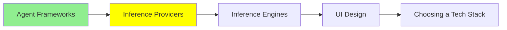

# Inference Providers

[LLM Fundamentals](../1_fundamentals/llms.md) helped you get an API key and make a first call. This module is about the layer that key belongs to. It is also about what changes when the calls are not free any more.

An **inference provider** runs the model on its own hardware and rents you access to it. You send text, you get text back, and you pay per token. You own none of the machines and none of the weights.

There are two ways to buy that access, and it helps to keep them clearly apart.

## The Gateway (Router)

[OpenRouter](https://openrouter.ai/) sits in front of many providers. You use one key and one API shape. The model name in your request decides which provider serves it. [LLM Fundamentals](../1_fundamentals/llms.md) already showed what this looks like. So here is what it gives you after the learning stage:

- **You can change model in one line.** The code stays the same, and only one string changes. If a new model comes out on a Monday, you can have it in your product a few hours later. You can also compare three of them on your own task in one afternoon.
- **No growing pile of keys.** You do not need a separate account, a separate billing relationship and a separate rate limit for each vendor.
- **Failover.** When one provider has an outage, the request can go to another provider instead of failing.
- **The same model from several sellers.** Several providers often serve the same open-weights model, at different prices and speeds. A gateway lets you choose by price, by latency, or by whichever provider is available at the moment.

The cost is one extra hop: your request goes through somebody else's infrastructure. That adds a little latency. It also puts one more company between you and the model.

OpenRouter is not the only gateway. **[Portkey](https://portkey.ai/)** does the same routing job, but the arrangement is different. With OpenRouter, you buy credits, use one OpenRouter key and get one bill. OpenRouter then pays the providers for you. With Portkey, you usually bring your own provider keys. Its [gateway](https://github.com/Portkey-AI/gateway) is open source, so you can run it on your own infrastructure.

Portkey does routing, retries and fallbacks. On top of those, it adds the things that a team in production asks for:

- guardrails
- observability
- budget limits
- caching

Palo Alto Networks acquired Portkey in 2026. So you will also see Portkey sold under the Palo Alto Networks name.

There is a different kind of router, and it is easy to confuse with these two. **[AgentRouter](https://www.agentrouter.to/quick-start)** is not an LLM router. It is an API router for AI agents. It gives an agent one key and one prepaid wallet. With them, the agent can find, pay for and call many kinds of API, such as:

- email
- phone and SMS
- company data
- web search
- travel booking

Model inference is only one of its domains. So the difference between the two kinds of router is how many kinds of API each one covers. An LLM router like OpenRouter or Portkey routes model calls. AgentRouter routes whatever paid API an agent decides it needs.

AgentRouter holds your wallet and sees every call you send through it. Its site also does not name the company behind it. So treat it like any third party that handles your data.

## Inference from LLM Vendors

The other way is to go straight to the company that made the model: OpenAI, Anthropic or Google.

You do this when you want the things that only the maker ships. New models usually appear there first. The provider-specific features are there too, and they are not small:

- prompt caching, which cuts the cost of a long system prompt
- batch endpoints at a discount
- the newest tool-calling behaviour
- the higher rate limits that you get by talking to a salesperson

If you build on one model and you are past the experiment stage, you usually end up going direct.

Nothing stops you from doing both. A common pattern is to go direct for the model in production, and to use a gateway to evaluate everything else.

## What to Compare, Beyond the Price

The price per million tokens is the number that everyone quotes. It is also the worst number to decide on by itself. Here is what shows up on the bill and in the product:

- **Prompt caching.** If your system prompt is long and does not change, a provider that caches it charges you only a fraction of the price for each repeat. Take an agent that sends the same 5,000-token block of instructions on every turn. For that agent, prompt caching is the biggest single way to cut cost. It also explains a result of the harness comparison in [Harness Engineering](../2_intermediate/harness_engineering.md): the fastest tool had the highest cost for each task that it completed successfully, because it almost never reused its cache.
- **Rate limits.** These are the limits on requests and tokens per minute. A good per-token price does not help you if your requests wait in a queue.
- **Latency, and which kind.** Time to the first token is what a person feels while they wait in a chat. Total time is what a batch job feels. These are different numbers, and providers are not good at both.
- **Context window and output limit.** These are two separate limits. The output limit is the one that people forget, until a long answer gets cut off.
- **What happens to your data.** Check whether the provider keeps your prompts, for how long, and whether it can train models on them. If your prompts contain customer data, read this part before you read the price.
- **Quantization.** This matters most on a gateway. Different sellers can serve the same model name at different precisions. A cheaper seller may run a copy that is quantized more aggressively. [LLM Fundamentals](../1_fundamentals/llms.md) explained what that costs in quality.

## Starting for Free

Both of the routes below have free tiers with daily limits. That is enough to build something real.

**[Google AI Studio](https://aistudio.google.com/)** is the most generous of the big vendors. You sign up and get a key. The free tier then covers the ordinary models, with a daily cap. **OpenRouter** also offers free models with daily limits. It is the fastest way to try several models on one prompt without opening accounts.

Here is one warning about free tiers, because this problem catches people at exactly the wrong moment. A free tier tells you whether the model can do your task. It tells you almost nothing about how your product will feel. Free capacity is slower, and it has stricter rate limits. It is also the first capacity that the provider cuts when it is busy. Measure latency on the tier that you plan to pay for.

## Where this fits in the series

## Summary

An inference provider runs the model and rents you access to it, per token. You buy that access either through a gateway or direct from the maker.

OpenRouter is the gateway to know. A gateway gives you:

- one key for many models
- a one-line model swap
- failover when a provider is down
- a choice of sellers for the same open-weights model

It costs you one extra hop, because every request passes through the gateway's servers on its way to the provider. Portkey does the same job with your own provider keys. Its gateway is open source, so you can host it yourself. AgentRouter is a different thing: it routes any paid API that an agent calls, not only model calls.

Going direct gives you the things that only the maker ships:

- new models first
- prompt caching
- batch discounts
- the rate limits that you negotiate

Most teams use a gateway to evaluate models, and go direct for the model they ship.

When you compare providers, the price per token is the least useful number on the page. All of these decide more:

- prompt caching
- rate limits
- time to first token
- the output limit
- the data policy

And measure latency on the paid tier, because the free tier is not the product you are shipping.

**Quick Check**: your agent sends the same long system prompt on every turn. Which line of a provider's pricing page matters most? And why is it not the price per token?

## References

- [OpenRouter](https://openrouter.ai/): one key for many models, and the fastest way to compare them
- [Portkey](https://portkey.ai/) and its open-source [gateway](https://github.com/Portkey-AI/gateway): routing with your own keys, plus guardrails and observability
- [AgentRouter](https://www.agentrouter.to/quick-start): one key and one wallet for the paid APIs an agent calls
- [Google AI Studio](https://aistudio.google.com/): a free key and a daily allowance, which is enough to learn on
- [LLM Fundamentals](../1_fundamentals/llms.md): where the first API call and the quantization trade-off are explained
