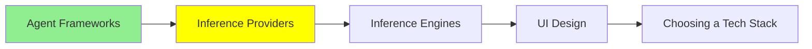

# Inference Provider‌ها

[مبانی LLM](../1_fundamentals/llms_fa.md) به شما کمک کرد تا یک API key بگیرید و اولین فراخوانی (call) را انجام دهید. این ماژول دربارهٔ لایه‌ای است که آن key به آن تعلق دارد. همچنین دربارهٔ این است که وقتی فراخوانی‌ها دیگر رایگان نیستند، چه چیزی تغییر می‌کند.

یک **inference provider** مدل را روی سخت‌افزار خودش اجرا می‌کند و دسترسی به آن را به شما اجاره می‌دهد. شما متن می‌فرستید، متن برمی‌گردد و به ازای هر token پول می‌دهید. شما نه مالک ماشین‌ها هستید و نه مالک model weights.

برای خرید این دسترسی دو راه وجود دارد. کمک می‌کند که این دو راه را روشن از هم جدا نگه دارید.

## Gateway (Router)

[OpenRouter](https://openrouter.ai/) جلوی بسیاری از provider‌ها قرار دارد. شما از یک key و یک شکل API استفاده می‌کنید. نام مدل در درخواست شما تعیین می‌کند که کدام provider مدل را برای شما اجرا کند. [مبانی LLM](../1_fundamentals/llms_fa.md) از قبل نشان داده بود که این کار چگونه است. پس در اینجا آنچه بعد از مرحلهٔ یادگیری به شما می‌دهد آمده است:

- **می‌توانید مدل را در یک خط عوض کنید.** کد ثابت می‌ماند و فقط یک string تغییر می‌کند. اگر یک مدل جدید روز دوشنبه بیرون بیاید، ممکن است چند ساعت بعد آن را در محصولتان داشته باشید. همچنین می‌توانید سه تا از آن‌ها را روی کار خودتان در یک بعدازظهر مقایسه کنید.
- **key‌ها روی هم انباشته نمی‌شوند.** برای هر vendor لازم نیست حساب جدا، صورتحساب جدا و rate limit جدا داشته باشید.
- **Failover.** وقتی یک provider دچار قطعی می‌شود، درخواست می‌تواند به provider دیگری برود، به جای اینکه شکست بخورد.
- **همان مدل از چند فروشنده.** چند provider اغلب همان مدل open-weights را با قیمت‌ها و سرعت‌های متفاوت ارائه می‌دهند. یک gateway به شما امکان می‌دهد بر اساس قیمت، بر اساس latency، یا بر اساس هر provider‌ای که در آن لحظه در دسترس است، انتخاب کنید.

هزینه‌اش یک hop اضافه است: درخواست شما از زیرساخت شرکت دیگری عبور می‌کند. این کمی latency اضافه می‌کند. همچنین یک شرکت دیگر را بین شما و مدل قرار می‌دهد.

OpenRouter تنها gateway نیست. **[Portkey](https://portkey.ai/)** همان کار مسیریابی (routing) را انجام می‌دهد، اما ساختار کارش فرق دارد. با OpenRouter، اعتبار (credit) می‌خرید، یک key از OpenRouter را استفاده می‌کنید و یک صورتحساب می‌گیرید. سپس OpenRouter به جای شما به provider‌ها پول می‌دهد. با Portkey، معمولاً key‌های provider خودتان را می‌آورید. [gateway](https://github.com/Portkey-AI/gateway) آن open source است، پس می‌توانید آن را روی زیرساخت خودتان اجرا کنید.

Portkey کار مسیریابی، retry و fallback را انجام می‌دهد. علاوه بر این‌ها، چیزهایی را اضافه می‌کند که یک تیم در production از آن‌ها می‌خواهد:

- guardrail‌ها
- observability
- محدودیت‌های بودجه
- caching

Palo Alto Networks در سال 2026 Portkey را خرید. پس ممکن است Portkey را با نام Palo Alto Networks هم ببینید، چون با آن نام فروخته می‌شود.

نوع دیگری از router وجود دارد و آن را به سادگی با این دو اشتباه می‌گیرند. **[AgentRouter](https://www.agentrouter.to/quick-start)** یک LLM router نیست. این یک API router برای AI agent‌ها است. به یک agent یک key و یک کیف پول پیش‌پرداخت (wallet) می‌دهد. با این دو، agent می‌تواند انواع زیادی API را پیدا کند، برایشان پول بپردازد و آن‌ها را فراخوانی کند، مانند:

- ایمیل
- تلفن و SMS
- داده‌های شرکت
- جستجوی وب
- رزرو سفر

Model inference تنها یکی از حوزه‌های آن است. پس تفاوت در دامنه است. یک LLM router مانند OpenRouter یا Portkey، فراخوانی‌های مدل را مسیریابی می‌کند. AgentRouter هر API پولی را که agent تصمیم می‌گیرد به آن نیاز دارد، مسیریابی می‌کند.

AgentRouter کیف پول شما را نگه می‌دارد و هر فراخوانی را که از طریق آن می‌فرستید، می‌بیند. سایتش هم نام شرکت پشت آن را ذکر نمی‌کند. پس با آن مثل هر third party که داده‌های شما را پردازش می‌کند رفتار کنید.

## Inference از LLM Vendor‌ها

راه دیگر این است که مستقیم به شرکتی بروید که مدل را ساخته است: OpenAI، Anthropic یا Google.

این کار را وقتی انجام می‌دهید که چیزهایی را بخواهید که فقط سازنده ارائه می‌کند. مدل‌های جدید معمولاً ابتدا همان‌جا ظاهر می‌شوند. ویژگی‌های مخصوص هر provider هم آنجاست و کم‌اهمیت نیستند:

- prompt caching، که هزینهٔ یک system prompt طولانی را کم می‌کند
- batch endpoint‌ها با تخفیف
- جدیدترین رفتار tool-calling
- rate limit‌های بالاتری که با صحبت با یک نماینده فروش به دست می‌آورید

اگر روی یک مدل کار می‌کنید و از مرحلهٔ آزمایش گذشته‌اید، معمولاً در نهایت مستقیم به سراغ سازنده می‌روید.

هیچ چیزی جلوی انجام هر دو را نمی‌گیرد. یک الگوی رایج این است که برای مدلی که در production استفاده می‌شود، مستقیم بروید و برای ارزیابی بقیهٔ مدل‌ها از یک gateway استفاده کنید.

## چه چیزهایی را جدا از قیمت مقایسه کنیم

قیمت هر میلیون token عددی است که همه اعلام می‌کنند. همچنین بدترین عددی است که بشود فقط با تکیه بر آن تصمیم گرفت. در ادامه آنچه در صورتحساب و در محصول ظاهر می‌شود، آمده است:

- **Prompt caching.** اگر system prompt شما طولانی است و تغییر نمی‌کند، provider‌ای که آن را cache می‌کند، برای هر تکرار فقط بخشی از قیمت را از شما می‌گیرد. یک agent را در نظر بگیرید که در هر turn همان بلوک 5,000-token از دستورالعمل‌ها را می‌فرستد. برای چنین agent‌ای، prompt caching بزرگ‌ترین عامل منفرد برای کاهش هزینه است. این موضوع نتیجه‌ای از مقایسهٔ harness در [Harness Engineering](../2_intermediate/harness_engineering_fa.md) را هم توضیح می‌دهد: سریع‌ترین tool، به ازای هر موفقیت، گران‌ترین بود، چون تقریباً هرگز cache خودش را دوباره استفاده نمی‌کرد.
- **Rate limit‌ها.** این‌ها محدودیت‌های تعداد درخواست و token در هر دقیقه هستند. یک قیمت خوب برای هر token به کار شما نمی‌آید، اگر درخواست‌هایتان در صف منتظر بمانند.
- **Latency، و کدام نوع آن.** زمان رسیدن به اولین token همان چیزی است که یک نفر در یک چت، هنگام انتظار حس می‌کند. زمان کل همان چیزی است که یک batch job حس می‌کند. این‌ها عددهای متفاوتی هستند و provider‌ها در هر دو خوب نیستند.
- **Context window و output limit.** این‌ها دو محدودیت جدا از هم هستند. output limit همان محدودیتی است که مردم فراموش می‌کنند، تا وقتی که یک پاسخ طولانی قطع شود.
- **آنچه با داده‌هایتان می‌شود.** بررسی کنید provider، prompt‌های شما را نگه می‌دارد یا نه، و اگر نگه می‌دارد، برای چه مدتی، و آیا می‌تواند از آن‌ها برای training مدل استفاده کند یا نه. اگر prompt‌های شما داده‌های مشتری دارند، پیش از خواندن قیمت، این بخش را بخوانید.
- **Quantization.** این موضوع بیشتر روی یک gateway اهمیت دارد. فروشنده‌های مختلف می‌توانند همان نام مدل را با precision متفاوت ارائه کنند. یک فروشندهٔ ارزان‌تر ممکن است کپی‌ای را اجرا کند که با شدت بیشتری quantize شده است. [مبانی LLM](../1_fundamentals/llms_fa.md) توضیح داده بود که این کار از نظر کیفیت چه هزینه‌ای دارد.

## شروع رایگان

هر دو مسیر زیر free tier‌هایی با محدودیت روزانه دارند. این برای ساختن چیزی واقعی کافی است.

**[Google AI Studio](https://aistudio.google.com/)** سخاوتمندترین بین vendor‌های بزرگ است. شما ثبت‌نام می‌کنید و یک key می‌گیرید. free tier سپس مدل‌های معمولی را با یک سقف روزانه پوشش می‌دهد. **OpenRouter** هم مدل‌های رایگان با محدودیت روزانه ارائه می‌دهد. این سریع‌ترین راه برای امتحان چند مدل روی یک prompt است، بدون اینکه حساب باز کنید.

یک هشدار دربارهٔ free tier‌ها هست، چون این مشکل آدم را دقیقاً در بدترین لحظه غافلگیر می‌کند. یک free tier به شما می‌گوید که آیا مدل می‌تواند کار شما را انجام دهد. دربارهٔ اینکه محصول شما چه حسی خواهد داشت، تقریباً هیچ چیزی نمی‌گوید. ظرفیت رایگان کندتر است و rate limit‌های سخت‌گیرانه‌تری دارد. همچنین اولین ظرفیتی است که provider وقتی شلوغ است حذفش می‌کند. latency را روی لایه‌ای اندازه بگیرید که قصد دارید برایش پول بدهید.

## کجای این مجموعه هستیم

## خلاصه

یک inference provider مدل را اجرا می‌کند و دسترسی به آن را به ازای هر token به شما اجاره می‌دهد. این دسترسی را یا از طریق یک gateway می‌خرید یا مستقیم از سازنده.

OpenRouter gateway‌ای است که باید بشناسید. یک gateway این موارد را به شما می‌دهد:

- یک key برای چندین مدل
- تعویض مدل با تغییر یک خط
- failover وقتی یک provider از کار افتاده است
- امکان انتخاب بین فروشنده‌ها برای همان مدل open-weights

هزینه‌اش یک hop اضافه است. Portkey همان کار را با key‌های provider خودتان انجام می‌دهد. gateway آن open source است، پس می‌توانید آن را خودتان میزبانی کنید. AgentRouter چیز متفاوتی است: هر API پولی را که یک agent فراخوانی می‌کند مسیریابی می‌کند، نه فقط فراخوانی‌های مدل.

رفتن مستقیم، چیزهایی را به شما می‌دهد که فقط سازنده ارائه می‌کند:

- مدل‌های جدید، اول از همه
- prompt caching
- تخفیف‌های batch
- rate limit‌هایی که با مذاکره به دست می‌آورید

بیشتر تیم‌ها برای ارزیابی مدل‌ها از یک gateway استفاده می‌کنند و برای مدلی که در محصولشان به کار می‌برند، مستقیم می‌روند.

وقتی provider‌ها را مقایسه می‌کنید، قیمت هر token کم‌فایده‌ترین عدد روی صفحه است. همهٔ این موارد بیشتر در تصمیم تعیین‌کننده‌اند:

- prompt caching
- rate limit‌ها
- زمان تا اولین token
- output limit
- سیاست داده‌ها

و latency را روی لایهٔ پولی اندازه بگیرید، چون free tier همان محصولی نیست که قرار است منتشر کنید.

**بررسی سریع**: agent شما در هر turn همان system prompt طولانی را می‌فرستد. کدام خط از صفحهٔ قیمت‌گذاری یک provider بیشترین اهمیت را دارد؟ و چرا آن خط قیمت هر token نیست؟

## منابع

- [OpenRouter](https://openrouter.ai/): یک key برای چندین مدل، و سریع‌ترین راه برای مقایسهٔ آن‌ها
- [Portkey](https://portkey.ai/) و [gateway](https://github.com/Portkey-AI/gateway) متن‌باز آن (open source): مسیریابی با key‌های خودتان، به همراه guardrail‌ها و observability
- [AgentRouter](https://www.agentrouter.to/quick-start): یک key و یک wallet برای API‌های پولی که یک agent فراخوانی می‌کند
- [Google AI Studio](https://aistudio.google.com/): یک key رایگان و سهمیهٔ روزانه، که برای یادگیری کافی است
- [مبانی LLM](../1_fundamentals/llms_fa.md): جایی که اولین فراخوانی API و trade-off مربوط به quantization توضیح داده شده است
