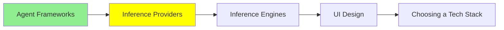

# Inference Provider‌ها

توی [مبانی LLM](../1_fundamentals/llms_fa.md) یه API key گرفتی و اولین call رو زدی. این ماژول دربارهٔ لایه‌ای حرف می‌زنه که اون key بهش تعلق داره. علاوه بر این، درباره‌ی این هم حرف می‌زنه که وقتی call‌ها دیگه رایگان نیستن، چه چیزی عوض می‌شه.

یه **inference provider** مدل رو روی سخت‌افزار خودش اجرا می‌کنه و دسترسی بهش رو اجاره می‌ده. تو متن می‌فرستی، متن برمی‌گردونه، و به ازای هر token پول می‌دی. نه ماشین‌ها مال توئه و نه model weights.

برای خریدن این دسترسی دو راه هست، و خوبه که این دو تا رو خوب از هم جدا نگه داری.

## Gateway (Router)

[OpenRouter](https://openrouter.ai/) جلوی خیلی از provider‌ها قرار داره. تو فقط یه key و یه شکل API داری. اسم مدلی که توی درخواستت می‌فرستی تعیین می‌کنه کدوم provider جوابش رو بده. [مبانی LLM](../1_fundamentals/llms_fa.md) قبلاً نشون داده بود که این کار توی عمل چه شکلیه. حالا ببین بعد از مرحلهٔ یادگیری، این کار چی بهت می‌ده:

- **می‌تونی مدل رو توی یه خط عوض کنی.** کد سرجاش می‌مونه و فقط یه string عوض می‌شه. اگه یه مدل جدید یه دوشنبه بیرون بیاد، چند ساعت بعد می‌تونی بذاریش توی محصولت. همین‌طور می‌تونی سه تا از اون‌ها رو روی کار خودت توی یه بعدازظهر با هم مقایسه کنی.
- **دیگه کلی key نداری که مدام نگهشون داری.** لازم نیست برای هر vendor یه حساب جدا، یه صورت‌حساب جدا و یه rate limit جدا داشته باشی.
- **Failover.** وقتی یه provider دچار قطعی می‌شه، درخواستت می‌تونه به یه provider دیگه بره، به جای این‌که خطا بگیره.
- **همون مدل از چند فروشنده.** خیلی وقت‌ها چند provider یه مدل open-weights رو با قیمت‌ها و سرعت‌های متفاوت ارائه می‌دن. gateway بهت اجازه می‌ده بر اساس قیمت، بر اساس latency یا هر provider‌ای که همون لحظه در دسترسه انتخاب کنی.

هزینه‌اش یه hop اضافه‌ست: درخواستت باید از زیرساخت یه شرکت دیگه رد بشه. این یه کم latency اضافه می‌کنه، و ضمن این‌که یه شرکت دیگه هم میاد وسط تو و مدل.

OpenRouter تنها gateway موجود نیست. **[Portkey](https://portkey.ai/)** همون کار routing رو انجام می‌ده، ولی ساختارش فرق داره. توی OpenRouter اعتبار می‌خری، با یه OpenRouter key کار می‌کنی و فقط یه صورت‌حساب می‌گیری، چون خود OpenRouter پول provider‌ها رو برات می‌ده. توی Portkey معمولاً key‌های خودت برای provider‌ها رو می‌آری. خود [gateway](https://github.com/Portkey-AI/gateway) هم open source‌ه، پس می‌تونی روی زیرساخت خودت اجراش کنی.

Portkey کارهای routing، retry و fallback رو انجام می‌ده. علاوه بر اون‌ها، چیزهایی رو هم اضافه می‌کنه که یه تیم توی production ازشون می‌خواد:

- guardrails
- observability
- budget limits
- caching

توی سال 2026، شرکت Palo Alto Networks، Portkey رو خرید. برای همین ممکنه Portkey رو زیر اسم Palo Alto Networks هم ببینی که داره فروخته می‌شه.

یه router از نوع دیگه هم هست که راحت می‌شه با این دو تا قاطیش کرد. **[AgentRouter](https://www.agentrouter.to/quick-start)** یه LLM router نیست، بلکه یه API router برای agent‌هاست. با یه key و یه کیف پول پیش‌پرداخت که به agent می‌ده، agent می‌تونه انواع API‌ها رو پیدا کنه، براشون پول بده و صداشون بزنه، مثلاً:

- ایمیل
- تلفن و پیامک
- اطلاعات شرکت‌ها
- جست‌وجوی وب
- رزرو سفر

ولی inference مدل فقط یکی از حوزه‌هاییه که AgentRouter توش فعاله، پس فرق اصلی‌شون توی دامنه‌شونه. یه LLM router مثل OpenRouter یا Portkey، درخواست‌های مدل رو route می‌کنه. و AgentRouter هر API پولی‌ای رو route می‌کنه که agent تشخیص بده بهش نیاز داره.

AgentRouter کیف پول تو رو نگه می‌داره و هر call‌ای که ازش رد کنی رو می‌بینه. سایتش هم اسم شرکت پشتش رو نمی‌گه، پس با اون مثل هر third party دیگه‌ای که داده‌هات دستشه رفتار کن.

## Inference مستقیم از سازنده‌های LLM

راه دوم اینه که مستقیم بری سراغ شرکتی که خود مدل رو ساخته: OpenAI، Anthropic یا Google.

این کار رو وقتی می‌کنی که بخوای چیزهایی رو بگیری که فقط سازنده ارائه می‌ده. مدل‌های جدید معمولاً اول همون‌جا بیرون میان، و ویژگی‌های مخصوص همون شرکت هم همون‌جاست و اصلاً کوچیک نیستن:

- prompt caching که هزینهٔ یه system prompt طولانی رو کم می‌کنه
- batch endpoint‌ها با تخفیف
- جدیدترین رفتار tool calling
- rate limit‌های بالاتری که با حرف زدن با فروشنده گیرت می‌آد

اگه روی یه مدل مشخص داری محصول می‌سازی و از مرحلهٔ آزمایش رد شدی، معمولاً آخرش مستقیم می‌ری سراغ همون شرکت.

هیچی جلوتو نمی‌گیره که هر دو رو با هم داشته باشی. یه الگوی رایج اینه که مدلی که توی production داری رو مستقیم بگیری و برای ارزیابی بقیهٔ مدل‌ها از یه gateway استفاده کنی.

## چی رو باید جدا از قیمت مقایسه کنی

قیمت هر میلیون token همون عددیه که همه نقلش می‌کنن. ولی بدترین عددی هم هست که بشه فقط بر اساسش تصمیم گرفت. این‌ها چیزهایی هستن که هم توی صورت‌حساب پیدا می‌شن، و هم توی محصولت:

- **Prompt caching.** اگه system prompt‌ت طولانی باشه و عوض نشه، یه provider که اون رو cache کنه، برای هر تکرار فقط یه کسری از قیمت رو ازت می‌گیره. یه agent رو در نظر بگیر که توی هر turn یه بلوک 5,000 token‌ای از دستورالعمل‌ها رو می‌فرسته. برای اون agent، prompt caching مهم‌ترین راه برای کم کردن هزینه‌ست. این موضوع یه نتیجه از مقایسهٔ harness توی [Harness Engineering](../2_intermediate/harness_engineering_fa.md) رو هم توضیح می‌ده: سریع‌ترین ابزار به ازای هر موفقیت گران‌ترین بود، چون تقریباً هیچ‌وقت cache‌ش رو دوباره استفاده نمی‌کرد.
- **Rate limits.** این‌ها سقف تعداد درخواست و token در هر دقیقه هستن. اگه درخواست‌هات توی صف بمونن، یه قیمت خوب برای هر token هم به دردت نمی‌خوره.
- **Latency، و کدوم نوعش.** زمان تا اولین token همون چیزیه که آدم وقتی توی چت منتظره حس می‌کنه. زمان کل هم چیزیه که یه batch job حس می‌کنه. این دو تا عدد با هم فرق دارن، و کمتر پیش میاد که provider‌ها توی هر دو خوب باشن.
- **Context window و output limit.** این‌ها دو تا محدودیت جدا از هم‌ان. محدودیت خروجی همونیه که آدم فراموشش می‌کنه، تا وقتی یه جواب بلند وسط حرف قطع بشه.
- **What happens to your data.** ببین provider با prompt‌هات چی کار می‌کنه: نگهشون می‌داره یا نه، اگه نگهشون می‌داره تا کی، و آیا برای train کردن مدل ازشون استفاده می‌کنه یا نه. اگه توی prompt‌هات داده‌های مشتری هست، قبل از این‌که به قیمت نگاه کنی، این بخش رو بخون.
- **Quantization.** این موضوع توی gateway‌ها بیشترین اهمیت رو داره. فروشنده‌های مختلف ممکنه یه اسم مدل یکسان رو با دقت‌های متفاوت ارائه کنن. یه فروشندهٔ ارزون‌تر ممکنه نسخه‌ای رو اجرا کنه که شدیدتر quantize شده. [مبانی LLM](../1_fundamentals/llms_fa.md) توضیح داده که این کار از نظر کیفیت چه هزینه‌ای داره.

## شروع رایگان

هر دو مسیری که در ادامه می‌بینی، free tier با سقف روزانه دارن. این برای ساختن یه چیز واقعی کافیه.

**[Google AI Studio](https://aistudio.google.com/)** از بین vendor‌های بزرگ دست‌ودل‌بازترینه. ثبت‌نام می‌کنی، یه key می‌گیری، و بعدش free tier مدل‌های معمولی رو با یه سقف روزانه پوشش می‌ده. **OpenRouter** هم مدل‌های رایگان با محدودیت روزانه داره. اگه بخوای چند مدل رو روی یه prompt امتحان کنی، بدون این‌که چند تا حساب باز کنی، سریع‌ترین راه همینه.

یه هشدار درباره free tier‌ها هم هست، چون این مشکل معمولاً دقیقاً توی بدترین لحظه گریبان آدم رو می‌گیره. free tier بهت می‌گه مدل می‌تونه کارت رو انجام بده یا نه، ولی تقریباً چیزی درباره‌ی این‌که محصولت برای کاربر چه حسی داره بهت نمی‌گه. ظرفیت رایگان کندتره و rate limit‌های سخت‌گیرانه‌تری داره. به علاوه، وقتی provider شلوغ می‌شه، اولین ظرفیتی که قطعش می‌کنه همین ظرفیت رایگانه. پس latency رو روی همون لایه‌ای اندازه بگیر که قراره برایش پول بدی.

## کجای این مجموعه هستیم

## خلاصه

یه inference provider مدل رو اجرا می‌کنه و دسترسی بهش رو به ازای هر token اجاره می‌ده. این دسترسی رو یا از طریق یه gateway می‌خری، یا مستقیم از خود سازنده‌اش.

OpenRouter همون gateway‌ایه که باید بشناسی. یه gateway این‌ها رو بهت می‌ده:

- یه key برای چندین مدل
- عوض کردن مدل توی یه خط
- failover وقتی یه provider از دسترس خارج شده
- انتخاب بین چند فروشنده برای یه مدل open-weights

هزینه‌اش یه hop اضافه‌ست. Portkey هم همون کار رو با key‌های خودت برای provider‌ها انجام می‌ده، و gateway‌ش open source‌ه، پس می‌تونی خودت میزبانیش کنی. اما AgentRouter یه چیز دیگه‌ست: هر API پولی‌ای رو که یه agent صدا می‌زنه route می‌کنه، نه فقط call‌های مدل.

رفتن مستقیم سراغ سازنده، چیزهایی رو بهت می‌ده که فقط خود سازنده ارائه می‌ده:

- مدل‌های جدید، اول از همه
- prompt caching
- تخفیف batch
- rate limit‌هایی که خودت باهاشون چونه می‌زنی

بیشتر تیم‌ها از gateway برای ارزیابی مدل‌ها استفاده می‌کنن، و برای مدلی که واقعاً توی محصولشون می‌ذارن، مستقیم می‌رن سراغ سازنده.

وقتی داری provider‌ها رو مقایسه می‌کنی، قیمت هر token کم‌فایده‌ترین عددیه که توی صفحه هست. همه‌ی این‌ها بیشتر تصمیم رو مشخص می‌کنن:

- prompt caching
- rate limit‌ها
- زمان تا اولین token
- محدودیت خروجی
- سیاست داده (data policy)

و latency رو روی لایهٔ پولی اندازه بگیر، چون free tier همون محصولی نیست که داری عرضه‌اش می‌کنی.

**بررسی سریع**: agent تو توی هر turn همون system prompt طولانی رو می‌فرسته. کدوم خط از صفحهٔ قیمت‌گذاری یه provider بیشترین اهمیت رو داره؟ و چرا این خط، قیمت هر token نیست؟

## منابع

- [OpenRouter](https://openrouter.ai/): یه key برای چندین مدل، و سریع‌ترین راه برای مقایسه‌شون
- [Portkey](https://portkey.ai/) و [gateway](https://github.com/Portkey-AI/gateway) open source‌شون: routing با key‌های خودت، به‌علاوهٔ guardrails و observability
- [AgentRouter](https://www.agentrouter.to/quick-start): یه key و یه کیف پول برای API‌های پولی‌ای که یه agent صداشون می‌زنه
- [Google AI Studio](https://aistudio.google.com/): یه key رایگان و یه سهمیهٔ روزانه، که برای یاد گرفتن کافیه
- [مبانی LLM](../1_fundamentals/llms_fa.md): جایی که اولین API call و trade-off مربوط به quantization توضیح داده شده
