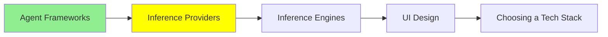

# Inference Provider‌ها

توی [مبانی LLM](../1_fundamentals/llms_fa.md) یه API key گرفتی و اولین call‌ت رو زدی. این درس درباره‌ی لایه‌ایه که اون key مال اونه، و اینکه وقتی دیگه call‌ها مجانی نیستن، چی عوض می‌شه.

**inference provider** مدل رو روی سخت‌افزار خودش اجرا می‌کنه و دسترسی بهش رو بهت اجاره می‌ده. تو متن می‌فرستی، متن تحویل می‌گیری، و به ازای هر token پول می‌دی؛ نه سرورها مال توئه، نه weight‌ها.

این دسترسی رو از دو راه می‌شه خرید، و بهتره حساب این دو تا رو از هم جدا نگه داری.

## Gateway (Router)

[OpenRouter](https://openrouter.ai/) جلوی کلی provider نشسته. تو با یه key و یه شکل API کار می‌کنی، و اسم مدلی که توی درخواستت می‌نویسی تعیین می‌کنه کدوم provider جوابت رو بده. شکل کار رو قبلاً توی [مبانی LLM](../1_fundamentals/llms_fa.md) دیدی، پس اینجا ببینیم بعد از دوره‌ی یادگیری، چه فایده‌ای برات داره:

- **مدل رو با یه خط عوض می‌کنی.** کد دست نمی‌خوره و فقط یه string عوض می‌شه. اگه یه دوشنبه مدل جدیدی بیاد، چند ساعت بعد می‌تونی توی محصولت داشته باشیش، یا توی یه بعدازظهر سه تا مدل رو روی کار خودت با هم مقایسه کنی.
- **از دست کلی key خلاص می‌شی.** لازم نیست برای هر vendor یه اکانت جدا، یه صورت‌حساب جدا و یه rate limit جدا داشته باشی.
- **Failover.** وقتی یه provider قطع می‌شه، درخواستت به‌جای اینکه fail بشه، می‌تونه بره سراغ یه provider دیگه.
- **یه مدل از چند تا فروشنده.** خیلی وقت‌ها چند تا provider یه مدل open-weights رو با قیمت و سرعت‌های مختلف serve می‌کنن، و gateway بهت اجازه می‌ده بر اساس قیمت، latency، یا هر کدوم که همون لحظه در دسترسه انتخاب کنی.

هزینه‌ش یه hop اضافه‌ست: درخواستت از زیرساخت یه شرکت دیگه رد می‌شه. این هم یه کم latency اضافه می‌کنه، هم یه شرکت دیگه رو بین تو و مدل قرار می‌ده.

OpenRouter تنها gateway موجود نیست. **[Portkey](https://portkey.ai/)** هم همین کار routing رو می‌کنه، ولی مدل کارش فرق داره. توی OpenRouter اعتبار (credit) می‌خری، با یه key از خود OpenRouter کار می‌کنی و یه صورت‌حساب می‌گیری، و OpenRouter پول provider‌ها رو از طرف تو می‌ده. توی Portkey معمولاً key‌های provider‌ها رو خودت میاری. خود [gateway](https://github.com/Portkey-AI/gateway) هم open source‌ه، پس می‌تونی روی زیرساخت خودت اجراش کنی.

Portkey کار routing و retry و fallback رو انجام می‌ده، و علاوه بر این‌ها چیزهایی رو هم اضافه می‌کنه که یه تیم توی production لازم داره:

- guardrails
- observability
- budget limits
- caching

Palo Alto Networks توی 2026 شرکت Portkey رو خرید، برای همین ممکنه Portkey رو با اسم Palo Alto Networks هم ببینی.

یه جور router دیگه هم هست که راحت با این دو تا قاطی می‌شه. **[AgentRouter](https://www.agentrouter.to/quick-start)** یه LLM router نیست؛ یه API router برای AI agent‌هاست. به agent یه key و یه کیف پول پیش‌پرداخت می‌ده، و agent با همین‌ها می‌تونه کلی API مختلف رو پیدا کنه، پولشون رو بده و صداشون بزنه، مثلاً:

- ایمیل
- تلفن و پیامک
- اطلاعات شرکت‌ها
- جستجوی وب
- رزرو سفر

inference مدل فقط یکی از حوزه‌هاشه. پس فرقشون توی گستره‌ی کارشونه: یه LLM router مثل OpenRouter یا Portkey فقط call‌های مدل رو route می‌کنه، ولی AgentRouter هر API پولی‌ای رو که agent تصمیم بگیره لازمش داره route می‌کنه.

AgentRouter کیف پولت دستشه و هر call‌ی که ازش رد می‌کنی رو می‌بینه، و سایتش هم نمی‌گه چه شرکتی پشتشه. پس باهاش همون‌طوری برخورد کن که با هر third party دیگه‌ای که داده‌هات دستشه برخورد می‌کنی.

## Inference مستقیم از سازنده‌های LLM

راه دوم اینه که مستقیم بری سراغ شرکتی که مدل رو ساخته: OpenAI، Anthropic یا Google.

این کار رو وقتی می‌کنی که چیزهایی رو می‌خوای که فقط خود سازنده ارائه می‌ده. مدل‌های جدید معمولاً اول همون‌جا میان، و قابلیت‌های مخصوص هر provider هم همون‌جاست، که کم هم نیستن:

- prompt caching، که هزینه‌ی یه system prompt طولانی رو پایین میاره
- batch endpoint‌ها با تخفیف
- جدیدترین رفتارهای tool calling
- rate limit‌های بالاتر، که با صحبت با تیم فروششون گیرت میاد

اگه محصولت روی یه مدل خاص بنا شده و از مرحله‌ی آزمایش گذشتی، معمولاً آخرش کارت به اینجا می‌کشه که مستقیم بری سراغ سازنده.

هیچی هم جلوت رو نمی‌گیره که هر دو رو با هم داشته باشی. یه الگوی رایج اینه که مدلی که توی production داری رو مستقیم از سازنده بگیری، و برای امتحان کردن بقیه‌ی مدل‌ها از gateway استفاده کنی.

## غیر از قیمت، چی رو مقایسه کنی

قیمت هر یک میلیون token عددیه که همه ازش حرف می‌زنن، ولی اگه فقط بر اساس همین تصمیم بگیری، بدترین معیار رو انتخاب کردی. این‌ها چیزهایی‌ان که اثرشون هم توی صورت‌حساب پیداست، هم توی محصول:

- **Prompt caching.** اگه system prompt‌ت طولانیه و عوض نمی‌شه، provider‌ی که cache‌ش کنه برای هر بار تکرار فقط کسری از قیمت رو ازت می‌گیره. یه agent رو تصور کن که توی هر turn همون بلوک 5,000 token‌ی دستورالعمل‌ها رو می‌فرسته؛ برای همچین agent‌ی، prompt caching مؤثرترین راه برای کم کردن هزینه‌ست. یه نتیجه از مقایسه‌ی harness‌ها توی [Harness Engineering](../2_intermediate/harness_engineering_fa.md) هم با همین توضیح داده می‌شه: سریع‌ترین ابزار، به ازای هر کاری که با موفقیت تموم می‌کرد، از همه گرون‌تر درمیومد، چون تقریباً هیچ‌وقت از cache‌ش دوباره استفاده نمی‌کرد.
- **Rate limits.** یعنی سقف تعداد درخواست و token در هر دقیقه. اگه درخواست‌هات توی صف بمونن، قیمت خوب به ازای هر token هیچ دردی ازت دوا نمی‌کنه.
- **Latency، و اینکه کدوم latency.** زمان تا اولین token چیزیه که آدم موقع منتظر موندن توی چت حسش می‌کنه، و زمان کل چیزیه که برای یه batch job مهمه. این‌ها دو تا عدد جدان، و provider‌ها معمولاً توی هر دو خوب نیستن.
- **Context window و output limit.** این‌ها دو تا محدودیت جدان. output limit همونیه که همه یادشون می‌ره، تا روزی که یه جواب طولانی وسط راه قطع بشه.
- **بلایی که سر داده‌هات میاد.** ببین provider prompt‌هات رو نگه می‌داره یا نه، اگه نگه می‌داره تا کِی، و اجازه داره باهاشون مدل train کنه یا نه. اگه توی prompt‌هات داده‌ی مشتری هست، این قسمت رو قبل از قیمت بخون.
- **Quantization.** این یکی بیشتر روی gateway مهمه. فروشنده‌های مختلف ممکنه یه اسم مدل رو با precision‌های مختلف serve کنن، و یه فروشنده‌ی ارزون‌تر ممکنه نسخه‌ای رو اجرا کنه که شدیدتر quantize شده. [مبانی LLM](../1_fundamentals/llms_fa.md) توضیح داده این کار چقدر از کیفیت کم می‌کنه.

## شروع رایگان

هر دو راهی که پایین می‌گیم free tier با سقف روزانه دارن، که برای ساختن یه چیز واقعی کافیه.

**[Google AI Studio](https://aistudio.google.com/)** از بین vendor‌های بزرگ از همه دست‌ودل‌بازتره: ثبت‌نام می‌کنی، key می‌گیری، و free tier‌ش مدل‌های معمولی رو با یه سقف روزانه پوشش می‌ده. **OpenRouter** هم مدل‌های رایگان با محدودیت روزانه داره، و سریع‌ترین راهه برای اینکه چند تا مدل رو روی یه prompt امتحان کنی، بدون اینکه چند جا اکانت باز کنی.

فقط یه هشدار درباره‌ی free tier‌ها، چون این مشکل دقیقاً بدترین موقع یقه‌ی آدم رو می‌گیره. free tier بهت می‌گه مدل از پس کارت برمیاد یا نه، ولی تقریباً هیچی درباره‌ی حس‌وحال محصولت برای کاربر نمی‌گه. ظرفیت رایگان کندتره، rate limit‌هاش سخت‌گیرانه‌تره، و وقتی provider شلوغ می‌شه، اولین چیزیه که قطع می‌شه. پس latency رو روی همون tier‌ی اندازه بگیر که قراره پولش رو بدی.

## کجای این مجموعه هستیم

## خلاصه

inference provider مدل رو اجرا می‌کنه و دسترسی بهش رو به ازای هر token بهت اجاره می‌ده. این دسترسی رو یا از طریق یه gateway می‌خری، یا مستقیم از سازنده‌ی مدل.

gateway‌ی که باید بشناسی OpenRouter‌ه، و یه gateway این‌ها رو بهت می‌ده:

- یه key برای کلی مدل
- عوض کردن مدل با یه خط
- failover وقتی یه provider از کار افتاده
- حق انتخاب بین چند فروشنده برای یه مدل open-weights

هزینه‌ش هم یه hop اضافه‌ست، چون هر درخواست سر راهش به provider، از سرورهای gateway رد می‌شه. Portkey همین کار رو با key‌های خودت انجام می‌ده، و چون gateway‌ش open source‌ه، می‌تونی خودت host‌ش کنی. AgentRouter ولی یه چیز دیگه‌ست: هر API پولی‌ای که agent صدا بزنه رو route می‌کنه، نه فقط call‌های مدل.

اگه مستقیم بری سراغ سازنده، چیزهایی گیرت میاد که فقط خودش ارائه می‌ده:

- مدل‌های جدید، زودتر از همه
- prompt caching
- تخفیف batch
- rate limit‌هایی که سرش چونه می‌زنی

بیشتر تیم‌ها مدل‌ها رو از طریق gateway امتحان می‌کنن، و مدلی که توی محصولشون می‌ره رو مستقیم از سازنده می‌گیرن.

موقع مقایسه‌ی provider‌ها، قیمت هر token کم‌فایده‌ترین عدد کل صفحه‌ست. همه‌ی این‌ها تأثیر بیشتری دارن:

- prompt caching
- rate limit‌ها
- زمان تا اولین token
- output limit
- سیاست نگهداری داده (data policy)

latency رو هم روی tier پولی اندازه بگیر، چون free tier اون محصولی نیست که قراره تحویل بدی.

**بررسی سریع**: agent‌ت توی هر turn همون system prompt طولانی رو می‌فرسته. کدوم خط از صفحه‌ی قیمت‌های یه provider از همه مهم‌تره؟ و چرا اون خط، قیمت هر token نیست؟

## منابع

- [OpenRouter](https://openrouter.ai/): یه key برای کلی مدل، و سریع‌ترین راه برای مقایسه‌شون
- [Portkey](https://portkey.ai/) و [gateway](https://github.com/Portkey-AI/gateway) متن‌بازش: routing با key‌های خودت، به‌اضافه‌ی guardrails و observability
- [AgentRouter](https://www.agentrouter.to/quick-start): یه key و یه کیف پول برای API‌های پولی‌ای که agent صدا می‌زنه
- [Google AI Studio](https://aistudio.google.com/): key رایگان و سهمیه‌ی روزانه، که برای یاد گرفتن کافیه
- [مبانی LLM](../1_fundamentals/llms_fa.md): جایی که اولین API call و بده‌بستون quantization توضیح داده شده
