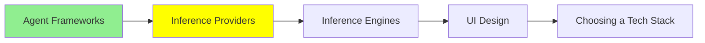

# Inference Provider'lar

[LLM Temelleri](../1_fundamentals/llms_tr.md) bölümünde bir API key almayı ve ilk çağrını yapmayı öğrendin. Bu modül ise o key'in bağlı olduğu katmanı, bir de çağrılar artık ücretsiz olmadığında neyin değiştiğini anlatıyor.

Bir **inference provider**, modeli kendi donanımında çalıştırır ve bu modele erişimini sana kiralar. Metin gönderirsin, metin geri alırsın ve ödemeyi token başına yaparsın. Bu makinelerin de modelin weight'lerinin de hiçbiri sana ait değil.

Bu erişimi almanın iki yolu var ve ikisini birbirinden net ayırmak, neyi satın aldığını anlamana yardımcı olur.

## Gateway (Router)

[OpenRouter](https://openrouter.ai/) birçok provider'ın önünde durur ve sana tek bir key ile tek bir API şekli sunar. İsteğindeki model adı, o isteğe hangi provider'ın cevap vereceğini belirler. Bunun nasıl göründüğünü [LLM Temelleri](../1_fundamentals/llms_tr.md) bölümünde zaten görmüştün. Öğrenme aşamasının ötesinde, bu yapının sana ne kazandırdığını şöyle sıralayabiliriz:

- **Modeli tek satırda değiştirebilirsin.** Kod aynı kalır, değişen tek şey model adını taşıyan bir string olur. Pazartesi günü yeni bir model çıkarsa, birkaç saat sonra onu ürününde kullanabilirsin. Üstelik üç modeli kendi işinde, tek bir öğleden sonrada birbirine karşı test edebilirsin.
- **Büyüyen bir key yığını yok.** Her üretici için ayrı bir hesap, ayrı bir fatura ilişkisi ve ayrı bir rate limit'le uğraşman gerekmez.
- **Failover.** Bir provider kesintiye uğradığında istek hata vermek yerine başka bir provider'a yönlendirilebilir.
- **Aynı model, birden fazla satıcıdan.** Birkaç provider, aynı açık ağırlıklı (open-weights) modeli farklı fiyat ve hızlarda sunabilir. Bir gateway ile fiyata, gecikmeye ya da o an müsait olan provider'a göre seçim yapabilirsin.

Bunun bedeli, isteğinin başkasının altyapısından geçtiği bir ek adım (hop) olur. Bu da biraz gecikme (latency) ekler ve sen ile model arasına bir şirket daha girmiş olur.

OpenRouter, bu işi yapan tek gateway değil. **[Portkey](https://portkey.ai/)** de aynı yönlendirme işini yapar, ama düzeni farklıdır. OpenRouter'da kredi satın alır, tek bir OpenRouter key'i kullanır ve tek bir fatura alırsın. Bu arada provider'lara ödemeyi de OpenRouter senin yerine yapar. Portkey'de ise genellikle kendi provider key'lerini getirirsin ve Portkey'in [gateway](https://github.com/Portkey-AI/gateway)'i açık kaynak olduğu için onu kendi altyapında da çalıştırabilirsin.

Portkey yönlendirmeyi, yeniden denemeyi (retry) ve fallback'i yapmanın yanında, canlı ortamda çalışan bir ekibin istediği şeyleri de ekler:

- guardrail'ler
- observability
- bütçe limitleri
- önbellekleme (caching)

Palo Alto Networks, 2026'da Portkey'i satın aldı, bu yüzden Portkey'i Palo Alto Networks markası altında da görebilirsin.

Bu ikisiyle kolayca karıştırılabilen farklı bir tür router daha var. **[AgentRouter](https://www.agentrouter.to/quick-start)** bir LLM router değil, AI agent'lar için bir API router'dır. Bir agent'a tek bir key ve önceden yüklenmiş tek bir cüzdan verir, bunlarla da agent çok farklı türdeki API'leri bulabilir, bunlar için ödeme yapabilir ve onları çağırabilir. Bu API'lerden bazıları şunlardır:

- e-posta
- telefon ve SMS
- şirket verileri
- web araması
- seyahat rezervasyonu

Model inference, onun kapsadığı alanlardan yalnızca biridir ve asıl fark da kapsamda yatar. OpenRouter ya da Portkey gibi bir LLM router model çağrılarını yönlendirirken, AgentRouter bir agent'ın ihtiyacı olduğuna karar verdiği her türlü ücretli API'yi yönlendirir.

AgentRouter cüzdanını o tutar ve ona gönderdiğin her çağrıyı görür. Üstelik sitesi arkasındaki şirketin adını da vermiyor. Bu yüzden onu, verilerini işleyen herhangi bir üçüncü taraf gibi düşün.

## LLM Üreticilerinden Doğrudan Inference

Diğer yol, modeli yapan şirkete doğrudan gitmek: OpenAI, Anthropic ya da Google.

Bu yolu, yalnızca üreticinin sunduğu şeyleri istediğinde seçersin. Yeni modeller genellikle önce orada çıkar, üstelik provider'a özgü özellikler de orada bulunur ve bunlar hiç de küçük değildir:

- uzun bir system prompt'un maliyetini düşüren prompt caching
- indirimli batch endpoint'ler
- en yeni tool calling davranışı
- bir satış temsilcisiyle konuşarak elde edilen daha yüksek rate limit'ler

Tek bir model üzerine kuruyorsan ve deneme aşamasını geçtiysen, çoğu zaman doğrudan gitmeye yönelirsin.

İkisini birlikte kullanmana engel yok. Yaygın bir yaklaşım, canlı ortamdaki model için doğrudan gitmek ve diğer her şeyi değerlendirmek için bir gateway kullanmaktır.

## Fiyatın Ötesinde Neyi Karşılaştırmalısın

Herkesin verdiği sayı milyon token başına fiyattır, ama aynı zamanda tek başına karar vermek için en az işe yarayan sayı da budur. Faturada ve üründe ortaya çıkan şeyler şunlardır:

- **Prompt caching.** System prompt'un uzunsa ve değişmiyorsa, onu önbelleğe alan bir provider her tekrar için yalnızca fiyatın küçük bir kısmını ücretlendirir. Her turda aynı 5.000 token'lık talimat bloğunu gönderen bir agent'ı düşün. Bu agent için prompt caching, maliyeti düşürmenin tek başına en büyük yoludur. Ayrıca [Harness Engineering](../2_intermediate/harness_engineering_tr.md) bölümündeki harness karşılaştırmasının bir bulgusunu da açıklar. Orada en hızlı araç, başarı başına en pahalı olandı, çünkü önbelleğini neredeyse hiç yeniden kullanmıyordu.
- **Rate limit'ler.** Bunlar, dakika başına istek ve token sayısına konan sınırlardır. İstekler bir kuyrukta bekliyorsa, token başına iyi bir fiyat sana pek yardımcı olmaz.
- **Gecikme ve hangi türünün önemli olduğu.** Bir sohbette beklerken insanın hissettiği şey ilk token'a kadar geçen süredir (time to first token), bir batch işinin hissettiği şey ise toplam süre. Bunlar farklı sayılar olduğu için provider'lar ikisinde birden iyi olmakta pek başarılı değil.
- **Context window ve çıktı sınırı.** Bunlar birbirinden ayrı iki sınırdır ve çıktı sınırını insanlar çoğu zaman, uzun bir cevap yarıda kesilene kadar unutur.
- **Verilerinin akıbeti.** Provider'ın prompt'larını saklayıp saklamadığına, bunları ne kadar süre tuttuğuna ve bunlarla model eğitip eğitemeyeceğine bak. Prompt'ların müşteri verisi içeriyorsa, fiyatı okumadan önce bu kısmı oku.
- **Niceleme (quantization).** Bu özellikle gateway'lerde önemlidir, çünkü farklı satıcılar aynı model adını farklı hassasiyet (precision) düzeylerinde sunabilir. Daha ucuz bir satıcı, daha agresif biçimde nicelenmiş bir kopya çalıştırıyor olabilir ve [LLM Temelleri](../1_fundamentals/llms_tr.md) bölümü bunun kaliteye neye mal olduğunu anlatmıştı.

## Ücretsiz Başlamak

Aşağıdaki iki yolun da günlük sınırları olan bir ücretsiz katmanı var ve gerçek bir şey inşa etmek için bu yeterli.

**[Google AI Studio](https://aistudio.google.com/)**, büyük üreticiler arasında en cömert olanıdır. Kayıt olup bir key aldıktan sonra ücretsiz katman, sıradan modelleri günlük bir üst sınırla kapsar. **OpenRouter** de günlük limitli ücretsiz modeller sunar ve ayrı hesaplar açmadan aynı prompt üzerinde birkaç modeli denemenin en hızlı yolu da budur.

Ücretsiz katmanlarla ilgili bir uyarım var, çünkü bu sorun insanları tam da en kötü anda yakalar. Ücretsiz katman, modelin görevini yapıp yapamayacağını söyler, ama ürününün nasıl hissettireceği hakkında neredeyse hiçbir şey söylemez. Ücretsiz kapasite daha yavaştır, daha sıkı rate limit'lere sahiptir ve provider meşgul olduğunda ilk kesilen kapasite de ücretsiz olandır. Bu yüzden gecikmeyi, parasını ödeyeceğin katmanda ölçmelisin.

## Bu serinin neresindeyiz

## Özet

Bir inference provider modeli çalıştırır ve bu modele erişimini token başına sana kiralar. Bu erişimi ya bir gateway üzerinden ya da doğrudan üreticiden satın alırsın.

Bilmen gereken gateway OpenRouter'dır ve bir gateway sana şunları verir:

- birçok model için tek bir key
- tek satırda model değiştirme
- bir provider çalışmadığında failover
- aynı açık ağırlıklı model için satıcı seçimi

Bunun bedeli bir ek adımdır (hop). Portkey aynı işi kendi provider key'lerinle yapar ve gateway'i açık kaynak olduğu için onu kendin barındırabilirsin. AgentRouter ise başka bir şeydir: bir agent'ın çağırdığı her ücretli API'yi yönlendirir, yalnızca model çağrılarını değil.

Doğrudan gitmek ise yalnızca üreticinin sunduğu şeyleri sana verir:

- yeni modeller önce
- prompt caching
- batch indirimleri
- pazarlıkla elde ettiğin rate limit'ler

Çoğu ekip modelleri değerlendirmek için bir gateway kullanır, ürüne koyduğu model için ise doğrudan gider.

Provider'ları karşılaştırırken, sayfadaki en az işe yarayan sayı token başına fiyattır. Aşağıdakiler ise bundan çok daha fazla şeyi belirler:

- prompt caching
- rate limit'ler
- ilk token'a kadar geçen süre
- çıktı sınırı
- veri politikası

Gecikmeyi de ücretli katmanda ölç, çünkü ücretsiz katman sunacağın ürün değildir.

**Hızlı Kontrol**: Agent'ın her turda aynı uzun system prompt'u gönderdiğini düşün. Bir provider'ın fiyatlandırma sayfasındaki hangi satır en çok önem taşır? Ve neden bu satır token başına fiyat değildir?

## Kaynaklar

- [OpenRouter](https://openrouter.ai/): birçok model için tek key ve bu modelleri karşılaştırmanın en hızlı yolu
- [Portkey](https://portkey.ai/) ve açık kaynaklı [gateway](https://github.com/Portkey-AI/gateway)'i: kendi key'lerinle yönlendirme, üstüne guardrail'ler ve observability
- [AgentRouter](https://www.agentrouter.to/quick-start): bir agent'ın çağırdığı ücretli API'ler için tek key ve tek cüzdan
- [Google AI Studio](https://aistudio.google.com/): ücretsiz bir key ve öğrenmek için yeterli bir günlük kota
- [LLM Temelleri](../1_fundamentals/llms_tr.md): ilk API çağrısının ve niceleme (quantization) trade-off'unun anlatıldığı bölüm
