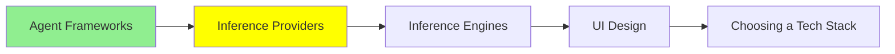

# Inference Provider'lar

[LLM Fundamentals](../1_fundamentals/llms_tr.md) sana bir API key ve ilk çağrıyı verdi. Bu modül o key'in ait olduğu katmanla ilgili. Ayrıca çağrılar bedava olmaktan çıkınca neyin değiştiğini anlatıyor.

Bir **inference provider** modeli kendi donanımında çalıştırıyor ve sana erişimi kiralıyor. Metin gönderiyorsun, metin geri alıyorsun ve token başına ödüyorsun. Ne makinelerin ne de weight'lerin sahibi sensin.

Bu erişimi satın almanın iki yolu var. İkisini birbirinden net ayırmak işe yarar.

## Gateway (Router)

[OpenRouter](https://openrouter.ai/) birçok provider'ın önünde duruyor. Tek key ve tek API şekli kullanıyorsun. İstekteki model adı, isteği hangi provider'ın sunacağına karar veriyor. [LLM Fundamentals](../1_fundamentals/llms_tr.md) bunun nasıl göründüğünü zaten göstermişti. O yüzden burada, öğrenme aşamasından sonra sana ne kazandırdığına bakıyoruz:

- **Modeli tek satırda değiştirebiliyorsun.** Kod aynı kalıyor, sadece bir string değişiyor. Pazartesi yeni bir model çıkarsa, birkaç saat sonra ürününde olabilir. Üç tanesini kendi işin üzerinde bir öğleden sonrada karşılaştırabilirsin de.
- **Key kalabalığı yok.** Her vendor için ayrı bir hesap, ayrı bir faturalama ilişkisi ve ayrı bir rate limit gerekmiyor.
- **Failover.** Bir provider'da kesinti olduğunda istek, başarısız olmak yerine başka bir provider'a gidebiliyor.
- **Aynı model birkaç satıcıdan.** Açık ağırlıklı (open-weights) bir modeli genelde birkaç provider, farklı fiyat ve hızlarda sunuyor. Bir gateway fiyata, gecikmeye (latency) ya da o an hangisi çalışıyorsa ona göre seçmeni sağlıyor.

Bedeli fazladan bir sıçrama (hop): isteğin başka birinin altyapısından geçiyor. Bu biraz gecikme ekliyor. Ayrıca seninle model arasına bir şirket daha koyuyor.

Tek gateway OpenRouter değil. **[Portkey](https://portkey.ai/)** aynı yönlendirme (routing) işini yapıyor, ama düzen farklı. OpenRouter'da kredi alıyorsun, tek bir OpenRouter key'i kullanıyorsun ve tek fatura alıyorsun. Provider'lara senin yerine OpenRouter ödüyor. Portkey'de genelde kendi provider key'lerini getiriyorsun. Portkey'in [gateway](https://github.com/Portkey-AI/gateway)'i açık kaynak, yani onu kendi altyapında çalıştırabiliyorsun.

Portkey routing, retry ve fallback yapıyor. Bunların üzerine, production'daki bir ekibin istediği şeyleri ekliyor:

- guardrail'ler
- observability
- bütçe limitleri
- caching

Palo Alto Networks 2026'da Portkey'i satın aldı. O yüzden Portkey'i bu şirketin adı altında satılırken de görebilirsin.

Bir de farklı türde bir router var ve bu ikisiyle kolayca karıştırılıyor. **[AgentRouter](https://www.agentrouter.to/quick-start)** bir LLM router değil. AI agent'lar için bir API router. Bir agent'a tek bir key ve önceden yüklenmiş tek bir cüzdan (wallet) veriyor. Bunlarla agent birçok API türünü bulabiliyor, parasını ödeyebiliyor ve çağırabiliyor, örneğin:

- e-posta
- telefon ve SMS
- şirket verisi
- web araması
- seyahat rezervasyonu

Model inference, alanlarından sadece biri. Yani fark kapsamda. OpenRouter ya da Portkey gibi bir LLM router model çağrılarını yönlendiriyor. AgentRouter ise bir agent'ın ihtiyaç duyduğuna karar verdiği her ücretli API'yi yönlendiriyor.

AgentRouter cüzdanını tutuyor ve içinden geçirdiğin her çağrıyı görüyor. Sitesi de arkasındaki şirketin adını vermiyor. O yüzden ona, verini işleyen herhangi bir üçüncü taraf gibi davran.

## LLM Vendor'larından Inference

Öbür yol, doğrudan modeli yapan şirkete gitmek: OpenAI, Anthropic ya da Google.

Bunu, sadece modeli yapan şirketin sunduğu şeyleri istediğinde yapıyorsun. Yeni modeller genelde önce orada çıkıyor. Provider'a özel feature'lar da orada ve bunlar küçük şeyler değil:

- uzun bir system prompt'un maliyetini düşüren prompt caching
- indirimli batch endpoint'leri
- en yeni tool-calling davranışı
- bir satış temsilcisiyle konuşarak aldığın daha yüksek rate limit'ler

Tek bir model üzerine kuruyorsan ve deneme aşamasını geçtiysen, genelde sonunda doğrudan gidiyorsun.

İkisini birden yapmana hiçbir şey engel değil. Yaygın bir düzen şu: production'daki model için doğrudan git, geri kalan her şeyi değerlendirmek için bir gateway kullan.

## Fiyatın Ötesinde Neyi Karşılaştırmalı

Milyon token başına fiyat, herkesin söylediği sayı. Tek başına karar vermek için de en kötü sayı. Faturada ve üründe görünen şeyler şunlar:

- **Prompt caching.** System prompt'un uzun ve değişmiyorsa, onu cache'leyen bir provider her tekrar için fiyatın sadece küçük bir kısmını alıyor. Her turda aynı 5.000 token'lık talimat bloğunu gönderen bir agent düşün. Böyle bir agent için prompt caching, maliyeti düşürmenin en büyük tek yolu. [Harness Engineering](../2_intermediate/harness_engineering_tr.md)'deki harness karşılaştırmasının bir sonucunu da bu açıklıyor: en hızlı tool başarı başına en pahalısıydı, çünkü cache'ini neredeyse hiç yeniden kullanmıyordu.
- **Rate limit'ler.** Bunlar dakika başına istek ve token limitleri. İsteklerin kuyrukta bekliyorsa, iyi bir token fiyatının faydası yok.
- **Gecikme, ve hangi türü.** İlk token'a kadar geçen süre, bir sohbette bekleyen insanın hissettiği şey. Toplam süre ise bir batch işinin hissettiği şey. Bunlar farklı sayılar ve provider'lar ikisinde birden iyi değil.
- **Context window ve output limiti.** Bunlar iki ayrı limit. Output limiti, insanların uzun bir cevap yarıda kesilene kadar unuttuğu limit.
- **Verine ne olduğu.** Provider'ın prompt'larını saklayıp saklamadığını, ne kadar süre sakladığını ve onlarla model eğitip eğitemeyeceğini kontrol et. Prompt'larında müşteri verisi varsa, bu kısmı fiyattan önce oku.
- **Quantization.** Bu en çok bir gateway'de önemli. Farklı satıcılar aynı model adını farklı hassasiyetlerde (precision) sunabiliyor. Daha ucuz bir satıcı, daha agresif quantize edilmiş bir kopya çalıştırıyor olabilir. [LLM Fundamentals](../1_fundamentals/llms_tr.md) bunun kaliteye ne mal olduğunu anlatmıştı.

## Bedava Başlamak

Aşağıdaki iki yolun da günlük limitli bedava katmanları (free tier) var. Bu, gerçek bir şey kurmaya yetiyor.

**[Google AI Studio](https://aistudio.google.com/)** büyük vendor'lar arasında en cömert olanı. Kaydoluyorsun ve bir key alıyorsun. Bedava katman da sıradan modelleri günlük bir üst sınırla kapsıyor. **OpenRouter** da günlük limitli bedava modeller sunuyor. Tek bir prompt üzerinde birkaç modeli hesap açmadan denemenin en hızlı yolu bu.

Bedava katmanlar hakkında bir uyarı var, çünkü bu sorun insanları tam yanlış anda yakalıyor. Bedava bir katman, modelin işini yapıp yapamadığını söylüyor. Ürününün nasıl hissettireceği hakkında ise neredeyse hiçbir şey söylemiyor. Bedava kapasite daha yavaş ve rate limit'leri daha sert. Provider meşgulken ilk kesilen kapasite de bu. Gecikmeyi, ödemeyi planladığın katmanda ölç.

## Bu serinin neresindeyiz

## Özet

Bir inference provider modeli çalıştırıyor ve sana token başına erişim kiralıyor. Bu erişimi ya bir gateway üzerinden ya da doğrudan modeli yapandan satın alıyorsun.

Bilinmesi gereken gateway OpenRouter. Bir gateway sana şunları veriyor:

- birçok model için tek key
- tek satırlık model değişimi
- bir provider düştüğünde failover
- aynı açık ağırlıklı model için satıcı seçimi

Bedeli fazladan bir sıçrama. Portkey aynı işi senin kendi provider key'lerinle yapıyor. Gateway'i açık kaynak, yani kendin barındırabiliyorsun. AgentRouter ise başka bir şey: sadece model çağrılarını değil, bir agent'ın çağırdığı her ücretli API'yi yönlendiriyor.

Doğrudan gitmek, sadece modeli yapanın sunduğu şeyleri veriyor:

- önce yeni modeller
- prompt caching
- batch indirimleri
- pazarlıkla aldığın rate limit'ler

Çoğu ekip modelleri değerlendirmek için bir gateway kullanıyor, ürüne koyduğu model için ise doğrudan gidiyor.

Provider'ları karşılaştırırken token başına fiyat, sayfadaki en az faydalı sayı. Şunların hepsi daha belirleyici:

- prompt caching
- rate limit'ler
- ilk token'a kadar süre
- output limiti
- veri politikası

Ve gecikmeyi ücretli katmanda ölç, çünkü bedava katman, yayınladığın ürün değil.

**Hızlı Kontrol**: agent'ın her turda aynı uzun system prompt'u gönderiyor. Bir provider'ın fiyat sayfasındaki hangi satır en çok önemli? Ve neden token başına fiyat değil?

## Kaynaklar

- [OpenRouter](https://openrouter.ai/): birçok model için tek key, ve onları karşılaştırmanın en hızlı yolu
- [Portkey](https://portkey.ai/) ve açık kaynak [gateway](https://github.com/Portkey-AI/gateway)'i: kendi key'lerinle routing, artı guardrail'ler ve observability
- [AgentRouter](https://www.agentrouter.to/quick-start): bir agent'ın çağırdığı ücretli API'ler için tek key ve tek cüzdan
- [Google AI Studio](https://aistudio.google.com/): bedava bir key ve günlük bir hak, öğrenmeye yeter
- [LLM Fundamentals](../1_fundamentals/llms_tr.md): ilk API çağrısının ve quantization ödününün anlatıldığı yer
