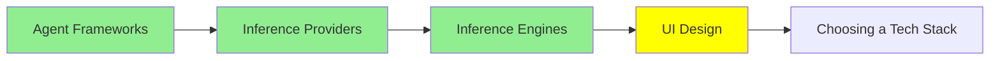

# UI Design

An agent that writes code will happily write you an interface. The problem is that it writes a different one every time.

Ask for a settings page today and a dashboard tomorrow. You get two screens that clearly came from two different products:

- different blues
- different corner radius
- different button heights
- a different idea of how heavy a heading should be

Each one looks fine alone. Together, they look like nobody was in charge.

This module is about the two tools that generate interfaces properly. It is also about the fix for that problem. The fix turns out to be the same idea as `AGENTS.md` in [Code Agents](../2_intermediate/coding_agents.md): a plain file in the repository that the agent reads.

## Two Tools That Turn a Description into a Screen

**[Google Stitch](https://stitch.withgoogle.com/)** takes a prompt, an image, a rough sketch or a spoken description. From that, it produces a high-fidelity interface, plus the HTML and CSS behind it. It came out of Google Labs at I/O 2025, and it runs on Gemini. The part that designers care about is the export. One click sends the whole design into Figma, and the layout, the components and the structure arrive unchanged. So it is useful on both sides of the handoff, which is the moment when designers pass their work on to developers. It works whether you want a picture to argue about or markup to build on.

**[Claude Design](https://claude.ai/design)** comes from Anthropic Labs and launched in April 2026. It does the same job from the other direction. It produces prototypes, slides, one-pagers and interactive pieces as real HTML, CSS and JavaScript. Two things make it interesting. First, it can take an existing **codebase** as the input. It finds the design system that is already in that code, and it applies that design system to whatever you ask for next. Second, it passes the work directly to Claude Code. That closes the gap between a prototype and the actual repository.

Between the two tools, the pattern is clear enough. Describing a screen is now faster than drawing one. And the output is code, not a picture of code.

## A Design System, and Why the Agent Needs it in a File

A **design system** is the set of decisions you make once, so that you do not have to make them again. It covers:

- your colours, and what each one is for
- the type scale
- the spacing steps
- the corner radius
- how a button looks in each of its states

Design teams have kept these for years. What changed is who else needs to read them.

An agent that generates a screen has to make every one of those decisions while it builds the screen. It has no way to know your decisions. So it invents decisions that look plausible, and on Tuesday the answer is different. You can tell it your decisions in the prompt. That works for one screen, and it stops working at the second one.

The fix is the same one that worked for instructions. Write the decisions down in a file in the repository, and let the agent read it.

## DESIGN.md

`DESIGN.md` is that file. It is a convention that came out of Stitch, and it now works with any agent that reads project instructions. Put it at the repository root with that exact name, and most agents find it on their own.

It holds two kinds of content, and it needs both:

- **The tokens**, which are exact values. These are the hex codes, the type scale, the spacing steps, the radii and the component states.
- **The intent**, in words. This says what the design is trying to feel like, what it avoids on purpose, and why the accent colour appears only in a few places. A token list cannot carry this part. It is what stops an agent from applying your palette to a layout you would never ship.

The demonstration is worth knowing because it is so direct. Take one prompt and add a `DESIGN.md` modelled on Stripe. You get Stripe's palette and spacing. Now swap in a different brand's file and change nothing else. The output changes to match the new file. [awesome-design-md](https://github.com/VoltAgent/awesome-design-md) collects community files for popular brands. So the fastest way to see the effect is this: put one of those files in your repository, then re-run a prompt that you have already run.

Notice where we have arrived. `AGENTS.md` holds the rules for working in the repository. `SOUL.md`, from [Personal Agents](../2_intermediate/personal_agents.md), holds who an agent is. And `DESIGN.md` holds what the product looks like. It is the same format, in the same location, for the same reason. Markdown sits exactly at the point where a human can write it comfortably and a model can parse it reliably. And because it lives in the repository, it gets versioned and reviewed like anything else.

## What They Still Do Not Do

It is worth being honest about this, because the demos are persuasive.

These tools give you a plausible screen fast. They do not give you what a designer gives you, which is knowing what the screen is for. That means knowing what the user is trying to finish, what should be hard to do by accident, and what to leave out. A tool can generate the third-best layout instantly, and you can still be solving the wrong problem instantly.

Accessibility is a clear example of that gap. It means that every person can use the screen, including a person who uses only a keyboard or a screen reader. A generated interface is often wrong in these ways:

- contrast that fails the ratio check
- focus states that were left out
- a control that only works with a mouse
- an icon button with no name for a screen reader

None of these show up in a screenshot. Check them yourself.

## Where this fits in the series

## Summary

An agent will write you an interface. If you leave it alone, it writes a different one every time. That is because it has to invent your design decisions while it works.

Google Stitch turns a prompt, an image or a sketch into a high-fidelity screen with HTML and CSS. It also exports the whole design into Figma. Claude Design produces real HTML, CSS and JavaScript. It can read the design system out of an existing codebase, and it passes the work on to Claude Code.

The fix for the inconsistency is `DESIGN.md`. It holds your tokens and your intent, in markdown, at the repository root, where the agent finds it. In the demonstration, you swap one brand's file for another and change nothing else. The output changes. It is the same approach as `AGENTS.md` and `SOUL.md`, and it works for the same reason.

None of it gives you judgement about what the screen is for. None of it gives you an accessible result either. Generated interfaces regularly fail on contrast, focus and keyboard access, and a screenshot will not tell you that.

**Quick Check**: you put your palette in the prompt, but the second screen still looks wrong. What does `DESIGN.md` hold that a prompt does not?

## References

- [Google Stitch](https://stitch.withgoogle.com/): turns a prompt, an image or a sketch into a real interface, and exports it to Figma in one click
- [From idea to app: Introducing Stitch](https://developers.googleblog.com/stitch-a-new-way-to-design-uis/): Google's own announcement, and where the DESIGN.md convention comes from
- [Claude Design](https://claude.ai/design): makes prototypes as real code, and can read the design system out of a codebase
- [awesome-design-md](https://github.com/VoltAgent/awesome-design-md): ready-made DESIGN.md files for well-known brands, so you can see the effect in one run
