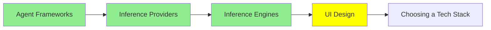

# UI Design

یه agent که کد می‌نویسه، با کمال میل برات یه interface هم می‌سازه. ولی مشکلش اینه که هر بار یه interface متفاوت می‌سازه.

مثلاً امروز ازش یه صفحه‌ی تنظیمات می‌خوای و فردا یه dashboard. آخرش دو تا صفحه تحویل می‌گیری که معلومه از دو تا محصول کاملاً جدا اومدن:

- رنگ آبی‌ها فرق داره
- گردی گوشه‌ها (corner radius) متفاوته
- ارتفاع دکمه‌ها فرق داره
- یه نظر دیگه درباره‌ی اینکه عنوان‌ها چقدر باید پررنگ باشن

هر کدوم به تنهایی خوب به نظر می‌رسه. ولی وقتی کنار هم می‌ذاریشون، انگار اصلاً هیچ‌کس این وسط کاره‌ای نبوده.

این module درباره‌ی دو تا tool حرف می‌زنه که می‌تونن interface رو درست و حسابی تولید کنن. درباره‌ی راه‌حل این مشکل هم هست، و جالب اینجاست که این راه‌حل همون ترفندیه که توی [Code Agent‌ها](../2_intermediate/coding_agents_fa.md) دیدیم.

## دو tool که از یه توصیف، صفحه می‌سازن

**[Google Stitch](https://stitch.withgoogle.com/)** یه prompt می‌گیره، یه عکس، یه کروکی سرسری، یا حتی یه توصیف گفتاری. از روی هر کدوم، یه interface کامل و high-fidelity درمیاره، به‌علاوه‌ی HTML و CSS پشتش. Stitch از Google Labs اومده و توی I/O 2025 معرفی شد، و زیر پوستش Gemini کار می‌کنه. اما بخشی که طراح‌ها بیشتر بهش اهمیت می‌دن، export کردنشه. با یه کلیک کل طرح می‌ره توی Figma، و layout و component‌ها و ساختارش دست‌نخورده می‌رسن. پس Stitch از هر دو طرف handoff، یعنی از طراحی تا توسعه، به درد می‌خوره. فرقی هم نداره بخوای یه تصویر داشته باشی که سرش بحث کنی، یا یه markup که بشه روش کار کرد.

**[Claude Design](https://claude.ai/design)** از Anthropic Labs اومده و آوریل 2026 منتشر شد. همون کار رو از سمت دیگه‌ای انجام می‌ده. prototype، اسلاید، one-pager و قطعه‌های تعاملی رو به شکل HTML و CSS و JavaScript واقعی می‌سازه. دو چیزش خیلی جالبه، و اولش اینکه می‌تونه یه **codebase** موجود رو به‌عنوان ورودی بگیره. design system‌ای رو که توی همون کد هست پیدا می‌کنه، و هر چیزی رو که بعداً ازش بخوای، با همون design system می‌سازه. دوم اینکه کارش رو مستقیم می‌ده دست Claude Code. این یعنی فاصله‌ی بین یه prototype و repository واقعی برداشته می‌شه.

بین این دو تا tool یه الگوی روشن شکل گرفته. الان توصیف کردن یه صفحه از کشیدنش سریع‌تره، و خروجی هم کد واقعیه، نه تصویری از کد.

## design system چیه و چرا agent به یه فایل نیاز داره

**design system** یعنی مجموعه‌ی تصمیم‌هایی که یه بار می‌گیری، تا دیگه لازم نباشه هر بار از نو بگیریشون. این تصمیم‌ها این موارد رو شامل می‌شن:

- رنگ‌هات و اینکه هر کدوم برای چی به کار می‌رن
- type scale، یعنی اندازه‌ی متن‌ها توی هر سطح
- spacing steps، یعنی فاصله‌ها
- corner radius، یعنی میزان گرد بودن گوشه‌ها
- اینکه یه دکمه توی هر حالتش چه شکلی باشه

تیم‌های طراحی سال‌هاست این‌ها رو نگه می‌دارن. چیزی که عوض شده اینه که حالا کسای دیگه‌ای هم باید بخونن‌شون.

یه agent که صفحه می‌سازه، باید همه‌ی این تصمیم‌ها رو وسط ساختن صفحه خودش بگیره. راهی نداره که تصمیم‌های تو رو بدونه، پس تصمیم‌هایی رو اختراع می‌کنه که به نظر درست میان. فردا که همون درخواست رو بدی، جوابش فرق داره. می‌تونی تصمیم‌هات رو توی prompt بهش بگی، و این برای یه صفحه جواب می‌ده، ولی از صفحه‌ی دوم دیگه جواب نمی‌ده.

راه‌حل همون چیزیه که برای دستورالعمل‌ها جواب داد. تصمیم‌ها رو توی یه فایل داخل repository بنویس و بذار agent اون رو بخونه.

## DESIGN.md

`DESIGN.md` همون فایله، یه قرارداد (convention) که از Stitch شروع شد و حالا با هر agent که دستورالعمل‌های پروژه رو می‌خونه کار می‌کنه. فقط کافیه با همین اسم توی ریشه‌ی repository بذاریش، اون‌وقت بیشتر agent‌ها خودشون پیداش می‌کنن.

این فایل دو نوع محتوا نگه می‌داره و هر دوتاش لازمه:

- **token‌ها**، یعنی مقدارهای دقیق. مثل hex code‌ها، type scale، spacing steps، radius‌ها و حالت‌های هر component.
- **intent**، یعنی نیت طراحی به صورت کلمات. این بخش می‌گه طراحی قراره چه حسی بده، عمداً از چی دوری می‌کنه، و چرا رنگ accent فقط توی چند جای محدود دیده می‌شه. یه لیست token نمی‌تونه این بخش رو حمل کنه. همین بخشه که جلوی agent رو می‌گیره تا palette تو رو روی یه layout نذاره که هیچ‌وقت منتشرش نمی‌کردی.

ارزش داره این نمایش رو ببینی، چون خیلی مستقیمه. یه prompt رو بردار و یه `DESIGN.md` کنارش بذار که الگوش Stripe باشه. اون‌وقت palette و spacing خود Stripe رو می‌گیری. حالا فایل یه برند دیگه رو جاش بذار و هیچ چیز دیگه‌ای رو عوض نکن. خروجی هم عوض می‌شه تا با فایل جدید جور باشه. [awesome-design-md](https://github.com/VoltAgent/awesome-design-md) فایل‌های آماده‌ی برندهای معروف رو جمع کرده که کاربرها ساختن. پس سریع‌ترین راه برای دیدن این اثر اینه که یکی از این فایل‌ها رو توی repository بذاری و بعد یه prompt رو که قبلاً اجرا کردی دوباره اجرا کنی.

ببین به کجا رسیدیم. `AGENTS.md` قوانین کار کردن توی repository رو نگه می‌داره. `SOUL.md` که توی [Personal Agent‌ها](../2_intermediate/personal_agents_fa.md) ازش حرف زدیم، می‌گه یه agent کیه. و `DESIGN.md` می‌گه محصول چه شکلیه. هر سه همون فرمت رو دارن، همون جا قرار می‌گیرن و به همون دلیل نوشته شدن. markdown دقیقاً همون نقطه‌ایه که آدم راحت می‌تونه بنویسدش و مدل هم می‌تونه بی‌دردسر parse کنه. و چون این فایل توی repository زندگی می‌کنه، مثل هر چیز دیگه‌ای نسخه‌بندی و review می‌شه.

## چیزهایی که این tool‌ها هنوز انجام نمی‌دن

ارزش داره دربارش صادق باشیم، چون demo‌ها خیلی قانع‌کننده‌ن.

این tool‌ها خیلی سریع یه صفحه‌ی باورپذیر بهت می‌دن. ولی کاری رو که یه طراح واقعی انجام می‌ده، انجام نمی‌دن، و اون کار اینه که بدونه صفحه برای چیه. یعنی بدونه کاربر دقیقاً داره سعی می‌کنه چی رو تموم کنه، کدوم کارها باید سخت باشن تا آدم اتفاقی انجامشون نده، و چی رو باید کنار بذاره. یه tool می‌تونه سومین بهترین layout رو فوری بسازه، و تو هم با همین سرعت ممکنه داری مسئله‌ی اشتباهی رو حل می‌کنی.

accessibility نمونه‌ی ملموس همین ماجراست، و interface تولیدشده اغلب توی این موارد اشتباه از آب درمیاد:

- contrast که توی تست ratio رد نمی‌شه
- حالت‌های focus که اصلاً گذاشته نشدن
- کنترلی که فقط با ماوس کار می‌کنه
- دکمه‌ی icon که برای screen reader هیچ اسمی نداره

هیچ‌کدوم از این‌ها توی screenshot دیده نمی‌شن، پس خودت باید یکی‌یکی بررسی‌شون کنی.

## کجای این مجموعه هستیم

## خلاصه

یه agent برات interface می‌نویسه، و اگه بی‌خیالش بشی، هر بار یه چیز متفاوت می‌نویسه، چون وسط کار باید تصمیم‌های طراحی تو رو خودش اختراع کنه.

Google Stitch یه prompt، عکس یا کروکی رو به یه صفحه‌ی high-fidelity با HTML و CSS تبدیل می‌کنه، و کل طرح رو هم به Figma export می‌کنه. Claude Design هم HTML و CSS و JavaScript واقعی می‌سازه. می‌تونه design system رو از یه codebase موجود بخونه و کارش رو بده دست Claude Code.

راه‌حل این ناهماهنگی، `DESIGN.md` هست. این فایل token‌ها و intent تو رو، به شکل markdown، توی ریشه‌ی repository نگه می‌داره، جایی که agent پیداش می‌کنه. توی اون نمایش فقط فایل یه برند رو با فایل برند دیگه عوض کردی، هیچ چیز دیگه‌ای رو دست نزدی، و خروجی هم عوض شد. این همون رویکردیه که `AGENTS.md` و `SOUL.md` ازش استفاده می‌کنن، و به همون دلیل هم جواب می‌ده.

هیچ‌کدوم از این‌ها قضاوت درباره‌ی اینکه صفحه برای چیه رو بهت نمی‌ده. نتیجه‌ی accessible هم بهت نمی‌ده. interface‌های تولیدشده مرتب توی contrast و focus و دسترسی با keyboard شکست می‌خورن، و یه screenshot این مشکل‌ها رو بهت نشون نمی‌ده.

**بررسی سریع**: تو palette رو توی prompt گذاشتی، ولی صفحه‌ی دومت باز هم درست به نظر نمی‌رسه. `DESIGN.md` چی داره که یه prompt نداره؟

## منابع

- [Google Stitch](https://stitch.withgoogle.com/): یه prompt، عکس یا کروکی رو به یه interface واقعی تبدیل می‌کنه و با یه کلیک به Figma می‌بره.
- [From idea to app: Introducing Stitch](https://developers.googleblog.com/stitch-a-new-way-to-design-uis/): اعلام رسمی خود گوگل، و منبعی که قرارداد DESIGN.md ازش شروع شد.
- [Claude Design](https://claude.ai/design): prototype رو به شکل کد واقعی می‌سازه و می‌تونه design system رو از یه codebase بخونه.
- [awesome-design-md](https://github.com/VoltAgent/awesome-design-md): فایل‌های آماده‌ی DESIGN.md برای برندهای معروف، تا اثرش رو توی یه اجرا ببینی.
