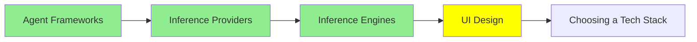

# UI Design

agent‌ی که کد می‌نویسه، با کمال میل برات interface هم می‌سازه؛ مشکل اینجاست که هر بار یه چیز متفاوت تحویلت می‌ده.

امروز ازش یه صفحه‌ی تنظیمات بخواه و فردا یه dashboard. دو تا صفحه تحویل می‌گیری که معلومه مال دو تا محصول جدان:

- آبی‌هاشون با هم فرق داره
- گردی گوشه‌هاشون (corner radius) یکی نیست
- ارتفاع دکمه‌هاشون فرق داره
- هر کدوم یه جور دیگه فکر کرده که تیترها چقدر باید پررنگ باشن

هر کدوم جدا جدا قشنگه، ولی کنار هم که بذاریشون، انگار هیچ‌کس بالای سر کار نبوده.

این درس درباره‌ی دو تا ابزاره که درست و حسابی interface تولید می‌کنن، و درباره‌ی راه‌حل همین مشکل؛ راه‌حلی که اتفاقاً همون ایده‌ی `AGENTS.md`‌ه که توی [Code Agent‌ها](../2_intermediate/coding_agents_fa.md) دیدیم: یه فایل ساده توی repository که agent می‌خونتش.

## دو ابزار که از یه توضیح، صفحه می‌سازن

**[Google Stitch](https://stitch.withgoogle.com/)** یه prompt، یه عکس، یه طرح دستی سرسری یا حتی یه توضیح شفاهی می‌گیره و ازش یه interface با جزئیات کامل (high-fidelity) درمیاره، همراه با HTML و CSS پشتش. Stitch توی I/O 2025 از Google Labs بیرون اومد و با Gemini کار می‌کنه. چیزی که برای طراح‌ها مهمه، امکان export‌ه: با یه کلیک کل طرح می‌ره توی Figma، و layout و component‌ها و ساختارش دست‌نخورده می‌رسن. برای همین، هر دو طرف تحویل کار از طراحی به توسعه (handoff) می‌تونن ازش استفاده کنن؛ چه یه تصویر بخوای که سرش بحث کنید، چه markup‌ی که روش بسازی.

**[Claude Design](https://claude.ai/design)** کار Anthropic Labs‌ه و آوریل 2026 منتشر شد. همین کار رو از اون طرف انجام می‌ده: prototype، اسلاید، one-pager و چیزهای تعاملی رو به شکل HTML و CSS و JavaScript واقعی می‌سازه. دو تا چیزش جالبه. اول اینکه می‌تونه یه **codebase** موجود رو به‌عنوان ورودی بگیره، design system‌ی که از قبل توی اون کد هست رو پیدا کنه، و هر چی بعداً ازش خواستی رو با همون design system بسازه. دوم اینکه کار رو مستقیم می‌سپره دست Claude Code، و این‌طوری فاصله‌ی بین prototype و repository واقعی از بین می‌ره.

این دو تا ابزار رو که کنار هم بذاری، الگو کاملاً روشنه: الان توضیح دادن یه صفحه از کشیدنش سریع‌تره، و خروجیش هم خود کده، نه عکسی از کد.

## Design System، و چرا باید توی یه فایل باشه

**design system** مجموعه‌ی تصمیم‌هاییه که یه بار می‌گیری که دیگه لازم نباشه هر بار از نو بگیری. این‌ها رو شامل می‌شه:

- رنگ‌هات، و اینکه هر کدوم برای چیه
- type scale، یعنی پله‌های اندازه‌ی متن
- پله‌های فاصله‌گذاری (spacing)
- گردی گوشه‌ها (corner radius)
- اینکه یه دکمه توی هر حالتش چه شکلیه

تیم‌های طراحی سال‌هاست این‌ها رو دارن؛ چیزی که عوض شده اینه که حالا یکی دیگه هم باید بخونتشون.

agent‌ی که صفحه می‌سازه، وسط ساختن مجبوره تک‌تک این تصمیم‌ها رو بگیره، و هیچ راهی نداره که بدونه تصمیم‌های تو چی بوده. پس یه چیزهایی از خودش درمیاره که معقول به نظر بیان، و سه‌شنبه یه جواب دیگه می‌ده. می‌تونی تصمیم‌هات رو توی prompt بهش بگی؛ برای یه صفحه جواب می‌ده، ولی از صفحه‌ی دوم دیگه نه.

راه‌حل همونیه که برای دستورالعمل‌ها جواب داد: تصمیم‌ها رو توی یه فایل داخل repository بنویس و بذار agent خودش بخونتش.

## DESIGN.md

`DESIGN.md` همون فایله: یه قرارداد (convention) که از Stitch شروع شد و حالا با هر agent‌ی که دستورالعمل‌های پروژه رو می‌خونه کار می‌کنه. دقیقاً با همین اسم توی ریشه‌ی repository بذارش، بیشتر agent‌ها خودشون پیداش می‌کنن.

دو جور محتوا توشه، و هر دوش لازمه:

- **token‌ها**، یعنی مقدارهای دقیق: hex code‌ها، type scale، پله‌های spacing، radius‌ها و حالت‌های component‌ها.
- **intent**، یعنی نیت طراحی، به زبون آدمیزاد: اینکه طراحی قراره چه حسی بده، عمداً از چی دوری می‌کنه، و چرا رنگ accent فقط چند جای محدود دیده می‌شه. این قسمت توی یه لیست token جا نمی‌شه، و همینه که نمی‌ذاره agent پالت تو رو روی layout‌ی پیاده کنه که خودت هیچ‌وقت منتشرش نمی‌کردی.

یه آزمایش ساده هست که ارزش داره بدونی، چون خیلی سرراست نتیجه رو نشون می‌ده. یه prompt بردار و یه `DESIGN.md` بهش اضافه کن که از روی Stripe ساخته شده؛ palette و spacing خود Stripe رو تحویل می‌گیری. حالا فایل یه برند دیگه رو جاش بذار و به هیچ چیز دیگه دست نزن؛ خروجی عوض می‌شه و با فایل جدید جور درمیاد. [awesome-design-md](https://github.com/VoltAgent/awesome-design-md) فایل‌هایی رو که community برای برندهای معروف نوشته جمع کرده، پس سریع‌ترین راه برای دیدن این اثر اینه که یکی از همین فایل‌ها رو توی repository‌ت بذاری و یه prompt که قبلاً اجرا کردی رو دوباره اجرا کنی.

حالا ببین به کجا رسیدیم. `AGENTS.md` قانون‌های کار توی repository رو نگه می‌داره، `SOUL.md` از [Personal Agent‌ها](../2_intermediate/personal_agents_fa.md) می‌گه agent کیه، و `DESIGN.md` می‌گه محصول چه شکلیه. هر سه یه فرمت دارن، یه جا می‌شینن، و به یه دلیل اونجان: markdown دقیقاً جاییه که هم آدم راحت می‌تونه بنویسدش، هم مدل با اطمینان parse‌ش می‌کنه. و چون توی repository‌ه، مثل بقیه‌ی کدها نسخه‌بندی و review می‌شه.

## چیزهایی که هنوز از دستشون برنمیاد

اینجا باید رو راست بود، چون demo‌ها حسابی آدم رو قانع می‌کنن.

این ابزارها خیلی سریع یه صفحه‌ی قابل‌قبول بهت می‌دن، ولی چیزی که یه طراح بهت می‌ده رو نمی‌دن: اینکه بدونه این صفحه اصلاً برای چیه. یعنی بدونه کاربر داره سعی می‌کنه چه کاری رو تموم کنه، چه کاری نباید بشه اشتباهی انجامش داد، و چی رو باید کلاً کنار گذاشت. یه ابزار می‌تونه در یه چشم به هم زدن یه layout بسازه که بد نیست ولی بهترین هم نیست، و تو هم با همون سرعت ممکنه داری یه مسئله‌ی اشتباه رو حل می‌کنی.

نمونه‌ی ملموسش accessibility‌ه، یعنی اینکه همه بتونن از صفحه استفاده کنن، حتی کسی که فقط با keyboard یا screen reader کار می‌کنه. interface‌ی که این ابزارها تولید می‌کنن اغلب این ایرادها رو داره:

- contrast‌ی که توی تست ratio رد می‌شه
- حالت‌های focus که کلاً جا افتادن
- کنترلی که فقط با ماوس کار می‌کنه
- دکمه‌ی آیکونی که هیچ اسمی برای screen reader نداره

هیچ‌کدوم از این‌ها توی screenshot معلوم نیست، پس خودت چکشون کن.

## کجای این مجموعه هستیم

## خلاصه

agent برات interface می‌نویسه، ولی اگه به حال خودش ولش کنی، هر بار یه چیز متفاوت می‌نویسه، چون وسط کار مجبوره تصمیم‌های طراحی تو رو از خودش دربیاره.

Google Stitch از یه prompt، عکس یا طرح دستی یه صفحه‌ی high-fidelity با HTML و CSS می‌سازه و کل طرح رو هم به Figma export می‌کنه. Claude Design، HTML و CSS و JavaScript واقعی می‌سازه، design system رو از دل یه codebase موجود بیرون می‌کشه، و کار رو می‌سپره دست Claude Code.

راه‌حل این ناهماهنگی، فایل `DESIGN.md` هست، که token‌ها و intent تو رو به شکل markdown توی ریشه‌ی repository نگه می‌داره، جایی که agent پیداش می‌کنه. توی اون آزمایش، فقط فایل یه برند رو با یه برند دیگه عوض می‌کنی و به هیچ چیز دیگه دست نمی‌زنی، و خروجی عوض می‌شه. این همون روشیه که `AGENTS.md` و `SOUL.md` دارن، و به همون دلیل هم جواب می‌ده.

ولی هیچ‌کدوم از این‌ها بهت نمی‌گه این صفحه اصلاً برای چیه، و تضمین هم نمی‌کنه نتیجه accessible باشه. interface‌های تولیدشده مرتب توی contrast و focus و کار با keyboard کم میارن، و screenshot هم این رو بهت نشون نمی‌ده.

**بررسی سریع**: palette‌ت رو توی prompt گذاشتی، ولی صفحه‌ی دوم باز هم یه جای کارش می‌لنگه. `DESIGN.md` چی داره که prompt نداره؟

## منابع

- [Google Stitch](https://stitch.withgoogle.com/): از یه prompt، عکس یا طرح دستی، یه interface واقعی می‌سازه و با یه کلیک می‌فرستدش توی Figma
- [From idea to app: Introducing Stitch](https://developers.googleblog.com/stitch-a-new-way-to-design-uis/): اعلام رسمی خود گوگل، و جایی که قرارداد DESIGN.md از اونجا شروع شد
- [Claude Design](https://claude.ai/design): prototype رو به شکل کد واقعی می‌سازه، و می‌تونه design system رو از دل یه codebase بخونه
- [awesome-design-md](https://github.com/VoltAgent/awesome-design-md): فایل‌های DESIGN.md آماده برای برندهای معروف، که اثرش رو با یه بار اجرا ببینی
