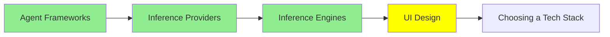

# UI Design

یک agent که کد می‌نویسد، با کمال میل برای شما یک interface هم می‌نویسد. مشکل این است که هر بار یک interface متفاوت می‌نویسد.

امروز یک صفحه تنظیمات بخواهید و فردا یک dashboard. دو صفحه دریافت می‌کنید که واضح است از دو محصول متفاوت آمده‌اند:

- آبی‌های متفاوت
- corner radius متفاوت
- ارتفاع دکمه‌های متفاوت
- یک ایده متفاوت درباره اینکه heading باید چقدر پررنگ باشد

هر کدام به‌تنهایی خوب به نظر می‌رسند. اما وقتی کنار هم قرار می‌گیرند، به نظر می‌رسد هیچ‌کس مسئول نبوده است.

این ماژول درباره دو tool است که interface را به‌درستی تولید می‌کنند. همچنین درباره راه‌حل آن مشکل است. معلوم می‌شود راه‌حل همان ترفندی است که در [Code Agent‌ها](../2_intermediate/coding_agents_fa.md) به کار رفت.

## دو Tool که یک توصیف را به صفحه تبدیل می‌کنند

**[Google Stitch](https://stitch.withgoogle.com/)** یک prompt، یک تصویر، یک طرح سرانگشتی (rough sketch) یا یک توصیف گفتاری می‌گیرد. از روی آن یک interface با وفاداری بالا (high-fidelity) می‌سازد، همراه با HTML و CSS پشت آن. این tool در I/O 2025 از Google Labs معرفی شد و روی Gemini اجرا می‌شود. بخشی که طراح‌ها به آن اهمیت می‌دهند، export است. با یک کلیک، کل طرح به Figma فرستاده می‌شود و layout، component‌ها و ساختار بدون تغییر منتقل می‌شوند. پس این tool با هر دو طرف انتقال از طراحی به توسعه (handoff) جور است. هم وقتی یک تصویر برای بحث می‌خواهید کار می‌کند، هم وقتی markup‌ای برای ساختن روی آن لازم دارید.

**[Claude Design](https://claude.ai/design)** از Anthropic Labs می‌آید و در آوریل 2026 معرفی شد. همان کار را از جهت مخالف انجام می‌دهد. این tool، prototype‌ها، slide‌ها، one-pager‌ها و قطعه‌های تعاملی را به صورت HTML، CSS و JavaScript واقعی تولید می‌کند. دو چیز آن را جالب می‌کند. اول اینکه می‌تواند یک **codebase** موجود را به عنوان ورودی بگیرد. design system‌ای را که از قبل در همان کد است پیدا می‌کند، و آن design system را روی هر چیزی که بعداً درخواست کنید اعمال می‌کند. دوم اینکه کار را مستقیم به Claude Code می‌سپارد. این کار فاصله بین یک prototype و repository واقعی را پر می‌کند.

از مقایسه این دو tool، الگو به اندازه کافی روشن است. حالا توصیف یک صفحه از کشیدن یکی سریع‌تر است. و خروجی کد است، نه تصویری از کد.

## یک Design System، و چرا Agent به آن در یک فایل نیاز دارد

یک **design system** مجموعه تصمیم‌هایی است که یک بار می‌گیرید، تا دیگر مجبور نباشید آن‌ها را دوباره بگیرید. شامل موارد زیر است:

- رنگ‌هایتان و کاربرد هر کدام
- type scale
- spacing steps
- corner radius
- شکل یک دکمه در هر یک از حالت‌هایش

تیم‌های طراحی سال‌ها این‌ها را نگه داشته‌اند. آنچه تغییر کرده این است که چه کسان دیگری باید آن‌ها را بخوانند.

یک agent که یک صفحه تولید می‌کند، باید هنگام ساختن آن صفحه، همه این تصمیم‌ها را خودش بگیرد. راهی برای دانستن تصمیم‌های شما ندارد. پس تصمیم‌هایی را اختراع می‌کند که باورپذیر به نظر می‌رسند، و روز سه‌شنبه جواب فرق می‌کند. می‌توانید تصمیم‌هایتان را در prompt به آن بگویید. این برای یک صفحه جواب می‌دهد، و از صفحه دوم دیگر جواب نمی‌دهد.

راه‌حل همان است که برای دستورالعمل‌ها جواب داد. تصمیم‌ها را در یک فایل داخل repository بنویسید، و به agent اجازه دهید آن را بخواند.

## DESIGN.md

`DESIGN.md` همان فایل است. این یک قرارداد (convention) است که از Stitch آمده است، و حالا با هر agent که project instructions را می‌خواند کار می‌کند. آن را با همین نام دقیق در ریشه repository بگذارید، و بیشتر agent‌ها خودشان آن را پیدا می‌کنند.

این فایل دو نوع محتوا نگه می‌دارد، و به هر دو نیاز دارد:

- **token‌ها**، که مقدارهای دقیق هستند. این‌ها عبارت‌اند از hex code‌ها، type scale، spacing steps، radius‌ها و component state‌ها.
- **نیت طراحی (intent)**، به صورت کلمات. این بخش می‌گوید طراحی می‌خواهد چه حسی بدهد، عمداً از چه چیزی دوری می‌کند، و چرا رنگ accent فقط در چند جا دیده می‌شود. یک فهرست token نمی‌تواند این بخش را حمل کند. همین بخش جلوی agent را می‌گیرد تا palette شما را روی یک layout اعمال نکند که هرگز آن را منتشر نمی‌کردید.

ارزش دارد این نمایش را بدانید، چون خیلی مستقیم است. یک prompt را بردارید و یک `DESIGN.md` را که بر اساس Stripe ساخته شده به آن اضافه کنید. palette و spacing‌های Stripe را می‌گیرید. حالا فایل یک برند دیگر را جایگزین کنید و هیچ چیز دیگری را تغییر ندهید. خروجی تغییر می‌کند تا با فایل جدید جور شود. [awesome-design-md](https://github.com/VoltAgent/awesome-design-md) فایل‌های جامعه را برای برندهای معروف گردآوری می‌کند. پس سریع‌ترین راه برای دیدن این اثر این است: یکی از آن فایل‌ها را در repository خود بگذارید، و سپس prompt‌ای را که قبلاً اجرا کرده‌اید دوباره اجرا کنید.

ببینید به کجا رسیده‌ایم. `AGENTS.md` قوانین کار در repository را نگه می‌دارد. `SOUL.md` که در [Personal Agent‌ها](../2_intermediate/personal_agents_fa.md) آمده است، مشخص می‌کند یک agent کیست. و `DESIGN.md` نگه می‌دارد که محصول چه شکلی است. هر سه قالب یکسان، مکان یکسان و دلیل یکسان دارند. Markdown دقیقاً در نقطه‌ای قرار دارد که یک انسان می‌تواند آن را راحت بنویسد و یک مدل می‌تواند آن را با اطمینان parse کند. و چون در repository است، مثل هر چیز دیگری نسخه‌بندی و review می‌شود.

## آنچه هنوز انجام نمی‌دهند

ارزش دارد در این باره صادق باشیم، چون demo‌ها قانع‌کننده‌اند.

این tool‌ها سریع یک صفحه قابل‌قبول به شما می‌دهند. آنچه یک طراح به شما می‌دهد را این tool‌ها نمی‌دهند، یعنی دانستن هدف صفحه. این یعنی بدانید کاربر چه کاری را می‌خواهد تمام کند، چه کارهایی نباید به‌سادگی و به‌تصادف انجام شوند، و چه چیزی را باید کنار بگذارید. یک tool می‌تواند فوراً سومین بهترین layout را بسازد، و شما هم می‌توانید فوراً مسئله اشتباهی را حل کنید.

دسترس‌پذیری (accessibility) نسخه ملموس همین موضوع است. یک interface تولیدشده اغلب به این روش‌ها اشتباه است:

- contrast ناکافی که در بررسی ratio رد می‌شود
- حالت‌های focus که جا افتاده‌اند
- یک control که فقط با ماوس کار می‌کند
- یک دکمه icon که برای screen reader نامی ندارد

هیچ‌کدام از این‌ها در screenshot دیده نمی‌شوند. خودتان آن‌ها را بررسی کنید.

## کجای این مجموعه هستیم

## خلاصه

یک agent برای شما یک interface می‌نویسد. اگر آن را به حال خودش رها کنید، هر بار یک interface متفاوت می‌نویسد. دلیلش این است که باید تصمیم‌های design شما را در حین کار اختراع کند.

Google Stitch یک prompt، یک تصویر یا یک طرح سرانگشتی را به یک صفحه با وفاداری بالا همراه HTML و CSS تبدیل می‌کند. همچنین کل طرح را به Figma export می‌کند. Claude Design، HTML، CSS و JavaScript واقعی تولید می‌کند. می‌تواند design system را از یک codebase موجود بخواند، و کار را به Claude Code می‌سپارد.

راه‌حل این ناسازگاری `DESIGN.md` است. این فایل token‌ها و intent شما را، به صورت markdown، در ریشه repository نگه می‌دارد، جایی که agent آن را پیدا می‌کند. در نمایش، فایل یک برند را با فایل برند دیگری عوض می‌کنید و هیچ چیز دیگری را تغییر نمی‌دهید. خروجی تغییر می‌کند. این همان رویکرد `AGENTS.md` و `SOUL.md` است، و به همان دلیل کار می‌کند.

هیچ‌کدام از این‌ها قضاوتی درباره هدف صفحه به شما نمی‌دهد. هیچ‌کدام هم نتیجه‌ای دسترس‌پذیر نمی‌دهد. interface‌های تولیدشده به‌طور مرتب در contrast، focus و دسترسی با keyboard شکست می‌خورند، و یک screenshot این را به شما نمی‌گوید.

**بررسی سریع**: شما palette را در prompt گذاشتید، اما صفحه دوم هنوز اشتباه به نظر می‌رسد. `DESIGN.md` چه چیزی را نگه می‌دارد که یک prompt نگه نمی‌دارد؟

## منابع

- [Google Stitch](https://stitch.withgoogle.com/): یک prompt، یک تصویر یا یک طرح سرانگشتی را به یک interface واقعی تبدیل می‌کند و با یک کلیک به Figma export می‌کند
- [From idea to app: Introducing Stitch](https://developers.googleblog.com/stitch-a-new-way-to-design-uis/): اعلام رسمی خود Google، و جایی که قرارداد DESIGN.md از آن آمده است
- [Claude Design](https://claude.ai/design): prototype‌ها را به صورت کد واقعی می‌سازد و می‌تواند design system را از یک codebase بخواند
- [awesome-design-md](https://github.com/VoltAgent/awesome-design-md): فایل‌های DESIGN.md آماده برای برندهای معروف، تا بتوانید اثر را در یک اجرا ببینید
