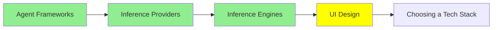

# UI Design

Kod yazan bir agent sana bir arayüz de yazar. Problem, her seferinde farklı bir tane yazması.

Bugün bir ayarlar sayfası, yarın bir dashboard iste. Açıkça iki farklı üründen gelmiş iki ekran alırsın:

- farklı maviler
- farklı köşe yuvarlaklığı
- farklı buton yükseklikleri
- bir başlığın ne kadar kalın olacağı konusunda farklı bir fikir

Her biri tek başına iyi görünüyor. Birlikte bakınca, sanki işin başında kimse yokmuş gibi görünüyorlar.

Bu modül, arayüzü düzgün üreten iki tool'la ilgili. Aynı zamanda o problemin çözümüyle de ilgili. Çözüm de [Code Agent'lar](../2_intermediate/coding_agents_tr.md)'daki hilenin aynısı çıkıyor.

## Bir Açıklamayı Ekrana Çeviren İki Tool

**[Google Stitch](https://stitch.withgoogle.com/)** bir prompt, bir görüntü, kaba bir karalama ya da sesli bir açıklama alıyor. Bundan yüksek doğrulukta (high-fidelity) bir arayüz ve arkasındaki HTML ile CSS'i üretiyor. I/O 2025'te Google Labs'tan çıktı ve Gemini üzerinde çalışıyor. Tasarımcıların önemsediği kısım export. Tek tıkla bütün tasarımı Figma'ya gönderiyor, ve layout, component'ler ve yapı bozulmadan aktarılıyor. Yani tasarımdan geliştirmeye devir teslimin her iki tarafına da uyuyor. Tartışacak bir resim istesen de, üzerine kuracak markup istesen de işe yarıyor.

**[Claude Design](https://claude.ai/design)** Anthropic Labs'tan geliyor ve Nisan 2026'da çıktı. Aynı işi öbür yönden yapıyor. Prototipleri, slaytları, tek sayfalıkları ve etkileşimli parçaları gerçek HTML, CSS ve JavaScript olarak üretiyor. İki şey onu ilginç yapıyor. Birincisi, input olarak mevcut bir **codebase**'i alabiliyor. O kodun içindeki design system'i buluyor ve sonra istediğin her şeye uyguluyor. İkincisi, işi doğrudan Claude Code'a devrediyor. Bu da bir prototiple gerçek repo arasındaki boşluğu kapatıyor.

İki tool'a birlikte bakınca desen yeterince net. Bir ekranı anlatmak artık çizmekten daha hızlı. Ve çıktı kodun resmi değil, kodun kendisi.

## Bir Design System, ve Agent'ın Onu Neden Bir Dosyada İstediği

Bir **design system**, bir kez verdiğin ve böylece tekrar vermek zorunda kalmadığın kararların toplamı. Şunları kapsar:

- renklerin ve her birinin ne için olduğu
- tipografi ölçeği (type scale)
- boşluk adımları
- köşe yuvarlaklığı
- bir butonun her durumunda nasıl göründüğü

Tasarım ekipleri bunları yıllardır tutuyor. Değişen şey, onları başka kimin okuması gerektiği.

Bir ekran üreten agent, o kararların her birini ekranı yaparken vermek zorunda. Senin kararlarını bilmesinin hiçbir yolu yok. Bu yüzden inandırıcı görünen kararlar uyduruyor, ve salı günü cevap farklı oluyor. Kararlarını prompt'ta söyleyebilirsin. Bu tek ekran için işe yarıyor, ama ikinci ekranda artık işe yaramıyor.

Çözüm, talimatlarda işe yarayanın aynısı. Kararları repo'nun içinde bir dosyaya yaz ve agent'ın okumasına izin ver.

## DESIGN.md

`DESIGN.md` o dosya. Stitch'ten çıkan bir konvansiyon, ve artık proje talimatlarını okuyan her agent'la çalışıyor. Onu tam bu isimle repo köküne koy, çoğu agent onu kendi başına bulur.

İki tür içerik tutuyor, ve ikisine de ihtiyacı var:

- **Token'lar**, yani tam değerler. Bunlar hex kodları, tipografi ölçeği, boşluk adımları, köşe yuvarlaklıkları ve component durumları.
- **Niyet**, kelimelerle. Bu kısım tasarımın nasıl bir his vermeye çalıştığını, bilerek neyden kaçındığını ve accent renginin neden az kullanıldığını söyler. Bir token listesi bu kısmı taşıyamaz. Bir agent'ın senin paletini asla yayına almayacağın bir layout'a uygulamasını engelleyen şey budur.

Bu gösterimi bilmeye değer, çünkü çok açık. Tek bir prompt al ve Stripe'a göre modellenmiş bir `DESIGN.md` ekle. Stripe'ın paletini ve boşluklarını alırsın. Şimdi başka bir markanın dosyasını koy ve başka hiçbir şeyi değiştirme. Çıktı yeni dosyaya uyacak şekilde değişir. [awesome-design-md](https://github.com/VoltAgent/awesome-design-md) popüler markalar için topluluk dosyalarını topluyor. Bu yüzden etkiyi görmenin en hızlı yolu şu: o dosyalardan birini repo'na koy, sonra daha önce çalıştırdığın bir prompt'u tekrar çalıştır.

Nereye vardığımıza dikkat et. `AGENTS.md` repo'da çalışmanın kurallarını tutuyor. [Personal Agent'lar](../2_intermediate/personal_agents_tr.md)'daki `SOUL.md` bir agent'ın kim olduğunu tutuyor. `DESIGN.md` de ürünün neye benzediğini tutuyor. Format aynı, yer aynı, sebep aynı. Markdown, bir insanın rahatça yazabildiği ve bir modelin güvenilir biçimde parse edebildiği noktada duruyor. Ve repo'da durduğu için, diğer her şey gibi versiyonlanıyor ve review ediliyor.

## Hâlâ Yapmadıkları

Bu konuda dürüst olmakta fayda var, çünkü demolar ikna edici.

Bu tool'lar sana hızlıca inandırıcı bir ekran veriyor. Bir tasarımcının verdiği şeyi vermiyorlar, o da ekranın ne için olduğunu bilmek. Yani kullanıcının neyi bitirmeye çalıştığını, neyin kazara yapılmasının zor olması gerektiğini ve neyin dışarıda bırakılacağını bilmek. Bir tool üçüncü en iyi layout'u anında üretebilir, ve sen yine de yanlış problemi anında çözüyor olabilirsin.

Erişilebilirlik bunun somut hâli. Üretilen bir arayüz sık sık şu şekillerde yanlış oluyor:

- oran kontrolünden geçmeyen kontrast
- dışarıda bırakılmış focus durumları
- sadece fareyle çalışan bir kontrol
- ekran okuyucu için adı olmayan bir ikon butonu

Bunların hiçbiri bir ekran görüntüsünde görünmüyor. Kendin kontrol et.

## Bu serinin neresindeyiz

## Özet

Bir agent sana bir arayüz yazar. Kendi hâline bırakırsan, her seferinde farklı bir tane yazar. Bunun sebebi, senin tasarım kararlarını çalışırken uydurmak zorunda olması.

Google Stitch bir prompt'u, görüntüyü ya da karalamayı HTML ve CSS'i olan yüksek doğruluklu bir ekrana çeviriyor. Bütün tasarımı Figma'ya da export ediyor. Claude Design gerçek HTML, CSS ve JavaScript üretiyor. Mevcut bir codebase'ten design system'i okuyabiliyor ve işi Claude Code'a devrediyor.

Tutarsızlığın çözümü `DESIGN.md`. Token'larını ve niyetini markdown olarak, repo kökünde, agent'ın bulduğu yerde tutuyor. Gösterimde bir markanın dosyasını başka bir markanınkiyle değiştiriyorsun ve başka hiçbir şeye dokunmuyorsun. Çıktı değişiyor. Bu, `AGENTS.md` ve `SOUL.md` ile aynı yaklaşım, ve aynı sebeple işe yarıyor.

Bunların hiçbiri sana ekranın ne için olduğuna dair bir yargı vermiyor. Erişilebilir bir sonuç da vermiyor. Üretilen arayüzler kontrast, focus ve klavye erişiminde düzenli olarak başarısız oluyor, ve bir ekran görüntüsü bunu sana söylemiyor.

**Hızlı Kontrol**: paletini prompt'a koydun, ama ikinci ekran hâlâ yanlış görünüyor. `DESIGN.md` bir prompt'un tutmadığı neyi tutuyor?

## Kaynaklar

- [Google Stitch](https://stitch.withgoogle.com/): bir prompt'u, görüntüyü ya da karalamayı gerçek bir arayüze çeviriyor ve tek tıkla Figma'ya export ediyor
- [From idea to app: Introducing Stitch](https://developers.googleblog.com/stitch-a-new-way-to-design-uis/): Google'ın kendi duyurusu, ve DESIGN.md konvansiyonunun çıktığı yer
- [Claude Design](https://claude.ai/design): prototipleri gerçek kod olarak üretiyor ve bir codebase'ten design system'i okuyabiliyor
- [awesome-design-md](https://github.com/VoltAgent/awesome-design-md): bilinen markalar için hazır DESIGN.md dosyaları, etkiyi tek çalıştırmada görebilmen için
