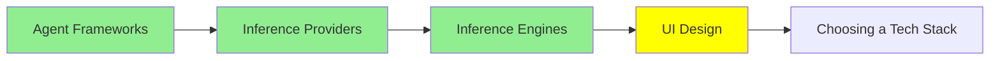

# UI Design

Kod yazan bir agent, seve seve sana bir arayüz de yazar. Ama sorun şu ki her seferinde farklı bir arayüz yazıyor.

Bugün bir ayarlar sayfası, yarın bir dashboard istediğini düşün. Sonunda açıkça iki farklı üründen çıkmış gibi duran iki ekran alırsın:

- farklı maviler
- farklı köşe yuvarlaklıkları
- farklı düğme yükseklikleri
- başlıkların ne kadar kalın olması gerektiğine dair farklı bir anlayış

Tek başına bakıldığında ikisi de iyi görünüyor. Yan yana gelince ise sanki işin başında kimse yokmuş gibi duruyorlar.

Bu modül, arayüzü düzgün biçimde üreten iki araçtan ve bu sorunun çözümünden söz ediyor. Çözüm ise [Code Agent'lar](../2_intermediate/coding_agents_tr.md) modülünde gördüğün yöntemin aynısı çıkıyor.

## Bir Açıklamayı Ekrana Dönüştüren İki Araç

**[Google Stitch](https://stitch.withgoogle.com/)**, bir prompt'u, bir görseli, kaba bir çizimi ya da sözlü bir açıklamayı girdi olarak alır. Bunlardan neredeyse son haline yakın bir arayüz (high-fidelity) üretir ve arkasındaki HTML ile CSS kodunu da verir. Araç, I/O 2025 etkinliğinde Google Labs'ten çıktı ve Gemini üzerinde çalışıyor. Tasarımcıların asıl ilgilendiği şey ise dışa aktarma özelliği. Tek tıkla tüm tasarımı Figma'ya gönderebilirsin; yerleşim, bileşenler ve yapı hiç değişmeden oraya geçer. Bu yüzden Stitch, tasarımdan geliştirmeye geçişin iki tarafında da işe yarar. Üzerinde tartışacağın bir görsel de istesen, üzerine inşa edeceğin bir işaretleme de istesen, Stitch ikisini de sunar.

**[Claude Design](https://claude.ai/design)**, Anthropic Labs'ten geliyor, Nisan 2026'da yayına girdi ve aynı işi bu kez diğer yönden yapıyor. Prototipleri, sunumları, tek sayfalık özetleri ve etkileşimli parçaları gerçek HTML, CSS ve JavaScript olarak üretiyor. Onu ilginç kılan iki özellik var. Birincisi, mevcut bir **codebase**'i girdi olarak alabiliyor, kodun içindeki design system'i bulup sonraki her isteğinde o design system'i uyguluyor. İkincisi ise işi doğrudan Claude Code'a aktarıyor, böylece prototip ile gerçek repository arasındaki boşluk kapanıyor.

İki aracı birlikte düşününce örüntü oldukça net: bir ekranı tarif etmek artık onu çizmekten daha hızlı ve ortaya çıkan şey bir kodun resmi değil, kodun kendisi.

## Tasarım Sistemi ve Neden Bir Dosyada Olması Gerektiği

Bir **tasarım sistemi (design system)**, bir kez verdiğin ve bir daha vermek zorunda kalmayacağın kararların toplamıdır. Şunları kapsar:

- renklerin ve her birinin ne işe yaradığı
- tip ölçeği (type scale)
- boşluk adımları (spacing steps)
- köşe yuvarlaklığı (corner radius)
- bir düğmenin her durumda nasıl göründüğü

Tasarım ekipleri bu kararları yıllardır tutuyor. Asıl değişen şey, bu kararları artık kimin de okuması gerektiği.

Bir ekran üreten agent, ekranı kurarken bu kararların hepsini kendisi vermek zorunda kalır. Senin kararlarını bilmesinin hiçbir yolu olmadığı için makul görünen kararları uydurur ve bugünkü cevapla yarınki cevap birbirinden farklı çıkar. Kararlarını prompt'a yazıp ona anlatabilirsin, ama bu yöntem tek bir ekranda işe yarar ve ikinci ekranda işe yaramaz.

Çözüm, talimatlar için zaten işe yarayan yöntemin aynısı: kararları repository içindeki bir dosyaya yaz, sonra agent'ın o dosyayı okumasını sağla.

## DESIGN.md

`DESIGN.md`, işte bu dosya: Stitch'in ortaya attığı bir adlandırma kuralı, ama artık proje talimatlarını okuyan her agent ile çalışıyor. Dosyayı repository'nin köküne tam bu adla koy, çoğu agent onu kendi kendine bulur.

Dosyada iki tür içerik var ve ikisine de ihtiyacın var:

- **Token'lar**, yani tam değerler. Hex kodları, tip ölçeği, boşluk adımları, köşe yarıçapları ve bileşen durumları bu gruba girer.
- **Niyet (intent)**, yani kelimelerle anlatılan kısım. Burada tasarımın nasıl bir his vermeye çalıştığı, neyden bilerek kaçındığı ve vurgu renginin neden yalnızca birkaç yerde göründüğü yazar. Bir token listesi bu kısmı taşıyamaz. Agent'ın senin paletini asla yayınlamayacağın bir yerleşime uygulamasını da bu kısım engeller.

Bu gösterim bilmeye değer, çünkü etkisi çok doğrudan. Aynı prompt'u al ve Stripe'ı örnek alan bir `DESIGN.md` ekle; böylece Stripe'ın paletini ve boşluklarını elde edersin. Sonra başka hiçbir şeyi değiştirmeden farklı bir markanın dosyasını koy ve çıktının yeni dosyaya uyacak şekilde değiştiğini gör. [awesome-design-md](https://github.com/VoltAgent/awesome-design-md) popüler markalar için topluluk tarafından hazırlanmış dosyaları bir araya getiriyor. Etkiyi görmenin en hızlı yolu da bunlardan birini repository'ne koyup daha önce çalıştırdığın bir prompt'u yeniden çalıştırmak.

Vardığımız noktaya dikkatle bak: `AGENTS.md` repository içinde çalışmanın kurallarını tutar. [Personal Agent'lar](../2_intermediate/personal_agents_tr.md) modülündeki `SOUL.md` ise agent'ın kim olduğunu anlatır, `DESIGN.md` de ürünün nasıl göründüğünü tutar. Üçü de aynı biçimde, aynı yerde ve aynı nedenle duruyor. Markdown tam da insanın rahatça yazabildiği, modelin de güvenle okuyabildiği noktada duruyor. Üstelik repository'de yaşadığı için diğer her şey gibi sürümlenir ve gözden geçirilir.

## Bu Araçların Yapamadıkları

Bu konuda dürüst olmak gerekiyor, çünkü demolar insanı kolayca ikna ediyor.

Bu araçlar sana makul görünen bir ekranı hızla verir. Ancak bir tasarımcının sunduğu şeyi vermezler: ekranın ne işe yaradığını bilmeyi. Bu da kullanıcının neyi tamamlamaya çalıştığını, neyin kazara yapılmasının zor olması gerektiğini ve neyin dışarıda bırakılacağını bilmek demek. Bir araç üçüncü en iyi yerleşimi anında üretebilir. Ama sen de yanlış problemi aynı hızda çözüyor olabilirsin.

Bunun en somut örneği erişilebilirlik (accessibility): üretilmiş bir arayüz çoğu zaman şu şekillerde hatalı olur:

- kontrast oranı testinden geçemeyen renk kombinasyonları
- eksik bırakılmış odak durumları (focus states)
- yalnızca fareyle çalışan bir kontrol
- ekran okuyucunun okuyabileceği bir adı olmayan ikon düğmesi

Bunların hiçbiri bir ekran görüntüsünde görünmez, bu yüzden onları kendin kontrol etmelisin.

## Bu serinin neresindeyiz

## Özet

Bir agent sana arayüz yazabilir, ama ona dokunmadan bırakırsan her seferinde farklı bir arayüz yazar. Bunun nedeni, çalışırken senin tasarım kararlarını kendisinin uydurmak zorunda kalmasıdır.

Google Stitch, bir prompt'u, bir görseli ya da bir çizimi HTML ve CSS ile birlikte neredeyse son haline yakın bir ekrana dönüştürür ve tüm tasarımı Figma'ya aktarabilir. Claude Design ise gerçek HTML, CSS ve JavaScript üretir. Mevcut bir codebase'den design system'i okuyabilir ve işi Claude Code'a devreder.

Tutarsızlığın çözümü `DESIGN.md`: bu dosya token'larını ve niyetini markdown olarak tutar ve agent'ın bulacağı repository kökünde durur. Gösterimde bir markanın dosyasını başka bir markanın dosyasıyla değiştirirsin, başka hiçbir şeye dokunmazsın ve çıktı da değişir. Bu, `AGENTS.md` ve `SOUL.md` ile aynı yaklaşım ve aynı nedenle işe yarıyor.

Bunların hiçbiri, ekranın ne işe yaradığına dair bir yargı sunmaz; erişilebilir bir sonuç da garanti etmez. Üretilmiş arayüzler kontrast, odak ve klavye erişiminde sık sık sorun çıkarır ve bunu bir ekran görüntüsü sana söylemez.

**Hızlı Kontrol**: Paletini prompt'a yazdın ama ikinci ekran yine de yanlış görünüyor. `DESIGN.md`, bir prompt'un taşımadığı neyi içinde barındırır?

## Kaynaklar

- [Google Stitch](https://stitch.withgoogle.com/): bir prompt'u, bir görseli ya da bir çizimi gerçek bir arayüze dönüştürür ve tek tıkla Figma'ya aktarır
- [From idea to app: Introducing Stitch](https://developers.googleblog.com/stitch-a-new-way-to-design-uis/): Google'ın kendi duyurusu. DESIGN.md kuralının nereden çıktığını da burada görebilirsin.
- [Claude Design](https://claude.ai/design): gerçek kod olarak prototipler üretir ve bir codebase'deki design system'i okuyabilir
- [awesome-design-md](https://github.com/VoltAgent/awesome-design-md): tanınmış markalar için hazır DESIGN.md dosyaları, böylece etkisini tek bir denemede görebilirsin
