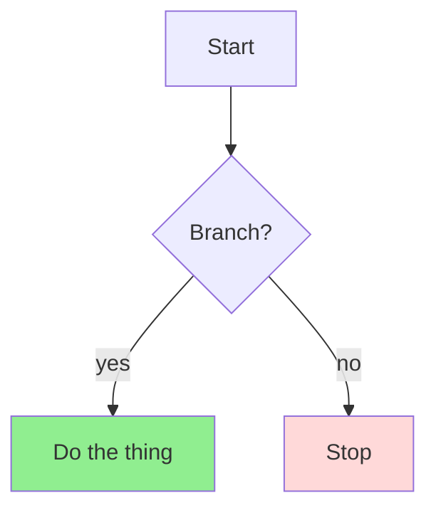

# Module 1: Kitchen Sink

*Category: Fundamentals — Module 1 (1 of 7 in this category)*

This opening paragraph is the lead, and the renderer marks it as one.

## I. A numbered section

Ordinary prose, with an [external link](https://example.com/paper) and a
[cross-reference](training.md) to another sheet.

### A. A subsection

A three-column table, whose first body cell becomes a row header:

| Layer | What it is | Cost |
| --- | --- | --- |
| One | The first thing | Low |
| Two | The second thing | High |

## II. Pictures and diagrams

  
*The caption line, which the renderer puts below the label.*



## III. Code, quotes and lists

```python
def add(a: int, b: int) -> int:
    return a + b
```

```
Program output, in an untagged fence.
```

> **Note:** a blockquote whose bold lead-in ends in a colon becomes a label.

> A blockquote with no lead-in stays a plain pull-rule.

> [!TIP]
> **A call-out's title**
>
> A call-out's body, as GitHub writes an alert.
>
> **[A call-out's button](https://example.com/)**

**Vendor** names a product with its mark, and
 Mono names one with a single-colour mark.

A checklist, which the record reads by index:

- [ ] The first item, unticked.
- [x] The second item, ticked.

## IV. Marks, lists and rules

A paragraph with *emphasis*, **strong** text, ~~deleted~~ text and `inline code`,\
and a second line after a hard break.

An ordered list that starts at three:

3. The third step.
4. The fourth step.

#### A level-four heading

A two-column table, centred on the left and aligned right on the right:

| Name | Count |
| :---: | ---: |
| First | 1 |
| Second | 22 |

A cross-reference to [a part of another sheet](training.md#a-part), an anchor
link [back to the top](#a-numbered-section), and a link to
[the catalog](../index.md).

---

## Summary

One paragraph of summary, with a [second cross-reference](rag.md).

**Quick Check**: does every structure in this file survive the renderer?
